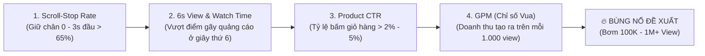

# CẨM NANG TOÀN DIỆN TIKTOK AFFILIATE (VIỆT NAM)
**Chính Sách Vi Phạm (CHR) & Bí Quyết Tạo Video Viral Triệu Đơn**
*Cập nhật: 30/10/2026 · Tác giả gốc phần Policy: @Huy Nguyen · Bản nâng cấp & hợp nhất toàn diện*

---

> [!IMPORTANT]
> **Tư duy cốt lõi của Affiliate chuyên nghiệp:** Kiếm ra 100 triệu tiền hoa hồng nhưng để tài khoản về 0 điểm CHR hoặc bị đóng băng hoa hồng thì công sức bằng không. Ngược lại, tuân thủ đúng luật mà video chỉ lẹt đẹt 200 view thì cũng không có đơn. Tài liệu này kết hợp **Tấm khiên (Luật ngầm & Chính sách CHR)** và **Mũi giáo (Kỹ thuật làm Video Viral & Chuyển đổi cao)** để bạn phát triển kênh bền vững.

---

# PHẦN I: CẨM NANG CHÍNH SÁCH & VI PHẠM TIKTOK AFFILIATE (VIỆT NAM)

Ở Việt Nam, TikTok Shop chấm điểm nhà sáng tạo (Affiliate) bằng **Điểm tình trạng nhà sáng tạo (CHR - Creator Health Rating, thang 0–1.000, mới vào có 200 điểm)**: mỗi video hoặc LIVE vi phạm bị trừ điểm, xuống **150 điểm** là mất quyền gắn giỏ hàng 3 ngày, về **0 điểm** là bị xóa quyền bán hàng vĩnh viễn.

---

## 1. Hệ thống điểm CHR hoạt động thế nào

**CHR (Creator Health Rating)** là thang điểm `0–1.000` phản ánh chất lượng nội dung và mức độ tuân thủ chính sách của bạn trên TikTok Shop. Mọi nhà sáng tạo mới đều bắt đầu từ **200 điểm**, và chỉ mình bạn nhìn thấy điểm này. Điểm bị trừ tự động reset sau **90 ngày**.

> [!NOTE]
> Nhiều bài hướng dẫn cũ trên mạng vẫn nói về "điểm vi phạm tối đa 24 điểm" hoặc "48 điểm" (dành cho Seller). Với Creator/Affiliate hiện nay, trang chính thức của TikTok Shop Việt Nam áp dụng **CHR**, nên hãy dựa hoàn toàn vào CHR.

### Bốn mức sức khỏe tài khoản

| Điểm CHR | Trạng thái | Ý nghĩa |
| :--- | :--- | :--- |
| **200 – 1.000** | Khỏe | Tài khoản an toàn |
| **151 – 199** | Cần cải thiện | Sắp chạm mốc bị phạt, nên chậm lại và kiểm tra nội dung kỹ hơn |
| **1 – 150** | Có nguy cơ bị vô hiệu hóa | Đã bị phạt theo mốc |
| **0** | Bị xóa quyền | Xóa vĩnh viễn toàn bộ quyền thương mại điện tử của nhà sáng tạo |

### Các mốc bị phạt tự động
Khi CHR tụt xuống từng mốc, hệ thống tự động áp dụng hình phạt. Bạn sẽ nhận cảnh báo trong hộp thư TikTok khi còn cách mốc 25 điểm (tức khoảng 175 điểm). **Hình phạt theo mốc điểm không được khiếu nại.**

| Khi CHR xuống còn | Hình phạt tự động |
| :--- | :--- |
| **150 điểm hoặc thấp hơn** | Mất quyền đăng video có giỏ hàng, LIVE và Product Showcase trong **3 ngày**; không được tham gia chiến dịch |
| **100 điểm hoặc thấp hơn** | Như trên, trong **7 ngày** |
| **50 điểm hoặc thấp hơn** | Như trên, trong **14 ngày** |
| **0 điểm** | **Xóa vĩnh viễn** quyền thương mại điện tử |

### Cách kiếm lại điểm (Cộng vào mỗi Thứ Hai)

| Cách thực hiện | Điểm cộng | Giới hạn |
| :--- | :--- | :--- |
| Video hoặc LIVE đúng chính sách và có ít nhất 1 đơn hoàn tất trong 180 ngày sau khi đăng | **+1 điểm** / nội dung | Tối đa **5 điểm / tuần** |
| Đơn hàng hoàn tất từ nội dung của bạn (đã giao thành công, không hủy/trả/hoàn tiền) | **+1 điểm** / 50 đơn | Tối đa **5 điểm / tuần** |
| Làm bài quiz chính sách đạt điểm tuyệt đối (chỉ mở sau khi bạn bị vi phạm) | **+5 điểm** / bài | Mỗi quiz làm 1 lần trong 30 ngày |

* Điểm cộng có hiệu lực **90 ngày** rồi hết hạn.
* **Ví dụ minh họa phép tính:** Bạn bắt đầu ở 200 điểm. Nếu 5 video liên tiếp đều dính loại lỗi bị trừ "tối đa 40 điểm", trường hợp xấu nhất bạn về 0 điểm và mất quyền bán hàng. Còn với loại lỗi "tối đa 10 điểm", bạn có đến vài chục video để sửa sai trước khi chạm mốc đầu tiên.
* Cảnh báo lần đầu (Warning) thường không làm giảm CHR; chỉ vi phạm tái diễn mới bị trừ điểm. Tuy nhiên, **vi phạm nghiêm trọng hoặc rủi ro cao có thể bị phạt/trừ điểm ngay lập tức**, bất kể bạn đang có bao nhiêu điểm.

---

## 2. Mỗi loại vi phạm bị trừ bao nhiêu điểm

Điểm bị trừ tính cho từng video hoặc LIVE vi phạm, phụ thuộc độ nghiêm trọng và tần suất. Bảng dưới là mức trừ tối đa TikTok công bố:

| Loại vi phạm | Trừ tối đa / nội dung | Nói dễ hiểu |
| :--- | :--- | :--- |
| **Hoạt động bất hợp pháp hoặc tội phạm** | **40 điểm** | Quảng bá hoặc thực hiện việc vi phạm pháp luật |
| **Nội dung có hoặc nhắm tới trẻ vị thành niên** | **40 điểm** | Trẻ dưới 18 tuổi giới thiệu sản phẩm mà không có người lớn đi cùng |
| **Quảng bá sản phẩm bị cấm hoặc không được hỗ trợ** | **40 điểm** | Gắn giỏ hàng hoặc nói về hàng thuộc danh mục cấm |
| **Quảng bá hàng giả** | **40 điểm** | Giới thiệu hàng giả mạo thương hiệu |
| **Lách thương hiệu** | **40 điểm** | Che logo, ghi ký tự lách để bán hàng giả/nhái thương hiệu lớn |
| **Giả mạo bằng nội dung AI** | **40 điểm** | Dùng AI mạo danh người khác (bác sĩ, người nổi tiếng) hoặc đánh lừa người xem |
| **Nội dung không nguyên bản (Reup/Sao chép)** | **40 điểm** | Đăng lại video của người khác (hoặc của chính mình) mà không chỉnh sửa sáng tạo mới |
| **Sai lệch thương hiệu giữa nội dung và sản phẩm** | **40 điểm** | Video nói thương hiệu A nhưng giỏ hàng gắn thương hiệu B |
| **Thông tin y tế sai lệch (mức nguy hại thấp)** | **20 điểm** | Nói sai về bệnh lý, cơ chế sức khỏe |
| **Dẫn khách ra ngoài TikTok Shop** | **20 điểm** | Link, số điện thoại, Zalo, Facebook, địa chỉ, mã QR (kể cả vô tình lộ trên vỏ hộp hàng) |
| **Nội dung quay sẵn trong LIVE** | **20 điểm** | Phát lại video cũ/ghi âm sẵn giả như đang LIVE trực tiếp |
| **Cờ bạc** | **20 điểm** | Quay số, bốc thăm, trò chơi may rủi ngoài công cụ chính thức |
| **Hứa hẹn sai về phần thưởng hoặc lợi ích** | **20 điểm** | Cam kết quà tặng, tiền hoàn, lợi ích không có thật để câu tương tác/đơn hàng |
| **Phát song song nhiều nền tảng/tài khoản; tương tác ảo** | **20 điểm** | LIVE cùng lúc nhiều nơi; mua tim, mua view, dùng tool spam bình luận |
| **Nội dung tình dục / Gợi dục** | **20 điểm** | Hành vi, trang phục hở hang quá mức hoặc ngôn từ gợi dục để câu view bán hàng |
| **Không gắn nhãn nội dung AI (AIGC)** | **20 điểm** | Dùng hình ảnh, video, giọng đọc/nhân vật AI tạo sinh mà không bật nút gắn nhãn AI |
| **Tuyên bố về kiểm soát cân nặng** | **20 điểm** | "Giảm cân nhanh", "đốt mỡ", "ức chế thèm ăn", ảnh trước và sau giảm cân |
| **Tuyên bố sai về công dụng sản phẩm** | **20 điểm** | Hứa hiệu quả không kiểm chứng được, dùng filter/AI làm giả hiệu quả tức thì |
| **Giá gây hiểu lầm** | **20 điểm** | Báo giá khuyến mãi đã hết hạn, so sánh giá vô căn cứ, nói giá 1 đằng giỏ hàng 1 nẻo |
| **Đấu giá và thao túng giá** | **20 điểm** | Hô giá, đấu giá tự phát không qua công cụ chính thức |
| **Nội dung giật gân, gây sốc** | **20 điểm** | Hình ảnh ghê rợn (máu mủ, vết thương, chất thải), bạo lực, hoặc khóc lóc kể khổ xin mua hàng |
| **Quảng bá hàng nhái** | **20 điểm** | Hàng mô phỏng kiểu dáng/thiết kế thương hiệu (hàng 1:1, rep, like auth) |
| **Vi phạm nhãn hiệu** | **20 điểm** | Dùng tên, logo thương hiệu, hình ảnh người nổi tiếng khi chưa được phép |
| **Nội dung không tương tác, chất lượng thấp** | **10 điểm** | Video ghép toàn ảnh tĩnh (>50% thời lượng), LIVE im lặng/treo máy |
| **Tuyên bố phóng đại** | **10 điểm** | "Tốt nhất", "số 1", "duy nhất", "100% khỏi hẳn" khi không có chứng nhận |
| **Quảng bá không liên quan** | **10 điểm** | Video không giới thiệu đúng sản phẩm đang gắn trong giỏ hàng |

*(Lưu ý: Vi phạm Tiêu chuẩn cộng đồng chung của TikTok được tính riêng ở tab "Vi phạm chung", dù không trừ trực tiếp điểm CHR nhưng vẫn làm gỡ video, bóp tương tác hoặc khóa tài khoản TikTok).*

---

## 3. Các lỗi hay gặp, ví dụ SAI và cách nói ĐÚNG

| Lỗi vi phạm | Ví dụ SAI (Bị phạt) | Cách làm ĐÚNG (An toàn) | Trừ tối đa |
| :--- | :--- | :--- | :--- |
| **Dẫn khách ra ngoài & Lộ thông tin (PII)** | Đọc SĐT, *"nhắn Zalo mình"*, để QR/link ở video, bio, bình luận. **Đặc biệt:** Quay unbox rạch hộp hàng vô tình để lộ phiếu giao hàng có SĐT, địa chỉ, mã vạch/QR. | *"Bấm vào giỏ hàng góc trái dưới video để đặt nha"*. Khi quay unbox phải xé bỏ hoặc dán che kín bill giao hàng trước khi bấm máy. | **20** |
| **Hứa chữa bệnh, kết quả thần kỳ** | *"Uống 1 tuần hết đau khớp"*, *"chữa khỏi 100%"*, chiếu ảnh trước-sau (Before/After) mặt đầy mụn rồi láng mịn. | Mô tả đúng công dụng được cấp phép: *"hỗ trợ cấp ẩm, làm dịu da"*, *"hỗ trợ sức khỏe"*, quay rõ bao bì/giấy công bố. | **20** |
| **Tuyên bố giảm hoặc tăng cân** | *"Uống là xuống 5kg"*, *"đốt mỡ bụng"*, *"ức chế thèm ăn"*, đưa thước dây đo bụng nhỏ lại tức thì. | Chỉ nói về lối sống lành mạnh, chế độ tập luyện kết hợp dụng cụ tập, thảm tập, cân sức khỏe. | **20** |
| **Tuyên bố phóng đại, tuyệt đối** | *"Sản phẩm số 1"*, *"tốt nhất thị trường"*, *"rẻ nhất Việt Nam"*, *"cam kết hiệu quả sau 3 ngày"*. | Nói đặc điểm vật lý kiểm chứng được: *"Chất liệu inox 304 dày 2mm, bảo hành 12 tháng, có 3 màu"*. | **10** |
| **So sánh với đối thủ hoặc sàn khác** | *"Rẻ hơn sàn S 30%"*, *"đừng mua hãng X, mua hãng này tốt hơn"*. | Chỉ so sánh với trải nghiệm cũ chung chung (*"dùng tiện hơn loại chổi truyền thống nhà mình hay dùng"*) và báo giá hiển thị trong giỏ hàng. | **10–20** |
| **Giá gây hiểu lầm & Lệch biến thể** | Cầm chai lớn 500ml trên tay hô *"Chỉ 19k"*, nhưng khách bấm vào giỏ hàng thì 19k là gói 10ml (chai 500ml giá 150k). | Cầm mẫu nào báo đúng giá mẫu đó, hoặc nói rõ: *"Gói dùng thử từ 19k, còn chai lớn 500ml mình đang cầm đang có voucher còn 135k trong giỏ hàng"*. | **20** |
| **Nội dung không nguyên bản (Reup)** | Tải video của hãng/Douyin/creator khác đăng lại; hoặc đăng lại nguyên xi 1 video cũ của chính mình lên nhiều lần. | Tự quay thật 100% hoặc nếu cắt ghép phải có mặt/giọng nói thật bình luận xuyên suốt và quay cảnh cầm sản phẩm thật. | **40** |
| **Nội dung không liên quan sản phẩm** | Đăng video gái xinh nhảy, cắt phim lẻ, tâm sự chuyện tình cảm rồi gắn giỏ hàng áo thun; hoặc chỉ nhá hình sản phẩm ở 1 giây cuối. | Sản phẩm đang gắn phải xuất hiện trực quan trong video và được giới thiệu rõ ràng bằng lời nói/phụ đề. | **10** |
| **Nội dung không tương tác / Ảnh tĩnh** | Ghép 5–10 tấm ảnh chụp màn hình sản phẩm trên sàn thành slideshow rồi chèn nhạc. | Quay video chuyển động thực tế, thao tác trên tay. Nếu chèn ảnh minh họa thì ảnh tĩnh phải chiếm **dưới 50%** diện tích khung hình và thời lượng. | **10** |
| **Cờ bạc, đấu giá, tặng quà tự phát** | *"Ai comment số may mắn mình tặng đơn 0đ"*, *"Share video này mình gửi thẻ cào"*. | Chỉ dùng tính năng Voucher/Flash Sale/Live Giveaway chính thức của TikTok Shop. | **20** |
| **Hàng giả, nhái, lách thương hiệu** | Nói *"Hàng rep 1:1"*, *"bản dupe hoàn hảo của Chanel"*, dùng băng dính dán che nửa logo Nike/Adidas trên sản phẩm. | Chỉ bán hàng chính hãng có thương hiệu được cấp phép trên sàn hoặc hàng OEM không nhái logo/kiểu dáng độc quyền. | **20–40** |
| **Nội dung AI sai quy định** | Dùng giọng AI/mặt AI đóng giả bác sĩ khuyên dùng thuốc; dùng AI tạo hiệu ứng vết bẩn tự bay màu hoặc quần áo mặc lên người mẫu AI khác xa hàng thật. | Bật công tắc **"Nội dung do AI tạo"** khi đăng nếu có dùng AI tạo hình/giọng; bắt buộc quay sản phẩm vật lý thật khi test công dụng. | **20–40** |
| **Trẻ vị thành niên** | Để bé dưới 18 tuổi một mình trong khung hình giới thiệu sản phẩm; hoặc kêu gọi *"các em nhỏ bảo bố mẹ mua đi"*. | Luôn có người lớn xuất hiện cùng trong khung hình và dẫn dắt nội dung hướng tới đối tượng mua là phụ huynh. | **40** |
| **Giật gân, ghê rợn, kể khổ** | Mở đầu bằng cảnh máu me, vết thương hở, côn trùng/bồn cầu bẩn thật; hoặc khóc lóc *"kho em bị ngập lụt, mua cứu em với"*. | Dùng vết bẩn mô phỏng sạch sẽ (tương ớt, nước màu, bút lông) để test sản phẩm; bán hàng bằng giá trị thực. | **20** |

---

## 4. [BỔ SUNG CHUYÊN SÂU] Các chính sách đặc thù riêng cho Video Affiliate (Shoppable Video)

Nhiều nhà sáng tạo nắm rõ luật LIVE nhưng lại bị trừ điểm CHR oan uổng khi làm **Video ngắn gắn giỏ hàng** vì chưa biết 6 quy định ngầm dưới đây của hệ thống quét AI TikTok:

### 4.1. Thế nào bị tính là "Lách luật Nội dung không nguyên bản" (-40 điểm & Khóa quyền ngay)?
Hệ thống Computer Vision của TikTok Shop hiện nay không chỉ quét trùng lặp file gốc mà còn bắt thẳng các thủ thuật "lách bản quyền" phổ biến sau:
* **Khung kẹp (Sandwich Frames / Chia đôi màn hình giả):** Để video sản phẩm lấy từ nguồn khác ở nửa trên, nửa dưới chèn video chạy bộ, cắt xà phòng ASMR, hoặc khuôn mặt ngồi im gật đầu không nói gì.
* **Chèn khung hình ẩn (Subtle Frame Insertion) & Biến đổi bề mặt:** Lật gương (Flip horizontal), phóng to 110%, đổi tốc độ 1.1x, phủ một lớp layer mờ 5%, hoặc chèn 1–2 frame đen/nhấp nháy giữa video để đổi mã MD5. **TikTok xếp hành vi này vào nhóm "Cố tình thao túng hệ thống" $\rightarrow$ Phạt nặng gấp đôi so với reup thông thường.**
* **Stitch / Duet thiếu giá trị:** Dùng tính năng Stitch/Duet video của người khác nhưng phần của bạn chỉ dài 2–3 giây chỉ tay xuống giỏ hàng mà không có nhận xét, đánh giá hay cầm sản phẩm thật.
* **Tự Re-up video của chính mình (Self-Duplication):** Lấy chính video đã đăng trên kênh của mình (hoặc kênh phụ của mình) đăng lại nhiều lần để "câu may mắn" mà không quay mới/dựng mới hoàn toàn.

### 4.2. Ba Quy tắc Vàng khi dùng AI (AIGC) trong Video Bán hàng
TikTok Shop **không cấm AI**, nhưng áp dụng 3 giới hạn đỏ cho video gắn giỏ hàng:
1. **Không làm biến dạng sản phẩm thật (No Product Distortion):** Không được dùng AI để tạo ra hình ảnh sản phẩm lung linh hơn thực tế, hoặc ghép quần áo lên người mẫu AI khiến độ rủ của vải, màu sắc, kích thước khác với sản phẩm giao cho khách.
2. **Không làm giả kết quả/hiệu ứng (No Fake Results):** Tuyệt đối không dùng hiệu ứng chuyển cảnh AI, bộ lọc (Beauty Filter) làm mịn da quá đà khi đang quay cảnh test mỹ phẩm/kem nền/sữa rửa mặt trên da mặt.
3. **Không dựng kịch bản khủng hoảng giả bằng AI (No Fake Crisis):** Không dùng ảnh/video AI tạo cảnh lũ lụt, cháy xưởng, người già ốm yếu để bịa chuyện thanh lý hàng cứu trợ.

### 4.3. Quy định An toàn Vật sắc nhọn & Hành vi nguy hiểm trong Video
* **Khi review dao kéo nhà bếp, dụng cụ đa năng, máy cắt:** Chỉ được quay cảnh sử dụng đúng công năng trong gian bếp/xưởng làm việc (thái thịt, gọt hoa quả) một cách an toàn. **Cấm:** Cầm dao múa máy, chĩa thẳng mũi nhọn vào camera, chặt chém bạo lực hoặc thử độ bén trên cơ thể người.
* **Khi review phụ kiện ô tô / xe máy (giá đỡ điện thoại, nước hoa ô tô, mũ bảo hiểm):** **Cấm** quay cảnh người giới thiệu đang trực tiếp lái xe di chuyển trên đường mà buông tay hoặc mất tập trung nhìn vào camera (vi phạm chính sách An toàn giao thông). Hãy quay khi xe đã đỗ hẳn ở nơi an toàn.

### 4.4. Quy tắc Đồng bộ Đa sản phẩm & Biến thể trong Giỏ hàng
* Nếu bạn gắn **nhiều hơn 1 sản phẩm** vào cùng 1 video, **tất cả** các sản phẩm được gắn đều phải xuất hiện rõ ràng trong khung hình của video đó.
* Nếu sản phẩm trong video đã **hết hàng màu/size bạn đang cầm** hoặc **hết chương trình Mua 1 Tặng 1**, nhưng lời thoại trong video vẫn khẳng định chắc nịch đang còn ưu đãi đó mà không có dòng đính chính ("Số lượng quà tặng tùy thời điểm trong giỏ hàng"), bạn có thể bị báo cáo lỗi *Giá/Khuyến mãi gây hiểu lầm (-20 điểm)*.

### 4.5. Bản quyền Âm nhạc Thương mại (Commercial Music Library)
* Khi một video được gắn giỏ hàng TikTok Shop, hệ thống tự động phân loại đó là **Nội dung Thương mại (Commercial Content)**.
* Nếu bạn dùng nhạc bản quyền thông thường của các ca sĩ nổi tiếng (không nằm trong *Thư viện âm nhạc thương mại - CML*), video có nguy cơ bị **tắt tiếng hoàn toàn (Mute Audio)** ngay khi đang lên xu hướng, hoặc **không thể chạy quảng cáo GMV Max / Video Shopping Ads**.
* **Giải pháp:** Ưu tiên dùng giọng nói gốc (Voiceover) + hiệu ứng âm thanh (SFX) + nhạc nền nhẹ từ kho nhạc Thương mại (Commercial Sounds) hoặc nhạc không bản quyền.

---

## 5. Danh mục Sản phẩm Cấm, Không hỗ trợ & Hạn chế (Bản đầy đủ Việt Nam)

Gắn giỏ hàng hoặc chỉ cần **để xuất hiện trong khung hình** các sản phẩm cấm là lỗi nặng nhất (**-40 điểm/nội dung**). Dưới đây là danh sách tổng hợp đầy đủ từ TikTok Shop Seller/Creator Academy Việt Nam:

### 5.1. Nhóm CẤM HOÀN TOÀN & KHÔNG ĐƯỢC HỖ TRỢ (Không gắn giỏ, không quay video)

| Nhóm ngành hàng | Chi tiết các mặt hàng bị cấm / không hỗ trợ tại Việt Nam |
| :--- | :--- |
| **1. Vũ khí, đạn dược & công cụ hỗ trợ** | Súng các loại (kể cả súng hơi, súng bắn đạn thạch/gel, súng đồ chơi giống thật), linh kiện súng; dao bấm, dao bướm, kiếm, côn nhị khúc, bình xịt hơi cay, dùi cui điện, pháo nổ. *(Ngoại lệ duy nhất: Dao kéo làm bếp gia dụng thông thường).* |
| **2. Thuốc lá, Vape & Chất kích thích** | Thuốc lá điếu, xì gà, thuốc lào, **thuốc lá điện tử (Vape, Pod, tinh dầu vape)**, phụ kiện hút, bật lửa hình súng/lựu đạn, ma túy và chất gây nghiện. |
| **3. Rượu, bia & Đồ uống có cồn** | Tất cả các loại rượu, bia, đồ uống có cồn (kể cả đồ uống không cồn nhưng bao bì/nhãn mác mô phỏng rượu bia). |
| **4. Thuốc & Sản phẩm y tế cấm** | Thuốc kê đơn (Rx), thuốc bán theo đơn bác sĩ, thuốc kích dục/tăng cường sinh lý cấp tốc, thuốc giảm cân cấp tốc, vắc-xin, máu, bộ xét nghiệm y tế chuyên dụng chưa được cấp phép. |
| **5. Sữa công thức cho trẻ dưới 24 tháng** | Cấm hoàn toàn việc quảng bá, làm video Affiliate cho **sữa công thức dành cho trẻ từ 0 đến dưới 24 tháng tuổi**, bình bú và núm vú giả (theo quy định pháp luật Việt Nam về bảo vệ nuôi con bằng sữa mẹ). |
| **6. Sản phẩm người lớn (18+)** | Đồ chơi tình dục (sex toys), búp bê tình dục, thuốc/dụng cụ kích dục, ấn phẩm/truyện/game khiêu dâm (R21), dịch vụ hẹn hò nhạy cảm. |
| **7. Động vật, thực vật & Hàng nguy hiểm** | Động vật sống, thú cưng, động vật hoang dã quý hiếm (ngà voi, sừng tê giác, móng hổ, trầm hương/gỗ quý cấm khai thác), hóa chất độc hại, chất phóng xạ. |
| **8. Tiền tệ, Tài chính & Dịch vụ số ảo** | Tiền thật, tiền giả, tiền xu/tiền cổ lưu hành, con dấu cơ quan, thẻ tín dụng, dịch vụ vay tiền/tín dụng đen, tiền ảo (Crypto), phần mềm lậu, tài khoản game/tài khoản xem phim lậu, "sản phẩm ảo" (bán không khí, cốc giấy 9 triệu để rửa tiền). |
| **9. Hàng giả, hàng nhái & Vi phạm SHTT** | Hàng giả mạo thương hiệu, hàng nhái (rep, superfake, 1:1), hàng che logo, hàng in hình nhân vật bản quyền/người nổi tiếng không phép. |
| **10. Nội dung Chính trị & Nhạy cảm** | Ấn phẩm, quần áo, phụ kiện có hình ảnh/biểu tượng chính trị nhạy cảm, bản đồ sai lệch chủ quyền lãnh thổ Việt Nam (đặc biệt lưu ý kiểm tra kỹ quả địa cầu, bản đồ, sách báo ngoại văn, đồ chơi có hình bản đồ trước khi lên hình!). |

### 5.2. Nhóm SẢN PHẨM HẠN CHẾ (Được làm Affiliate nhưng phải kiểm tra kỹ)

Từ ngày **20/03/2026**, người bán ở các ngành dưới đây bắt buộc phải khai báo giấy phép trên hệ thống. Là Affiliate, bạn chỉ nên chọn sản phẩm từ **Shop Mall / Shop Uy tín đã up đủ giấy phép công bố**:

| Nhóm ngành hàng | Điều kiện & Cách nói an toàn cho Affiliate |
| :--- | :--- |
| **Mỹ phẩm & Chăm sóc cá nhân** | Phải có Phiếu công bố mỹ phẩm. **Cách nói:** Chỉ nói làm sạch, dưỡng ẩm, làm sáng mịn bề mặt, che khuyết điểm. Không nói "trị nám tận gốc", "thay da sinh học", "chữa viêm da". |
| **Thực phẩm bảo vệ sức khỏe (TPCN), Vitamin, Collagen, Protein** | Shop phải có Giấy tiếp nhận đăng ký bản công bố & Giấy xác nhận nội dung quảng cáo. **Bắt buộc trong video:** Phải nói (hoặc hiện chữ rõ ràng) câu *"Thực phẩm này không phải là thuốc và không có tác dụng thay thế thuốc chữa bệnh"*. Chỉ dùng từ *"hỗ trợ"*. |
| **Thiết bị y tế gia đình & Kính áp tròng (Lens)** | Máy đo huyết áp, máy đo đường huyết, kính áp tròng phải thuộc shop đã được duyệt giấy phép phân loại thiết bị y tế. Không tự ý hướng dẫn chẩn đoán bệnh trong video. |
| **Mẹ và Bé (Trên 24 tháng) & Thực phẩm đóng gói** | Chỉ nhận làm sữa cho trẻ **từ 24 tháng tuổi trở lên** (nêu rõ độ tuổi "dành cho bé trên 2 tuổi" ngay trong video để AI không quét nhầm sang sữa 0–24 tháng!). |

### 5.3. Điều kiện tham gia Chiến dịch (Campaigns) của TikTok Shop
* Giữ điểm **CHR > 150** (an toàn nhất là từ **175 trở lên**).
* Điểm hiệu suất quảng bá (**PPS - Promotion Performance Score**) đạt từ **3.5 trở lên**.
* **Không có bất kỳ vi phạm nào trong 30 ngày gần nhất** thuộc 3 lỗi nặng: *Nội dung không nguyên bản, Sản phẩm bị cấm/hạn chế, hoặc Trẻ vị thành niên*.

---

## 6. Hình phạt ngoài điểm số: Hoa hồng, Tài khoản liên kết, Lách luật

Theo *Chính sách thực thi đối với nhà sáng tạo (Việt Nam, cập nhật 22/09/2026)*, TikTok Shop có thể áp dụng hình phạt ngay mà không cần chờ điểm CHR chạm mốc 0:

1. **Những hành vi rủi ro cao bị đình chỉ ngay lập tức:**
   * Liên tục đăng nội dung gây hiểu lầm, bị cấm hoặc không an toàn (tham khảo mốc Mỹ: lặp lại cùng 1 lỗi **6 lần trong 90 ngày** là khóa quyền vĩnh viễn bất chấp điểm CHR còn cao).
   * Cố lách quy định (dùng khung kẹp, chèn frame ẩn, mua tương tác giả, dùng nhiều tài khoản để né phạt).
   * Vi phạm nghiêm trọng bị báo chí phản ánh, người dùng báo cáo hàng loạt hoặc vi phạm pháp luật.
2. **Tài khoản liên kết bị phạt chùm (Associated Accounts):** Nếu TikTok phát hiện nhiều tài khoản do cùng một người/tổ chức vận hành (chung CCCD, chung tài khoản ngân hàng rút tiền, chung thiết bị/IP thường xuyên), một tài khoản vi phạm nặng có thể kéo theo khóa quyền cho tất cả các tài khoản liên kết.
3. **Đóng băng và Khấu trừ Hoa hồng:**
   * TikTok có quyền **đóng băng hoa hồng tối đa 90 ngày** đối với các đơn hàng phát sinh từ video vi phạm để điều tra.
   * Nếu kết luận vi phạm nghiêm trọng/gian lận hoặc bạn **không khiếu nại trong 30 ngày** (hoặc khiếu nại bị từ chối), số tiền hoa hồng đó sẽ bị **khấu trừ vĩnh viễn**.
   * Kiểm tra tại: *TikTok Studio $\rightarrow$ Công cụ $\rightarrow$ Kiếm tiền $\rightarrow$ Số dư $\rightarrow$ Lịch sử thu nhập*.

---

## 7. Khiếu nại, Công cụ phòng vệ & Checklist 12 điểm trước khi đăng

### Quy tắc Khiếu nại (Appeals)
* **Thời hạn:** Tối đa **30 ngày** kể từ ngày nhận thông báo vi phạm. Mỗi lỗi chỉ được bấm khiếu nại **duy nhất 1 lần** (hãy chuẩn bị đủ ảnh chụp sản phẩm thật, giấy công bố của shop, hậu trường file quay gốc trên máy điện thoại để chứng minh video nguyên bản trước khi bấm gửi).
* **Lưu ý:** Không xóa video đang chờ khiếu nại (nên giữ nguyên để bộ phận xét duyệt kiểm tra). Các hình phạt tự động theo mốc điểm (150, 100, 50, 0) không thể khiếu nại — bạn chỉ có thể khiếu nại từng *phiếu vi phạm* cụ thể để lấy lại điểm.

### Các công cụ bảo vệ tài khoản bắt buộc phải biết

| Công cụ | Công dụng thực chiến | Đường dẫn trên App TikTok |
| :--- | :--- | :--- |
| **Video Pre-Check (Kiểm tra video trước khi đăng)** | Tải bản nháp video lên để AI của TikTok quét trước các lỗi chính sách trong vài phút và báo chỗ cần sửa **trước khi đăng công khai** (không bị trừ điểm khi test ở đây!). | *TikTok Studio $\rightarrow$ Trung tâm nhà sáng tạo TikTok Shop $\rightarrow$ Bộ công cụ $\rightarrow$ Video Pre-Check* |
| **Trang CHR & Ảnh chụp vi phạm** | Xem điểm sức khỏe hiện tại, ảnh chụp đúng giây bị bắt lỗi và gửi đơn khiếu nại. | *Trung tâm nhà sáng tạo $\rightarrow$ TikTok Shop $\rightarrow$ Tình trạng tài khoản (cuối trang)* |
| **Quiz chính sách** | Trả lời đúng 100% câu hỏi trắc nghiệm để gỡ lại **+5 điểm CHR** (mỗi 30 ngày/lần sau khi bị phạt). | *Tình trạng tài khoản $\rightarrow$ Làm bài kiểm tra* |

### Checklist 12 điểm an toàn tuyệt đối trước khi bấm Đăng
- [ ] **1.** Sản phẩm không thuộc nhóm cấm/không hỗ trợ; nếu là TPCN/Mỹ phẩm/Đồ ăn thì Shop đã có giấy phép đầy đủ. (Tuyệt đối không dính tới sữa cho bé dưới 24 tháng, thuốc giảm cân, rượu bia, vape).
- [ ] **2.** Đã kiểm tra kỹ bối cảnh quay: Không vô tình lọt bản đồ sai lệch, logo hãng khác, hoặc dao kéo chĩa nguy hiểm vào ống kính.
- [ ] **3.** Nếu quay cảnh đập hộp (Unbox): Đã xé bỏ hoặc tô đen hoàn toàn **phiếu giao hàng (SĐT, địa chỉ, mã QR)** trên vỏ hộp.
- [ ] **4.** Sản phẩm trong video khớp 100% với sản phẩm và biến thể/giá tiền đang gắn trong giỏ hàng.
- [ ] **5.** Không có từ khóa cấm: *"Chữa khỏi", "Đốt mỡ", "Giảm X kg", "Số 1", "Tốt nhất", "Rẻ nhất", "Cam kết 100%"*. (Với TPCN đã có câu *"Sản phẩm này không phải là thuốc..."*).
- [ ] **6.** Không có hình ảnh Trước – Sau (Before/After) về điều trị da/giảm cân hoặc hình ảnh vết thương, máu mủ, chất bẩn sinh học ghê rợn.
- [ ] **7.** Không nhắc tên sàn khác (Shopee, Lazada, FB, Zalo), không đọc SĐT, không gắn link/QR ở video, caption, bình luận hay bio.
- [ ] **8.** Video do chính mình quay/dựng mới 100%, không re-up video cũ của chính mình, không dùng chiêu khung kẹp/chèn frame ẩn. Ảnh tĩnh (nếu có) chiếm dưới 50%.
- [ ] **9.** Không có trẻ em dưới 18 tuổi xuất hiện một mình hoặc lời kêu gọi nhắm vào trẻ em. Không vừa lái xe vừa quay video.
- [ ] **10.** Nếu có dùng AI tạo hình ảnh/giọng đọc: Đã bật công tắc **"Nội dung do AI tạo"** và không dùng AI làm giả công dụng sản phẩm.
- [ ] **11.** Âm nhạc sử dụng là nhạc nền nhẹ an toàn bản quyền thương mại, không câu tương tác bẩn hay hứa tặng quà tự phát ngoài hệ thống.
- [ ] **12.** Đã chạy qua công cụ **Video Pre-Check** đối với các mặt hàng nhạy cảm (sức khỏe, mỹ phẩm) trước khi bấm Đăng chính thức.

---
---

# PHẦN II: BÍ QUYẾT TẠO VIDEO TIKTOK AFFILIATE VIRAL & CHUYỂN ĐỔI CAO (TỪ VĨ MÔ ĐẾN VI MÔ)

Sau khi đã nắm vững Phần I để **không bao giờ mất điểm CHR**, Phần II sẽ chỉ cho bạn cách làm sao để một video gắn giỏ hàng vượt qua ngưỡng 200 view, bùng nổ lên hàng trăm ngàn view và **nổ đơn liên tục** mà vẫn **an toàn 100% trước thuật toán kiểm duyệt**.

---

## 1. Giải mã Thuật toán Phân phối Thương mại (eCommerce Algorithm)

Khi bạn gắn giỏ hàng vào video, thuật toán TikTok không còn chấm điểm video của bạn giống như một video nhảy nhót hay hài hước thông thường nữa. Nó đưa video vào **Phễu Phân Phối Thương Mại** với 4 chỉ số quyết định việc "bơm view":

1. **Tỷ lệ dừng lướt (Scroll-Stop Rate - 1.5s đến 3s đầu):** Phải giữ được tối thiểu **65% – 70%** người xem không vuốt qua ở 3 giây đầu.
2. **Tỷ lệ vượt "Điểm gãy giây thứ 6" (6-Second Retention):** Người dùng TikTok rất ghét xem quảng cáo. Nếu từ giây thứ 4 đến giây thứ 6 họ nhận ra *"À, lại là video bán hàng nhàm chán"* và vuốt đi hàng loạt, thuật toán sẽ khóa van phân phối ở mức 200 – 500 view.
3. **CTR vào Giỏ hàng (Product Anchor CTR):** Tỷ lệ người xem bấm vào thẻ sản phẩm màu vàng/cam ở góc trái. Mức chuẩn tốt là **2% – 5%+**.
4. **GPM (Gross Merchandise Value per Mille – Doanh thu trên mỗi 1.000 lượt xem):** **Đây là bí mật lớn nhất của TikTok Shop.**
   * Thuật toán ưu tiên những video **kiếm ra tiền cho sàn nhanh nhất**.
   * Nếu video của bạn mới có **1.000 view** nhưng đã chốt được **3–5 đơn hàng** (GPM cao), hệ thống AI sẽ lập tức nhận diện đây là "cỗ máy in tiền" và tự động đẩy video đó tới hàng chục ngàn người có hành vi mua sắm tương tự!

---

## 2. Cấu trúc Kịch bản "Kim Tự Tháp Ngược" theo từng giây (Độ dài vàng: 25s – 42s)

Đừng làm video dài quá 60 giây nếu bạn chưa phải là KOC có thương hiệu cá nhân mạnh. Khoảng **25 đến 42 giây** là "điểm ngọt" hoàn hảo: vừa đủ thời gian chứng minh chất lượng sản phẩm, vừa giúp tỷ lệ xem hết video (Completion Rate) đạt mức cao nhất.

### ⏱️ Giây 0.0 – Giây 1.5: Đòn khóa Thị giác (Visual Pattern Interrupt)
Mắt người xử lý hình ảnh nhanh gấp 10 lần tai nghe âm thanh. Trong 1.5 giây đầu, **phải có một hành động vật lý mạnh mẽ hoặc kết quả trực quan ngay lập tức**:
* **Tuyệt đối tránh:** Đứng cười chào hỏi, quay hộp hàng đóng kín đặt trên bàn, mở đầu chậm rãi.
* **Cách làm chuẩn:**
  * Đưa ngay **kết quả ấn tượng nhất** của sản phẩm lên giây 0.0 (Ví dụ: Đổ cốc nước màu lên áo mà nước trôi tuột như lá khoai; Kéo một đường cây gạt kính làm sạch bong lớp bọt dày; Bóp mạnh chiếc balo вакуум xẹp lép chỉ còn bằng cuốn vở).
  * **Lưu ý an toàn Policy CHR:** Khi tạo cảnh test vết bẩn ở 3s đầu, **hãy dùng vết bẩn nhân tạo sạch sẽ** (sốt cà chua, xì dầu, bột cacao, bùn đất làm vườn) thay vì quay bồn cầu dơ thật hay vết thương thật để không bị phạt -20 điểm lỗi *Nội dung gây sốc/ghê rợn*.

### ⏱️ Giây 1.5 – Giây 5.0: Hook Tâm lý & Phá bỏ "Rào cản Quảng cáo"
Kết hợp câu nói đầu tiên và dòng chữ tiêu đề trên màn hình để giữ chân đúng tệp khách có tiền:
* **Chiến thuật 1 – Gọi tên "Nỗi đau vi mô" (Micro-Pain Point):**
  * *Kém hiệu quả:* "Hôm nay mình giới thiệu cho các bạn một chiếc ổ cắm điện rất tiện lợi."
  * *Viral & Ra đơn:* "Nhà ai cứ cắm củ sạc nhanh vào là nó choán hết chỗ của lỗ cắm bên cạnh như thế này thì xem hết 15 giây này nhé!"
* **Chiến thuật 2 – Tâm lý "Hoài nghi & Kiểm chứng" (Anti-Selling / Skeptical Review):**
  * Đặt mình vào vị trí người mua khó tính đi kiểm chứng lời đồn: *"Thấy trên TikTok người ta khen cái [Tên SP] hơn trăm nghìn này dữ quá, mình phải đặt thử một cái về test xem có đúng như lời đồn hay lại phí tiền..."*
* **Chiến thuật 3 – Con số lẻ & Sự cụ thể hóa:**
  * Não người cực kỳ nhạy với con số lẻ cụ thể: Thay vì nói *"Dùng lâu lắm rồi chưa hỏng"*, hãy nói *"Đây là chiếc chảo chống dính sau đúng 4 tháng mình dùng chiên trứng mỗi sáng..."* (Khách hàng tin ngay vì tính chân thực và không vi phạm lỗi phóng đại!).

### ⏱️ Giây 5.0 – Giây 22.0: Chứng minh Thị giác & Kỹ thuật "Khen 8 - Chê 2"
* **Nguyên tắc "Nói đến đâu – Tay làm đến đó" (Show, Don't Tell):**
  * Không bao giờ cầm sản phẩm đứng yên một chỗ rồi đọc thông số.
  * Nói "nhỏ gọn"? $\rightarrow$ Bỏ ngay vào túi quần hoặc đặt cạnh chiếc điện thoại để so sánh kích thước thật.
  * Nói "chắc chắn"? $\rightarrow$ Treo thử 2 chai nước ngọt 1.5L lên ngay trước ống kính.
  * Nói "vải dày dặn không lộ"? $\rightarrow$ Luồn đèn flash điện thoại vào bên trong lớp vải để chứng minh độ cản sáng.
* **Bí quyết "Khen 8 phần – Chê 2 phần" (Đòn tâm lý chốt đơn đỉnh cao):**
  * Khách hàng năm 2026 không tin những video khen sản phẩm hoàn hảo 100%.
  * Hãy chủ động nêu ra **1 điểm hạn chế nhỏ hoàn toàn chấp nhận được** ở khoảng giây thứ 15:
    * *Ví dụ:* *"Có một điểm mình hơi tiếc ở em máy xay này là cối thủy tinh của nó cầm khá đằm và hơi nặng tay với các bạn nữ một xíu, nhưng đổi lại thì khi xay đá nó cực kỳ êm, không bị rung lắc và không bám mùi nhựa..."*
  * **Tác dụng kép:** Vừa khiến người xem tin bạn 100% là người dùng thật công tâm, vừa tránh hoàn toàn lỗi **Tuyên bố phóng đại (-10 điểm CHR)** của TikTok!

### ⏱️ Giây 22.0 – Giây 35.0: Neo giá thông minh & CTA Vòng lặp (Seamless Loop CTA)
* **Neo giá trị hợp lý (An toàn Policy):**
  * **Lưu ý Policy CHR:** Tuyệt đối không nói *"Rẻ hơn Shopee 50k"* hay *"Giảm 90% chỉ còn hôm nay"* nếu không đúng sự thật trong giỏ hàng (-20 điểm).
  * **Cách nói khôn ngoan & đúng luật:** So sánh chi phí chia nhỏ theo ngày hoặc so với giá trị sử dụng: *"Tính ra cả một bộ 3 món dày dặn thế này trong giỏ hàng đang có mã trợ giá chỉ bằng đúng 2 cốc trà sữa, mà dùng được cả năm trời..."*
* **Kỹ thuật CTA "Chống vuốt đi" ở 3 giây cuối:**
  * Nếu bạn nói *"Cảm ơn các bạn đã xem, nhớ bấm giỏ hàng nha, tạm biệt!"*, người xem sẽ lướt đi ngay từ chữ "Cảm ơn", làm tụt tỷ lệ xem hết video.
  * Hãy nối câu chỉ dẫn mua hàng vào thẳng một mẹo chọn phân loại và **cắt sát sạt ở chữ cuối cùng**:
    * *"Mình có gắn đúng link shop chính hãng ở giỏ hàng góc trái màn hình, mọi người bấm vào kiểm tra xem tài khoản của mình có được áp thêm cái mã Freeship với voucher giảm 15k không nhé, à mà nhớ chọn bản màu xám vì..."* $\rightarrow$ **Cắt cụt ngay đó!** Video tự động phát lặp lại giây 0.0 trong lúc người xem đang đưa tay bấm vào giỏ hàng!

---

## 3. Những Tiểu Tiết "Vi Mô" Quyết Định 80% Độ Viral & Tỷ Lệ Chuyển Đổi

Đây là danh sách những chi tiết cực nhỏ mà các KOC/Affiliate chuyên nghiệp tối ưu trong từng video:

### 3.1. Nhịp độ cắt cảnh (Quy tắc 2.5 giây & Không khoảng chết)
* **Thay đổi khung hình mỗi 2 – 3 giây:** Không bao giờ để một góc máy tĩnh kéo dài quá 3.5 giây. Hãy xen kẽ liên tục: *Cảnh 1 (Toàn cảnh cầm SP) $\rightarrow$ Cảnh 2 (Zoom cận cảnh chất liệu) $\rightarrow$ Cảnh 3 (Thao tác sử dụng thực tế) $\rightarrow$ Cảnh 4 (Góc nghiêng/chi tiết phụ kiện)*.
* **Triệt tiêu 100% khoảng thở (Zero Dead Air):** Khi dựng trên CapCut, hãy phóng to thanh âm thanh (Waveform) lên mức tối đa và cắt bỏ toàn bộ những đoạn đường thẳng không có sóng âm ở đầu và cuối mỗi câu nói. Giữa câu trước và câu sau chỉ cách nhau `0.05 – 0.1 giây`.

### 3.2. Thiết kế Âm thanh 3 lớp (3-Layer Audio Design)
Một video giữ chân người xem cực tốt luôn có cấu trúc âm thanh 3 tầng:
1. **Tầng 1 – Giọng nói (Voiceover) & Tiếng động thực tế của sản phẩm (ASMR) [Âm lượng 100%]:**
   * Tăng tốc độ giọng đọc lên **1.1x – 1.15x** (nhanh gọn, dứt khoát nhưng vẫn tròn vành rõ chữ).
   * Giữ lại (hoặc thu sát mic) tiếng động vật lý thật của sản phẩm: tiếng *"Tách"* khi đóng nắp hộp, tiếng *"Rẹt"* khi kéo khóa, tiếng *"Xèo"* khi chiên chảo. Âm thanh vật lý thật kích thích cảm giác muốn sở hữu cực mạnh!
2. **Tầng 2 – Hiệu ứng âm thanh chuyển cảnh (SFX) [Âm lượng 25% – 35%]:**
   * Chèn đúng 3–4 tiếng SFX nhẹ nhàng ở 5 giây đầu và lúc hiện giá/ưu điểm: tiếng *Whoosh* (chuyển cảnh), tiếng *Pop / Bubble* (khi hiện chữ trên màn hình), tiếng *Click*. Đừng lạm dụng các tiếng cười khả ố hay tiếng chuông chói tai kiểu cũ.
3. **Tầng 3 – Nhạc nền Thương mại (Commercial BGM) [Âm lượng cực nhỏ: 4% – 8%]:**
   * Chỉ để làm nền lấp đầy khoảng trống tần số âm thanh, tuyệt đối không được lấn át giọng nói.

### 3.3. Nghệ thuật đặt tên "Thẻ Giỏ Hàng" (Product Anchor Title) tăng gấp đôi CTR
Khi bạn gắn link sản phẩm vào video ở bước đăng bài, TikTok cho phép bạn **sửa lại dòng chữ hiển thị trên nút giỏ hàng màu vàng** (giới hạn khoảng 30 ký tự).
* ❌ **Sai lầm của 90% người làm:** Để nguyên tên mặc định dài lê thê của nhà bán hàng: *"Combo 2 hộp viên uống bổ sung vitamin C chính hãng mẫu mới..."* $\rightarrow$ Bị cắt cụt chữ và không có tính thúc đẩy.
* ✅ **Cách tối ưu tăng vọt CTR (nhưng vẫn chuẩn Policy CHR):** Đổi tên thẻ giỏ hàng thành câu chỉ dẫn rõ ràng, ngắn gọn, khớp với lời bạn nói trong video:
  * `[Chính Hãng] Mua 1 Được 2 Tại Đây` *(Nếu trong giỏ hàng đúng là combo Mua 1 Tặng 1)*
  * `Săn Voucher Trợ Giá + Freeship`
  * `Link Mẫu Mình Đang Dùng (Đủ Size)`

### 3.4. Đồng bộ 3 lớp SEO cho AI của TikTok (Giúp phân phối chuẩn tệp khách mua)
Làm sao để TikTok phân phối video của bạn cho **người đang muốn mua hàng** thay vì phân phối cho trẻ con chỉ xem giải trí?
Hệ thống AI của TikTok đọc hiểu video của bạn qua 3 kênh cùng lúc trong **5 giây đầu tiên**:
1. **Computer Vision (Thị giác máy tính):** Hình ảnh sản phẩm thật xuất hiện rõ nét ngay đầu video.
2. **Speech-to-Text (Nhận diện giọng nói):** Miệng bạn phát âm chuẩn xác **Từ khóa chính của sản phẩm** trong câu đầu tiên.
3. **OCR (Đọc chữ trên màn hình):** Dòng chữ tiêu đề (Hook Text) trên màn hình và phần Caption/Hashtag có chứa đúng **Từ khóa tìm kiếm** đó.
> 👉 **Mẹo vàng:** Khi cả *Hình ảnh + Giọng nói + Chữ trên màn hình + Tên sản phẩm trong giỏ hàng* trùng khớp từ khóa ở 5 giây đầu, AI của TikTok sẽ lập tức đẩy video của bạn lên cả **Tab Tìm Kiếm (Search Traffic)** — nguồn traffic mang lại đơn hàng đều đặn suốt nhiều tháng sau khi đăng!

### 3.5. Chiến thuật "Tạo thảo luận tự nhiên" ở Bình luận (An toàn Policy)
* **Lưu ý Policy CHR:** TikTok cấm dùng tool spam bình luận hoặc thuê hội nhóm seeding gian lận có hệ thống (*Tương tác ảo - trừ 20 điểm*).
* **Cách làm tự nhiên & đúng luật để kích thích bình luận thật từ người xem:**
  * Hãy đặt một câu hỏi mở hoặc để lại một chi tiết kích thích sự tò mò ngay trong video để người xem thật tự nguyện bình luận:
    * *"Không biết ở đây có bác nào giống em không, trước giờ toàn dùng sai cách cái đầu chổi này..."*
    * *"Giữa màu Đen nhám với màu Trắng kem này thì mọi người thấy màu nào để trên bàn làm việc sang hơn?"*
  * Ngay khi có người xem thật đầu tiên bình luận hỏi về sản phẩm (*"Size L bao nhiêu kg mặc vừa shop?", "Dùng có bền không?"*), hãy **trả lời thật chi tiết, lịch sự và Ghim (Pin) bình luận đó lên đầu**, hoặc dùng tính năng **"Trả lời bình luận bằng Video"** (gắn luôn giỏ hàng vào video trả lời đó). Đây là cách nhân bản video bán hàng hợp pháp và hiệu quả nhất trên TikTok!

### 3.6. Thiết lập Kỹ thuật & Khung hình Chuẩn (Visual Hygiene)
* **Ánh sáng & Góc quay:** Quay bằng **Camera sau** của điện thoại (nét gấp nhiều lần camera trước). Lau thật sạch ống kính bằng khăn mềm trước khi bấm quay (chi tiết nhỏ nhưng quyết định độ trong trẻo của video!). Luôn quay thuận sáng (ánh sáng chiếu từ trước mặt vào sản phẩm, không quay ngược sáng cửa sổ).
* **Thông số xuất file:** Xuất video ở độ phân giải **1080p (Full HD) – 30fps hoặc 60fps**. Không xuất 4K (vì máy chủ TikTok sẽ nén video 4K cực mạnh làm bệt màu và vỡ nét).
* **Bật tải lên chất lượng cao:** Trước khi bấm nút Đăng, kéo xuống mục **Tùy chọn khác (More options)** $\rightarrow$ Bật công tắc **"Cho phép tải lên chất lượng cao" (Allow high-quality uploads)**.

---

## 4. Ma Trận Chuyển Đổi: "Làm Sao Để Vừa Viral Mạnh Vừa Không Dính Gậy Policy?"

Bảng đối chiếu dưới đây giúp bạn biến những câu Hook dễ vi phạm chính sách thành những câu Hook **vừa sắc bén, giữ chân cao, vừa an toàn tuyệt đối với điểm CHR**:

| Tình huống bán hàng | Cách làm DỄ CHẾT KÊNH (Trừ 10–40 điểm CHR) | Cách làm CAO THỦ (Viral cao + An toàn 100% CHR) |
| :--- | :--- | :--- |
| **Bán Mỹ phẩm (Kem che khuyết điểm, Sữa rửa mặt, Serum)** | Chiếu ảnh mặt đầy mụn bọc trước và sau khi dùng 7 ngày; cam kết *"Sạch mụn 100% sau 3 ngày, tốt nhất hiện nay"*. | Test trực tiếp độ che phủ/làm sạch theo thời gian thực ngay trước ống kính (không cắt ghép, không bật filter): Dùng kem che thử vết mực đen trên vỏ quả quýt sần sùi, hoặc dùng máy đo độ ẩm da trước và ngay sau khi thoa dưỡng ẩm. |
| **Bán Đồ định hình / Dụng cụ tập thể dục / Trà thảo mộc** | Nói *"Uống vào đốt mỡ bụng, tuần giảm 4kg không cần tập"*, chiếu cảnh lấy thước dây đo eo nhỏ lại. | Tập trung vào cảm giác thoải mái, chất liệu hoặc thói quen sinh hoạt: *"Bí quyết để mặc váy body đi tiệc không bị lộ ngấn bụng chỉ trong 10 giây nhờ chiếc quần gen định hình không cuộn gập này..."* |
| **Bán Đồ gia dụng / Chất tẩy rửa nhà bếp** | Quay cảnh bồn cầu bẩn thật, côn trùng chết, hoặc cầm dao chặt sắt thép nguy hiểm; hô *"Tẩy sạch số 1 thế giới"*. | Tự tạo vết bẩn mẫu bằng dầu ăn cháy + tương đen trên đáy nồi inox, rồi xịt bọt tẩy và lau nhẹ 1 đường sáng bóng (Visual ASMR cực cuốn mà không bị gán nhãn ghê rợn). |
| **Bán Thời trang / Quần áo / Giày dép** | Lấy video người mẫu Trung Quốc trên Douyin về ghép nhạc + lồng tiếng AI; hoặc che logo hàng nhái thương hiệu lớn. | Tự quay cảnh phối đồ (Outfit check) hoặc quay cận cảnh tay kéo giãn thớ vải, vò mạnh không nhăn, xả nước kiểm tra độ phai màu, báo rõ chiều cao + cân nặng của người mặc mẫu. |
| **Muốn báo giá rẻ để chốt đơn nhanh** | Hô *"Rẻ hơn Shopee một nửa!"*, *"Giảm 90% chỉ còn 9k"* (trong khi giỏ hàng bán 99k). | Mở màn hình điện thoại quay trực tiếp thao tác bấm vào giỏ hàng của chính video đó để chỉ cho khách thấy giá sau khi áp mã Freeship và Voucher của TikTok Shop đang còn đúng bao nhiêu tiền. |
| **Muốn dùng AI hỗ trợ làm video nhanh** | Dùng AI tạo nhân vật bác sĩ khuyên dùng sản phẩm, hoặc dùng AI tạo video sản phẩm ảo mà không bật nhãn AI. | Tự tay quay cảnh cầm và test sản phẩm thật 100%, chỉ dùng AI để hỗ trợ lên ý tưởng kịch bản, lọc tạp âm giọng nói của chính bạn, hoặc nếu dùng giọng đọc AI thì bật nút *"Nội dung do AI tạo"* đầy đủ. |

---

## 5. Quy trình 6 bước chuẩn xuất bản 1 Video Affiliate "Bách Phát Bách Trúng"

1. **Bước 1 – Chọn Sản Phẩm Đúng Chuẩn:** Giá dễ chốt đơn xung động (**49.000đ – 249.000đ**), điểm đánh giá sản phẩm **$\ge$ 4.6 sao**, Shop đã có giấy phép đầy đủ (không nằm trong danh mục cấm), điểm PPS của shop tốt và có sẵn chương trình Freeship/Voucher.
2. **Bước 2 – Viết Kịch Bản 30 Giây:** Chọn 1 nỗi đau cụ thể nhất của khách hàng + 1 màn test thị giác trực quan nhất cho 3 giây đầu + 1 điểm khen/chê chân thực ở giữa + 1 câu CTA vòng lặp ở cuối.
3. **Bước 3 – Quay Thực Tế (Camera Sau):** Lau sạch cam, đủ ánh sáng, quay 5–8 góc ngắn (mỗi góc 3–5 giây), thu âm giọng nói năng lượng (nhớ che kín mọi thông tin cá nhân/mã QR trên vỏ hộp nếu có cảnh unbox).
4. **Bước 4 – Hậu Kỳ CapCut:** Cắt sát khoảng thở, đổi cảnh mỗi 2.5s, chèn chữ Hook ở giây 0.0 trong vùng an toàn (Safe Zone), thêm phụ đề chạy theo chữ, phối 3 lớp âm thanh (Voice 100% + SFX 30% + Nhạc thương mại 5%), xuất file 1080p-30/60fps.
5. **Bước 5 – Kiểm Duyệt & Tối Ưu Giỏ Hàng:** Chạy qua **Video Pre-Check** trên TikTok Studio và đối chiếu **Checklist 12 điểm an toàn CHR**. Khi gắn sản phẩm, đổi tên **Thẻ Giỏ Hàng (Anchor Title)** thành câu thu hút dưới 30 ký tự, bật *"Cho phép tải lên chất lượng cao"*.
6. **Bước 6 – Chăm Sóc Sau Đăng:** Trả lời các bình luận thắc mắc của người xem trong 1 giờ đầu, ghim bình luận giải đáp size/cách dùng lên đầu, và dùng tính năng *"Trả lời bằng video"* cho những câu hỏi hay nhất để tạo video bán hàng thứ 2, thứ 3 hoàn toàn tự nhiên!

---

## Nguồn tham khảo & Đối chiếu Chính sách
Thông tin lấy từ **TikTok Shop Academy (trang dành cho Việt Nam)** tính đến **30/10/2026**. Chính sách có thể thay đổi theo từng giai đoạn, hãy đối chiếu lại trong Trung tâm nhà sáng tạo trước khi quyết định.

* **Chính sách thực thi đối với nhà sáng tạo (Việt Nam, cập nhật 22/09/2026):** Các hình phạt, đóng băng hoa hồng, khiếu nại.
* **Creator Health Rating (Áp dụng cho Việt Nam và Đông Nam Á, cập nhật 19/10/2026):** Thang điểm CHR 0–1.000, bảng điểm trừ, mốc phạt tự động.
* **TikTok Shop Content Policy (Việt Nam, cập nhật 17/03/2026 & bổ sung 2026):** Các loại nội dung bị cấm, quy định Video không nguyên bản (Sandwich frames, frame insertion), 3 quy tắc vàng về Nội dung do AI tạo (AIGC), bảo mật thông tin cá nhân (PII) và an toàn vật sắc nhọn.
* **TikTok Shop Product Listing Guidelines (Việt Nam, cập nhật 05/10/2026):** Ví dụ về tuyên bố phóng đại, so sánh, trước-sau, giảm cân, sản phẩm ảo.
* **Danh mục Sản phẩm bị cấm, Không được hỗ trợ và Sản phẩm bị hạn chế (TikTok Shop Seller Academy Việt Nam):** Quy định chi tiết về 10 nhóm hàng cấm/không hỗ trợ và 4 nhóm hàng hạn chế cần giấy phép.
* **Thuộc tính sản phẩm và thông tin vận chuyển (Việt Nam, cập nhật 14/10/2026):** Giấy phép sản phẩm bắt buộc từ 20/03/2026.
