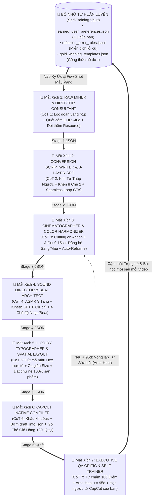
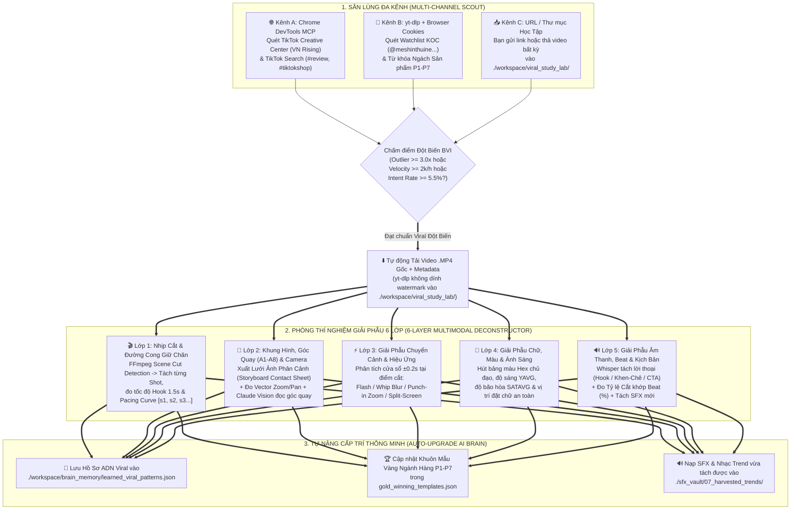
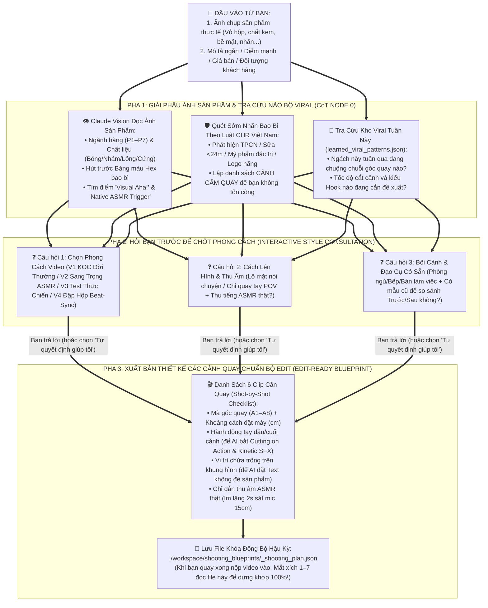
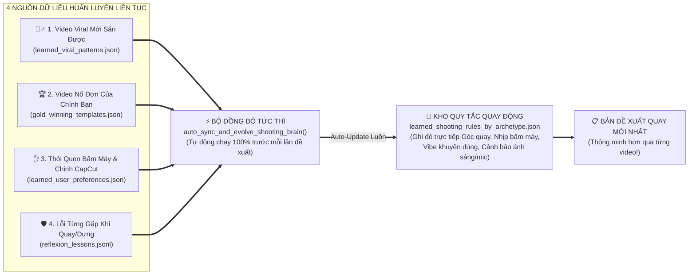

# CẨM NANG TOÀN DIỆN: PHONG CÁCH QUAY, EDIT & KHAI THÁC TỐI ĐA CAPCUT CHO VIDEO REVIEW TRIỆU VIEW
**Trường phái: `meshinthuine` (Mẹ Shin) & Các Reviewer Đa Ngành Hàng Đầu TikTok Shop**
*Bản Nâng Cấp Toàn Diện: Giải phẫu Kỹ thuật Quay + Bách Khoa Vũ Khí CapCut (Transitions, Animations, Effects, Masks, SFX, Music) + Ma trận Tùy biến theo Sản phẩm (`P1–P7`), Resource (`R1–R5`) & Bối cảnh (`E1–E5`)*

---

> [!IMPORTANT]
> **Nguyên lý tối thượng của tài liệu này:**
> 1. **Không có một công thức cắt ghép cứng nhắc cho mọi video:** Giữ vững **"Bộ khung ADN Giữ chân người xem"** (Chân thực, nhịp nhanh không khoảng nghỉ, chữ phủ thông minh, âm thanh 4 lớp), nhưng phải biến hóa linh hoạt theo **7 Nhóm Sản Phẩm (`P1–P7`)**, **5 Kịch Bản Nguyên Liệu (`R1–R5`)**, và **5 Bối Cảnh Quay (`E1–E5`)**.
> 2. **Khai thác 100% sức mạnh của CapCut nhưng "Tinh tế, Không Lạm Dụng":** CapCut có hàng nghìn hiệu ứng chuyển cảnh, chữ động, mặt nạ (Mask), bộ lọc giọng và âm thanh (SFX). Sự khác biệt giữa một Reviewer chuyên nghiệp ra ngàn đơn (như `meshinthuine`) và một người mới tập edit là **biết chọn đúng 20% hiệu ứng đắt giá nhất của CapCut với thời lượng siêu ngắn (`0.15s – 0.35s`)** để nâng tầm sản phẩm mà không làm người xem bị rối mắt hay dính lỗi chính sách CHR của TikTok Shop.

---

# PHẦN I: BỘ KHUNG ADN CỐT LÕI (CORE STYLE FOUNDATION)

Trước khi đi vào từng tính năng CapCut và từng ngành hàng, mọi video theo trường phái này đều phải tuân thủ 3 trụ cột nền tảng sau:

## 1. Hệ thống 8 Góc Quay Chuẩn (Master Camera Angles)

Chỉ cần 1 điện thoại (luôn quay bằng **Camera sau** ở `1080p - 30/60fps`) và 1 chân máy Tripod có cổ bẻ góc:

| Mã góc | Tên góc quay | Khoảng cách & Góc đặt máy | Vai trò tâm lý & thị giác |
| :--- | :--- | :--- | :--- |
| **`A1`** | **Trung cảnh Đời thường (Medium Lifestyle)** | Cách `1.2m – 1.8m`, ngang tầm ngực/mắt, lấy từ thắt lưng trở lên kèm không gian sống phía sau. | Tạo niềm tin "người thật – nhà thật", dùng mở đầu tình huống hoặc kết thúc video. |
| **`A2`** | **POV Góc nhìn thứ nhất 45° (Over-the-Shoulder / Chest POV)** | Máy đặt ngang vai/ngực chúc xuống mặt bàn góc `45 độ`, chỉ thấy 2 bàn tay thao tác. | Giúp người xem nhập vai như chính tay họ đang mở hộp và chạm vào sản phẩm. |
| **`A3`** | **Siêu cận Chi tiết (Extreme Macro / Texture Shot)** | Cách sản phẩm `10cm – 18cm` (hoặc zoom `2x`), khóa nét AE/AF vào bề mặt vật liệu. | Chứng minh chất lượng vật lý: thớ vải, giọt kem, lưỡi dao, mối hàn, độ dày nhựa. |
| **`A4`** | **Thẳng đứng 90° từ đỉnh (Top-Down Flatlay)** | Tripod bẻ ngang chúc thẳng `90 độ` xuống mặt bàn/thảm. | Điểm danh phụ kiện trong hộp (*Unboxing layout*) hoặc so sánh kích thước 2 món đồ. |
| **`A5`** | **Góc Đối chứng Cố định (Locked-Off Action Test)** | Cố định chân máy tuyệt đối tại 1 vị trí, quay xuyên suốt quá trình giải quyết vấn đề. | Chứng minh hiệu quả thật 100% không cắt ghép gian lận (lau vết bẩn, vắt nước, hút bụi). |
| **`A6`** | **Góc Điểm nhìn Vật thể (Inside-Out Object POV)** | Đặt điện thoại nằm trong tủ lạnh, trong hộp carton, trong ngăn kéo nhìn ngược ra tay người. | Tạo cú sốc thị giác (*Pattern Interrupt*) chống lướt qua ở 2 giây đầu. |
| **`A7`** | **Toàn cảnh Tôn dáng / Gương (Full-Body / Mirror Shot)** | Đặt máy ngang tầm hông (`Hip-level`), cách `2.2m – 3.0m` hoặc quay qua gương lớn. | Đặc trị cho sản phẩm Thời trang, Đồ mặc nhà, Địu em bé, Túi xách, Cây lau nhà cán dài. |
| **`A8`** | **Cận cảnh Phản ứng Khuôn mặt (Micro-Reaction Shot)** | Lấy từ vai lên đầu, tập trung vào ánh mắt, cái gật đầu, nụ cười hoặc biểu cảm khi thử đồ ăn/mùi hương. | Truyền tải cảm xúc giác quan (vị ngon, mùi thơm, sự êm ái) mà camera không tự ghi lại được. |

---

## 2. Quy tắc Nhịp điệu, Cắt khoảng thở & 4 Kiểu Zoom

1. **Cắt sạch 100% khoảng thở (Zero Dead Air):**
   * Thu âm giọng đọc (Voiceover) với ngữ điệu tự nhiên như đang tâm sự với bạn thân, nhưng khi đưa vào phần mềm dựng phải **cắt bỏ toàn bộ khoảng nghỉ lấy hơi** giữa các câu (khoảng cách giữa câu trước và câu sau chỉ `0.05s – 0.08s`).
   * Đẩy tốc độ giọng đọc lên **`1.08x – 1.15x`** (bật tính năng **Giữ tông giọng / Keep Pitch** trong CapCut để giọng không bị chua như sóc chuột).
2. **4 Kỹ thuật Zoom & Chuyển động giữ mắt người xem:**
   * **Pop-Zoom (Zoom nảy tức thì):** Tại từ khóa quan trọng (giá tiền, tính năng ăn tiền), cắt đôi clip và phóng to đoạn sau từ `100%` lên `112% – 115%` ngay lập tức.
   * **Slow Creep-Zoom (Zoom rón rén bằng Keyframe):** Đặt Keyframe đầu clip `100%` $\rightarrow$ cuối clip `106%` cho mọi cảnh dài hơn `2.0 giây` để khung hình không bao giờ đứng im.
   * **Speed-Ramp (Tăng tốc – Phanh gấp / Curve Speed):** Tua nhanh `2.5x – 4.0x` ở đoạn thao tác lặp lại (lắp ốc, cọ rửa, quấn dây) và **phanh về `1.0x`** đúng khoảnh khắc hoàn tất.
   * **Picture-in-Picture (PiP / Lớp phủ Overlay):** Khi cảnh chính đang quay toàn cảnh (`Track V1`), bật thêm 1 khung nhỏ bo tròn ở góc trên (`Track V2`) để zoom cận vào chi tiết đang nói tới.

---
---

# PHẦN II: BÁCH KHOA TOÀN THƯ VŨ KHÍ CAPCUT DÀNH CHO REVIEWER
*(Đã đối chiếu trực tiếp từ mã nguồn thư viện tài nguyên gốc của CapCut Desktop / `VectCutAPI` / `pyCapCut`)*

Rất nhiều người dùng CapCut chỉ biết cắt ghép cơ bản mà bỏ phí **90% kho vũ khí giữ chân người xem** có sẵn trong CapCut. Ngược lại, nhiều người mới lại lạm dụng hiệu ứng lòe loẹt làm video trông "rẻ tiền". Dưới đây là quy chuẩn sử dụng toàn bộ các tính năng đắt giá nhất của CapCut theo chuẩn Reviewer chuyên nghiệp:

---

## 1. Hệ thống Chuyển Cảnh CapCut (Transitions — Tab `Transitions / Chuyển cảnh`)

> [!TIP]
> **Quy tắc Vàng khi dùng Chuyển cảnh trong Video Review:**
> * **80% các vết cắt cùng bối cảnh** (ví dụ: từ cảnh toàn mặt bàn cắt vào cận cảnh bàn tay) chỉ nên dùng **Hard Cut + Đổi độ phóng đại (`100% -> 115%`)** để nhịp video nhanh và thật nhất.
> * **20% các vết cắt chuyển đoạn lớn** (từ Hook sang Mở hộp, từ Mở hộp sang Test thực tế, hoặc đổi góc phòng) **BẮT BUỘC dùng Chuyển cảnh CapCut** với thời lượng cực ngắn **`0.20s – 0.35s`** (tuyệt đối không để mặc định `0.8s – 1.0s` vì sẽ làm chậm nhịp video).

### Bảng 10 Hiệu ứng Chuyển cảnh CapCut Đắt Giá Nhất cho Affiliate:

| Tên trên CapCut (EN / VI) | Mã Resource ID CapCut | Thời lượng chuẩn | Khi nào dùng & Tác dụng Thị giác |
| :--- | :---: | :---: | :--- |
| **1. `Pull in` / Kéo vào** | `6724226861666144779` | `0.25s` | Chuyển từ **Cảnh Toàn (`A1/A2`) $\rightarrow$ Cảnh Cận Chi Tiết (`A3`)**. Tạo lực hút mắt người xem lao thẳng vào bề mặt sản phẩm. |
| **2. `Pull Out` / Kéo ra** | `6724226338418332167` | `0.25s` | Chuyển từ **Cảnh Cận (`A3`) $\rightarrow$ Cảnh Toàn kết quả (`A1/A7`)**. Mở rộng không gian mượt mà kèm hiệu ứng nhòe chuyển động (Motion Blur) ở viền. |
| **3. `Horizontal Blur` / Làm mờ ngang** | `7451535587812594193` | `0.25s` | Chuyển giữa **Màu 1 $\rightarrow$ Màu 2 $\rightarrow$ Màu 3** của sản phẩm thời trang/đồ gia dụng, tạo cảm giác lướt катаlog cao cấp. |
| **4. `Radial Blur` / Làm mờ tỏa tròn** | `7215489792597824001` | `0.25s` | Dùng ngay sau **Cảnh Hook (giây `2.0s`)** để cuốn người xem vào phần thân video. |
| **5. `Dissolve` / Hòa tan (Mờ chồng)** | `6724846004274729480` | `0.15s – 0.25s` | Đặc trị cho **Mỹ phẩm (`P3`), Đồ ăn (`P6`) và Mẹ & Bé (`P2`)**: làm mềm vết cắt khi thoa kem thẩm thấu lên da hoặc khi tua qua thời gian chờ. |
| **6. `Slide` / Trượt (hoặc `Left` / `Right`)** | `6757982416649851399` | `0.25s` | Dùng khi **Điểm danh các món phụ kiện đi kèm** (Món số 1 $\rightarrow$ Món số 2 $\rightarrow$ Món số 3). Kết hợp hoàn hảo với tiếng SFX `Light Swish`. |
| **7. `Flash` / Nháy sáng (hoặc `White Flash`)** | `6987208055511323137` | `0.15s` | Dùng đúng khoảnh khắc **Biến hình Trước $\rightarrow$ Sau (Before/After)** của đồ tẩy rửa, bật đèn decor hoặc lên đồ thời trang. Kết hợp với tiếng `Camera Shutter` hoặc `Sparkle`. |
| **8. `Blurred Highlight` / Điểm sáng mờ** | `7134999483762348545` | `0.30s` | Tạo hiệu ứng ánh sáng bokeh lung linh chuyển giữa các cảnh **Nước hoa, Skincare, Nến thơm, Decor phòng ngủ**. |
| **9. `Mix` / Hòa trộn** | `6724845717472416269` | `0.20s` | Nối mượt 2 góc quay gần giống nhau khi bạn lỡ cắt bỏ đoạn nói vấp ở giữa. |
| **10. `Glitch` / Nhiễu sóng nhẹ** | `6724844028213596680` | `0.15s` | Chỉ dùng ở giây `0.8s` khi chuyển từ **Tình huống Thảm họa/Bất tiện $\rightarrow$ Giải pháp Công nghệ (`P5`)**. |

> [!CAUTION]
> **Những chuyển cảnh CẤM DÙNG trong Video Review:**
> Không dùng các chuyển cảnh 3D xoay vòng chóng mặt (*Cube, Flip, Page Curl, Vortex, Flame*) vì vừa làm đứt mạch tập trung vào sản phẩm, vừa mang cảm giác video ghép ảnh thời xưa.

---

## 2. Nghệ Thuật Typography Sang Trọng: Cỡ Chữ Động, Phối Màu Theo Nền Video, Hiệu Ứng Chữ & Sticker/Icon Bling

Một sai lầm phổ biến khiến nhiều video review trông "rẻ tiền, chợ búa" là **bất kể video quay sản phẩm gì, nền sáng hay tối, cũng đóng khung 1 cỡ chữ, dùng màu Vàng chói `#FFE600` kèm viền Đen dày cộp `#000000`**. Để đạt đẳng cấp thẩm mỹ sang trọng (Luxury & Editorial Aesthetic) mà vẫn nổi bật từng từ khóa, hệ thống áp dụng 4 quy chuẩn thông minh sau:

### 2.1. Quy tắc Cỡ Chữ Linh Hoạt Theo Độ Dài Câu & Khóa Biên Vùng An Toàn (`Adaptive Font Sizing & Safe-Zone Wrap`)
* **Không bao giờ giữ cố định 1 size chữ cho mọi câu phụ đề:**
  * **Câu ngắn đắt giá (`<= 12 ký tự`, ví dụ: *"Sạch bong!"*, *"Chỉ 89 cành"*):** Tự động phóng lên **`Size 9.2 – 10.0`** (từ khóa nhấn phóng lên **`11.2`**) để đập ngay vào mắt người xem.
  * **Câu tiêu chuẩn (`13 – 22 ký tự`):** Đặt **`Size 8.0 – 8.5`** (từ khóa nhấn **`9.5`**) — vừa vặn 1 dòng ngang tầm mắt.
  * **Câu dài (`23 – 34 ký tự`):** Tự động thu nhẹ về **`Size 7.0 – 7.5`** kết hợp bật khóa biên **`line_max_width = 0.76` (`76%` chiều ngang màn hình)** để CapCut tự ngắt thành 2 dòng cân đối ở giữa, **tuyệt đối không bao giờ tràn sang cột nút Tim/Bình luận/Chia sẻ bên phải của TikTok**!

### 2.2. Bảng 5 Bộ Phối Màu Chữ – Viền – Đổ Bóng Theo Tông Màu Chủ Đạo Của Video (`5 Scene-Aware Luxury Color Palettes`)
Thay vì dùng viền đen `#000000` cứng nhắc, hệ thống phân tích **Màu chủ đạo & Độ sáng vùng đặt chữ của video** kết hợp với **Ngành hàng (`P1–P7`)** để chọn bộ màu tinh tế nhất:

| Tên Bộ Phối Màu | Ngành hàng & Tông video áp dụng | Màu Chữ Chính (`Base`) | Màu Từ Khóa Nhấn (`Highlight`) | Màu Viền (`Stroke`) & Độ dày | Hiệu ứng Đổ Bóng (`Diffuse Shadow`) & Hộp Nền (`Pill Box`) |
| :--- | :--- | :---: | :---: | :---: | :--- |
| **1. `LUXURY_EDITORIAL`**<br>*(Sang trọng, Tạp chí)* | Mỹ phẩm, Skincare, Nước hoa (`P3`), Thời trang thiết kế (`P4`), Decor (`P7`). | **Trắng Ngọc Trai**<br>`#FAF8F5` | **Vàng Champagne** `#F3D59B`<br>hoặc **Hồng Rose Gold** `#F4C2C2` | **Nâu Espresso Sẫm** `#2C221E`<br>*(Viền mảnh tinh tế: `width 0.038`)* | • Bóng khuếch tán mềm (`smoothing 0.65, alpha 0.55`).<br>• Font khuyên dùng: `Luxury` / `Poppins-Bold` / `Modern`. |
| **2. `COZY_PASTEL_MAMI`**<br>*(Ấm cúng chuẩn `meshinthuine`)* | Mẹ & Bé, Gia đình, Phòng ngủ ấm (`P2`). | **Trắng Kem Ấm**<br>`#FFFDF9` | **Vàng Bơ Dịu** `#FFE885`<br>hoặc **Hồng Đào** `#FFB7B2`<br>hoặc **Xanh Bơ** `#A8E6CF` | **Nâu Cacao Ấm** `#3E2723`<br>*(Viền vừa: `width 0.055`)* | • Hộp nền Callout màu **Trắng Sữa Mờ** `#FFF8E7` (`alpha 0.90`, bo tròn góc `round_radius 0.45`).<br>• Font: `Nunito` / `HarmonyOS Sans`. |
| **3. `CLEAN_CRISP_MODERN`**<br>*(Sạch bóng, Hiện đại)* | Gia dụng tiện ích & Tẩy rửa (`P1`), Nhà tắm, Gian bếp sáng. | **Trắng Tinh Khiết**<br>`#FFFFFF` | **Xanh Ngọc Sạch** `#38EF7D`<br>hoặc **Vàng Nắng** `#FFD700` | **Xanh Navy Đậm** `#0F2027`<br>*(Viền rõ nét: `width 0.065`)* | • Bóng sắc nét giúp chữ nổi bần bật trên nền gạch men/inox trắng sáng. |
| **4. `TECH_SLEEK_HUD`**<br>*(Công nghệ, Tối giản)* | Phụ kiện Công nghệ, Bàn làm việc, Đồ Ô tô (`P5`). | **Trắng Bạc**<br>`#F5F7FA` | **Xanh Cyan** `#00F2FE`<br>hoặc **Cam Amber** `#FF9F43` | **Xám Than Chì** `#1A1D24`<br>*(Viền mảnh: `width 0.045`)* | • Hộp nền dạng **Kính Đen Mờ (`Glassmorphism #141E30`, `alpha 0.82`)**.<br>• Font: `Inter-Black` / `Exo`. |
| **5. `APPETITE_SAVORY`**<br>*(Kích thích vị giác)* | Đồ ăn vặt, Trà, Thực phẩm (`P6`). | **Trắng Kem**<br>`#FFFDF7` | **Cam Mật Ong** `#FF8008`<br>hoặc **Vàng Giòn** `#FFC837` | **Nâu Caramel Đậm** `#3B1D0A`<br>*(Viền đằm: `width 0.065`)* | • Đổ bóng nâu ấm tạo cảm giác đồ ăn chín vàng, ngọt ngào. |

> [!TIP]
> **Cơ chế Tự Động Bù Trừ Theo Độ Sáng Nền Video (`Dynamic Contrast Guard`):**
> * Nếu vùng dưới của cảnh quay có nền **quá sáng hoặc trắng lóa** (ví dụ: quay trên mặt bàn đá trắng, áo sơ mi trắng, gạch phòng tắm `Độ sáng YAVG > 175`): Hệ thống tự động **tăng độ đậm của bóng đổ (`shadow_alpha = 0.85`) và tăng nhẹ viền thêm `+25%`** (hoặc bật lớp nền mờ nhẹ dưới chân chữ) để chữ không bao giờ bị chìm vào nền trắng!
> * Ngược lại, nếu cảnh quay có nền **tối hoặc trầm** (`YAVG < 95`): Hệ thống tự động **mảnh hóa viền chữ (`width = 0.035`)** để chữ nhìn thanh thoát, sang trọng tối đa!

### 2.3. Bảng Hiệu Ứng Động Cho Chữ (`Text Animations` — Tab `Text -> Animation -> In / Out / Loop`)

| Nhóm | Tên Hiệu ứng (EN / VI) | Mã Resource ID CapCut | Thời lượng | Cách ứng dụng chuẩn Reviewer & Luxury |
| :--- | :--- | :---: | :---: | :--- |
| **Vào (`In`)** | **`Spring` / Đàn hồi** | `6887766363436225025` | `0.20s` | **Số 1 cho Phụ đề động (Dynamic Subtitles):** Chữ phóng nhẹ từ nhỏ lên lớn và nảy đàn hồi cực kỳ bắt mắt. |
| **Vào (`In`)** | **`Pop Up` / Bật lên** | `7145435451946439170` | `0.20s` | Dùng cho **Các nhãn tính năng (Callout Badges)** bay ra cạnh sản phẩm kèm tiếng `Soft Pop`. |
| **Vào (`In`)** | **`Fade In` / `Slide Up` (Sang trọng)** | `6724916044072227332` | `0.22s` | Đặc trị cho video **Mỹ phẩm cao cấp (`P3`), Nước hoa, Thời trang (`P4`), Decor (`P7`)** cần sự êm ái, thanh lịch như tạp chí Vogue. |
| **Vào (`In`)** | **`Bounce In` / Nảy vào** | `6887766069587481090` | `0.25s` | Dùng cho **Banner Hook trên cùng** ở giây `0.0s` để thu hút sự chú ý tức thì. |
| **Vào (`In`)** | **`Elastic Telescopic II`** | `7161336180561154562` | `0.25s` | Chữ co giãn ngang như dây thun, cực hợp khi nhấn mạnh **Giá tiền rẻ bất ngờ** hoặc **Độ co giãn của vải (`P4`)**. |
| **Vào (`In`)** | **`Typewriter` / Máy đánh chữ** | `7210980292243231233` | `0.40s` | Dùng cho các **Thông số kỹ thuật công nghệ (`P5`)** hoặc **Thông tin chiều cao/cân nặng mẫu (`P4`)**. |
| **Ra (`Out`)** | **`Bounce Out` / `Fade Out`** | `6887765964515971585` | `0.15s` | Chỉ dùng cho **Banner Hook** và **Callout Badges** khi thu nhỏ biến mất. *(Phụ đề nối tiếp nhau liên tục thì KHÔNG cần gắn `Out` để tránh nhấp nháy).* |
| **Vòng lặp (`Loop`)** | **`Flare` (Lấp lánh Bling) / `Jump` / `Jiggle`** | `7128311749186425346` | `0.8s/vòng` | • Dùng **`Flare`** cho các nhãn ưu điểm sang trọng & Icon Bling (`✦ ✨`).<br>• Dùng **`Jump` / `Jiggle`** cho câu kêu gọi bấm Giỏ hàng ở 3 giây cuối! |

### 2.4. Nghệ Thuật Điểm Xuyết Sticker, Icon Bling Lấp Lánh & Nhãn Thẩm Mỹ (`Luxury Micro-Bling & Stickers`)
* **Nguyên tắc "Sang Trọng Không Lòe Loẹt" (`Less is Luxury`):**
  * **Tuyệt đối tránh:** Các sticker hoạt hình xanh đỏ lòe loẹt, chữ "SALE" nhấp nháy kiểu hội chợ (vừa làm giảm giá trị sản phẩm, vừa dễ bị AI của TikTok quét lỗi *Nội dung quảng cáo kém chất lượng*).
  * **3 Tầng Điểm Xuyết Bling & Sticker Đẳng Cấp:**
    1. **Micro-Bling Floating Accents (Cụm ký hiệu Bling ánh kim nổi cạnh sản phẩm):** Đặt các cụm tia sáng nhỏ tinh tế (`✦`, `✧`, `✨`, `🫧`, `🤍`, `🌿`) ở kích thước nhỏ (`scale 0.65`) với màu **Vàng Champagne `#F3D59B`** hoặc **Trắng Ngọc Trai**, gắn hiệu ứng vòng lặp **`Flare` (Lấp lánh)** ngay sát mép sản phẩm đúng `1.2 giây` khi sản phẩm vừa được lau sạch bóng, khi làn da vừa thoa serum căng mọng, hoặc khi xoay dáng quần áo!
    2. **Hiệu ứng Ánh Kim Tự Nhiên Bắt Sáng (`Glowburst` `6753169731617821191` & `Edge Glow` `6769065553207235086`):** Tự động bắt vào các điểm phản quang trên bề mặt sản phẩm (nắp chai nước hoa, mặt inox, trang sức, làn da) tạo tia lấp lánh Bling tự nhiên như quay dưới đèn Studio.
    3. **Native CapCut Stickers (`Track Sticker`):** Chỉ dùng đúng 2 vị trí đắt giá: (a) Khung ngắm lấy nét mảnh ở cảnh Macro soi chất liệu, và (b) **Mũi tên tối giản màu Trắng/Vàng kem** chỉ nhẹ xuống góc trái màn hình ở 3 giây cuối để điều hướng khách bấm vào Giỏ hàng!

### 2.5. Trí Tuệ Hút Mã Màu Trực Tiếp Từ Video Thực Tế & Quyết Định "Lúc Nào Dùng Cái Nào" (`Dynamic Frame Color Harmonics`)
* **Không ép cứng màu chữ theo ngành hàng:** Cùng là đồ gia dụng nhưng nếu quay trong căn bếp gỗ ấm cúng thì không thể dùng chữ xanh/trắng lạnh lẽo; cùng là thời trang nhưng chiếc áo màu Đỏ rượu vang phải có bảng màu chữ khác chiếc áo màu Xanh rêu!
* **Quy trình 3 Bước Hút Màu Thực Tế Từ Khung Hình Video (`Real-Time Frame Color Sampling`):**
  1. **Đo Nhiệt Độ Ánh Sáng Thực Tế Của Cảnh Quay (`Ambient Temperature` -> Chọn Màu Chữ Chính `base_hex`):**
     * Nếu cảnh quay có ánh sáng **Ấm (`Kênh Đỏ R > Kênh Xanh Lam B + 12`)**: Tự động dùng **Trắng Ngọc Trai Ấm (`#FFFDF8`)** để chữ hòa quyện vào ánh đèn phòng.
     * Nếu cảnh quay có ánh sáng **Lạnh / Trung tính**: Tự động dùng **Trắng Tinh Khiết (`#F8FAFC`)**.
  2. **Hút Màu Chủ Đạo Của Sản Phẩm (`Subject Hue` -> Tính Mã Màu Từ Khóa Nhấn `highlight_hex`):**
     * Lấy mẫu màu `RGB -> HSV` tại vùng trung tâm sản phẩm:
       * **Chế độ Đồng điệu Sang trọng (`Tonal Champagne Accent`):** Giữ góc màu (`Hue`) của sản phẩm/bối cảnh nhưng nâng độ sáng lên **`Value = 96%`** và khóa độ bão hòa ở mức Pastel sang trọng **`Saturation = 42% – 58%`** *(Ví dụ: Bối cảnh Gỗ/Be -> Từ khóa tự mang mã Vàng Champagne `#F5D799`; Sản phẩm Hồng đất -> Từ khóa tự mang mã Hồng Rose Gold `#F7C6C7`; Bối cảnh Xanh lá -> Từ khóa tự mang mã Xanh Ngọc Kem `#B8F2D0`)*.
       * **Chế độ Tương phản Nổi bật (`Split-Complementary Pop` cho câu Hook / Giá tiền):** Xoay góc màu `150°` trên vòng tròn màu so với nền thực tế nhưng khóa `Saturation <= 65%` để nổi bần bật mà không bị chói mắt kiểu neon rẻ tiền.
  3. **Hút Tông Tối Sâu Nhất Trong Video Làm Màu Viền & Hộp Nền (`Deepest Ambient Shade` -> Thay thế màu đen `#000000` vô hồn):**
     * Lấy chính góc màu (`Hue`) của bối cảnh video nhưng hạ độ sáng xuống **`Value = 14%`, `Saturation = 35%`**. Quay trên bàn gỗ ấm -> Viền chữ tự mang màu **Nâu Espresso Gỗ (`#241A14`)**; Quay trên nền vải xanh -> Viền chữ tự mang màu **Xanh Đêm Sẫm (`#121B26`)**.
* **Luật Quyết Định "Lúc Nào Dùng Kiểu Chữ & Hiệu Ứng Nào?":**
  * **Khi nền dưới chữ thoáng đãng (`Low Edge Complexity` – mặt bàn trơn, tường phẳng):** Dùng **Chữ Trơn + Viền mảnh đồng tông + Bóng khuếch tán mềm** (Tắt hộp nền `background_alpha = 0`) để không gian video rộng mở, sang trọng.
  * **Khi nền dưới chữ rối mắt hoặc lóa sáng (`High Edge Complexity` – kệ hàng nhiều chữ, gạch hoa văn):** Tự động bật **Hộp Nền Kính Mờ (`background_alpha = 0.78, round_radius = 0.45`)** mang mã màu tối của bối cảnh để tách lớp chữ nổi hẳn lên!
  * **Khi nhịp nói nhanh (`< 1.8s/câu`):** Dùng hiệu ứng **`Spring`**; **Khi nhịp nói chậm rãi / cảnh quay `Micro Slow-Mo 0.90x`:** Tự động đổi sang **`Fade In` / `Slide Up`** êm ái; **Khi đọc con số thông số/kích thước:** Tự động đổi sang **`Typewriter`**.

### 2.6. Trí Tuệ Định Vị Bố Cục Chữ Tránh Đè Lên Sản Phẩm (`Obstacle-Aware Spatial Positioning`)
Vị trí đặt chữ quyết định 50% sự chuyên nghiệp của video. Tuyệt đối không để chữ đè bẹp lên mặt sản phẩm hay bàn tay đang thao tác! Hệ thống chia màn hình 9:16 thành **Lưới 9 Vùng (`9-Zone Saliency Grid`)** để định vị tọa độ sản phẩm `(sx, sy)` trong từng cảnh quay:
1. **Tự Động Dịch Chuyển Phụ Đề Khi Sản Phẩm Nằm Thấp (`Dynamic Subtitle Y-Shift`):**
   * **Ở các cảnh `A1/A7` (Quay người hoặc cầm sản phẩm ngang ngực `sy > -0.15`):** Đặt phụ đề ở **Vùng Đáy Chuẩn (`pos_y = -0.38`)**.
   * **Ở các cảnh `A2/A3/A4` (Tay và sản phẩm thao tác sát đáy mặt bàn `sy <= -0.18`):** Hệ thống tự động **nâng Phụ đề lên vùng trên (`pos_y = +0.42` hoặc `-0.18` tùy khoảng trống)** để nhường trọn vẹn vùng dưới cho người xem ngắm sản phẩm!
   * **Luật Ổn Định Mắt Đọc (`Eye-Tracking Lock`):** Các câu phụ đề nối tiếp nhau trong cùng 1 cảnh quay luôn giữ cố định một mức `pos_y` (chỉ đổi khi chuyển sang góc quay mới có bố cục khác) để mắt người xem không bị nhảy lên xuống.
2. **Đặt Nhãn Callout & Icon Bling Vào "Khoảng Trống Thở" Cạnh Sản Phẩm (`Negative-Space Anchoring`):**
   * Nhãn tính năng (`"✓ Inox 316 dày dặn"`) **không bao giờ đè lên giữa sản phẩm**, mà tự động tìm vùng nền ít chi tiết nhất nằm **bên cạnh mép sản phẩm**:
     * Nếu sản phẩm đang lệch sang Phải (`sx > +0.08`) -> Đặt nhãn Callout ở **Khoảng trống bên Trái (`pos_x = sx - 0.38`)**.
     * Nếu sản phẩm đang lệch sang Trái (`sx < -0.08`) -> Đặt nhãn Callout ở **Khoảng trống bên Phải (`pos_x = sx + 0.36`)**.
     * Nếu sản phẩm nằm giữa màn hình (`sx ≈ 0.0`) -> So sánh độ trống trải giữa góc Trên-Trái `(-0.34, sy + 0.26)` và góc Trên-Phải `(+0.32, sy + 0.26)`, góc nào nền phẳng hơn thì đặt Callout vào góc đó!

---

## 3. Hiệu Ứng Động Cho Video & Ảnh PiP (Video Intro / Outro / Combo Animations)

Khi bạn chèn một **Khung hình phụ (PiP Video)** hoặc **Thẻ ảnh thông số / Voucher (`Kịch bản R4`)** lên `Track V2`, tuyệt đối không để nó tự nhiên hiện ra rồi biến mất. Hãy gắn bộ hiệu ứng động của CapCut cho clip đó:

1. **Hiệu ứng Vào (`Intro_type`) cho Khung PiP & Clip đầu:**
   * **`Mini Zoom` (`6800268825611735559`):** Phóng nhẹ 5% cực tinh tế ở đầu mỗi clip cắt mới — thay thế hoàn hảo cho thao tác đặt Keyframe thủ công!
   * **`Slide Up` (`6798333487523828238`) / `Slide Left` (`6798332871267324423`):** Dùng cho **Thẻ ảnh thông số / Bảng màu** trượt từ mép màn hình vào góc.
   * **`Shake 1` (`6739418227031413256`) / `Rock Vertically` (`6739418390030455300`):** Dùng cho cảnh **Đập hộp hoặc Torture Test (thử độ bền)** để tăng cảm giác lực tác động mạnh mẽ.
   * **`Wiper` (`6802871256849846791`):** Hiệu ứng gạt nước mở màn hình, cực hợp cho sản phẩm **Cây lau nhà / Xịt tẩy kính (`P1`)**.
2. **Hiệu ứng Kết hợp (`Combo / Group Animation`) cho Thẻ Nổi (`R4`):**
   * **`Enlarge and bounce` (`7032223659116728833`)**, **`3D card 2` (`6836319649844433415`)** hoặc **`Pendulum 1` (`6811007755785081357`):** Giúp tấm ảnh tĩnh đè trên góc màn hình nghiêng nhẹ 3D và đung đưa sống động, **vừa đẹp mắt vừa tránh 100% lỗi CHR "Nội dung ảnh tĩnh" của TikTok!**

---

## 4. Hiệu Ứng Kỹ Xảo Cảnh Quay & Mặt Nạ (Video Effects, Masks & Canvas Blur)

### 4.1. Top 6 Hiệu ứng Video (`Tab Effects -> Video Effects`) dùng trong Review:
1. **`Camera Focus` / Lấy nét máy ảnh (`6719658716750156291`):** Hiện khung ngắm máy ảnh lấy nét vào sản phẩm trong `0.8 giây` đầu tiên — báo hiệu cho não người xem *"Hãy nhìn kỹ vào chi tiết này!"*.
2. **`Blurry Focus` / Lấy nét mờ (`6758752103092457991`):** Khung hình mờ nhẹ ở 0.2s đầu rồi nét căng vào chủ thể ở giữa, tạo cảm giác như quay bằng ống kính máy ảnh cơ đắt tiền.
3. **`Edge Glow` / Phát sáng viền (`6769065553207235086`) & `Glowburst` (`6753169731617821191`):** Dùng đúng `1.0 giây` khi sản phẩm inox/trang sức/mỹ phẩm vừa được lau sạch hoặc mở nắp dưới ánh đèn.
4. **`Bluray Scanning` / Quét tia Laser (`7255269076526699010`):** Tia sáng quét dọc qua sản phẩm, cực kỳ ăn khách khi review **Đồ công nghệ (`P5`), Máy lọc không khí, Máy tiệt trùng bình sữa (`P2`)** để minh họa tính năng diệt khuẩn/cảm biến!
5. **`Camera Shake` / Rung máy nhẹ (`6863326875649839623`):** Đặt `0.3s` tại khoảnh khắc đặt mạnh đồ vật xuống bàn để chứng minh độ chắc chắn.

### 4.2. Mặt nạ (Masks — Tab `Video -> Mask`) — Vũ khí tạo Bố cục Đa Khung Hình:
* **`Split` / Chia đôi (`7374020197990011409`):** Chia màn hình thành 2 nửa (Nửa trên Trước khi dùng – Nửa dưới Sau khi dùng), kéo nhẹ thanh **Feather (Độ mờ viền) = `5–10`** để đường ghép giữa 2 video mượt không lộ vết cắt.
* **`Circle` / Hình tròn (`7374021188315517456`):** Biến video cận cảnh trên `Track V2` thành một **Kính lúp phóng đại hình tròn** nằm ở góc trên bên phải màn hình, soi rõ thớ vải hoặc giọt serum.
* **`Rectangle` / Hình chữ nhật bo góc (`7374021450748924432`):** Kéo thông số **Round Corners (Bo góc) = `25–35`** để tạo khung hình Picture-in-Picture sang trọng như giao diện iOS.

### 4.3. Làm mờ Nền (Background Blur / Canvas Blur):
* Khi quay các clip ngang hoặc khi muốn làm nổi bật bảng thông số ở giữa màn hình, bật **`Canvas -> Blur`** (CapCut có 4 mức độ mờ chuẩn: `0.0625`, `0.375`, `0.75`, `1.0`) thay vì để viền đen hai bên.

---

## 5. Kho Âm Thanh CapCut: Sound Effects (SFX), Nhạc Nền Thương Mại & Bộ Lọc Giọng

Một video có hình ảnh đẹp nhưng thiếu **Sound Design (Thiết kế âm thanh)** của CapCut sẽ giống như món ăn thiếu gia vị — người xem sẽ lướt đi sau 3 giây!

### 5.1. Bản Đồ Tìm Kiếm Sound Effects (SFX) Trong CapCut (`Tab Audio -> Sound effects`)
Thay vì mò mẫm, bạn (hoặc AI) chỉ cần gõ đúng các từ khóa tiếng Anh sau vào ô tìm kiếm `Sound effects` của CapCut và bấm **Ngôi sao (Favorite)** để lưu vào thư mục dùng mãi mãi:

| Nhóm tác dụng | Từ khóa gõ trong CapCut SFX | Âm lượng chuẩn | Đặt ở vị trí nào trên Timeline? |
| :--- | :--- | :---: | :--- |
| **1. Tiếng Nảy Chữ & Nhãn (`UI Pop`)** | `"Bubble"`, `"Pop"`, `"Water drop"`, `"Switch"`, `"Message"` | `-15dB` (`25%`) | Đặt khớp chính xác vào frame đầu tiên khi **Banner Hook** hoặc **Callout Badge** nảy ra. |
| **2. Tiếng Lướt Chuyển Cảnh (`Whoosh`)** | `"Swish"`, `"Whoosh"`, `"Swoosh"`, `"Page turn"`, `"Wind"` | `-16dB` (`22%`) | Đặt ngay dưới chân các chuyển cảnh `Pull in`, `Slide`, `Horizontal Blur`. (Ưu tiên tiếng `Light Swish` ngắn `0.2s`, không dùng tiếng gió hú dài). |
| **3. Tiếng Báo Hiệu Kết Quả (`Magic / Ding`)** | `"Sparkle"`, `"Ding"`, `"Magic"`, `"Shining"`, `"Bell"`, `"Chime"` | `-14dB` (`30%`) | Đặt đúng khoảnh khắc **Vết bẩn biến mất (`P1`)**, **Đèn bật sáng (`P7`)**, hoặc khi **Báo giá hời / Ưu đãi freeship**. |
| **4. Tiếng Cơ Học & Đập Hộp (`Mechanical`)** | `"Click"`, `"Camera shutter"`, `"Keyboard"`, `"Snap"`, `"Box"` | `-12dB` (`35%`) | Dùng khi khớp khóa gập lại, nam châm hít nhau (`P5`), hoặc khi chụp ảnh kết quả lên đồ (`P4`). |
| **5. Tiếng Ẩm Thực & Đời Sống (`Food / Cozy`)** | `"Crunch"`, `"Pouring water"`, `"Sizzle"`, `"Coffee"` | `-10dB` (`45%`) | Bổ trợ thêm vào cảnh rót trà, bẻ bánh giòn (`P6`) nếu lúc quay mic điện thoại thu hơi nhỏ. |
| **6. Tiếng Nhấn Mạnh Tình Huống (`Comedy / Hook`)** | `"Boing"`, `"Record scratch"`, `"Huh"`, `"Gasp"` | `-14dB` (`28%`) | Chỉ dùng **tối đa 1 lần** ở giây đầu tiên nếu mở đầu bằng tình huống hài hước hoặc lỗi sai thường gặp. |

### 5.2. Tư Duy Đạo Diễn Khi Chọn Nhạc Nền (BGM), Phối Hợp Phong Cách Bối Cảnh & Quyết Định "Khi Nào Edit Theo Nhịp Beat – Khi Nào Không"

Một sai lầm chí mạng của người mới (và các AI cấp thấp) là **chọn bừa 1 bài nhạc xu hướng rồi video nào cũng cắt giật đùng đùng theo tiếng trống** — làm cho video review Mỹ phẩm cao cấp hoặc Mẹ & Bé mất sạch vẻ sang trọng, hoặc nhạc có lời ca sĩ hát đè lên làm khách không nghe rõ lời tư vấn!

Hệ thống của chúng ta không bao giờ chọn nhạc bừa mà bắt buộc phân tích **4 yếu tố thực tế của Resource Video** (*Có Voiceover hay không? Tốc độ tay nhanh hay chậm? Ánh sáng bối cảnh ấm hay lạnh? Ngành hàng cần sang trọng hay năng lượng?*) để kích hoạt đúng **1 trong 4 Chế Độ Âm Nhạc & Nhịp Dựng (`4 Music & Beat-Sync Modes`)** dưới đây:

#### A. Ma Trận 4 Chế Độ Chọn Nhạc & Quyết Định Edit Theo Nhịp Beat (`When to Beat-Sync vs. When to Flow`)
| Chế độ Âm nhạc & Nhịp dựng | Khi nào bắt buộc dùng? (Điều kiện Resource & Bối cảnh) | Thể loại Nhạc, Tempo (`BPM`) & Âm sắc chuẩn | Cách Edit theo Nhịp (`Beat-Sync Strategy`) & Kiểm soát Âm lượng |
| :--- | :--- | :--- | :--- |
| **🔥 Chế độ 1: `BEAT_DRIVEN_MONTAGE`<br>(Nhạc Cầm Trịch – Cắt Khớp 100% Phách Mạnh)** | • Video **không có giọng đọc (`R5`)** hoặc các phân đoạn **Montage khoe dáng/nhảy đổi đồ (`P4 Thời trang`)**, **biến hình phòng (`P7 Decor`)**.<br>• Hoặc `4 giây` giữa video khi điểm danh nhanh 4–5 màu sắc/phụ kiện liên tiếp. | • **Hot Trend Upbeat Instrumental / Funky Pop / House Lounge / K-Pop Beat**.<br>• Tempo nhanh: **`115 – 128 BPM`** (Tiếng trống Kick/Snare nảy giòn, dứt khoát). | • **Cắt theo nhịp 100% (`0ms Hard Beat-Lock`):** Mọi điểm chuyển cảnh (`Whip/Slide/Flash`) và cú nhảy đổi đồ (`Jump Match-Cut`) rơi **trúng phóc vào đỉnh Phách Mạnh (`Downbeat`)** của nhạc!<br>• Tốc độ clip co giãn đàn hồi (`0.90x – 1.25x`) để khớp khít khoảng cách giữa 2 phách nhạc.<br>• Âm lượng nhạc: **`35% – 55%`** (tự động võng xuống `18%` ở đúng `0.4s` có tiếng ASMR thật của sản phẩm). |
| **⚡ Chế độ 2: `HYBRID_PULSE_SYNC`<br>(Lời Nói Dẫn Dắt – Chuyển Cảnh Đệm Nhịp Beat Mềm)** | • Video **có Giọng đọc Voiceover năng lượng** kết hợp thao tác tay nhanh (`P1 Gia dụng`, `P5 Công nghệ`, `P6 Đồ ăn`).<br>• Khung hình sáng sủa, nhịp độ chuyển động tay cao (`YDIF >= 6.0`). | • **Lo-Fi HipHop Beat / Modern R&B Groove / Marimba Tech Pluck / Upbeat Acoustic**.<br>• Tempo vừa: **`96 – 114 BPM`**.<br>• **Cấm tuyệt đối nhạc có lời hát (`No Vocals`)** để không đụng độ dải tần giọng đọc (`300Hz–3kHz`)! | • **Lời thoại làm chủ đạo, Nhạc làm bệ phóng (`Elastic Beat-Snap ±140ms`):** Hình ảnh ưu tiên khớp 100% với từ khóa đang đọc, nhưng nếu điểm chuyển cảnh nằm cách phách nhạc trong bán kính `0.14s`, thuật toán tự động **hút điểm cắt trùng khít vào phách nhạc**!<br>• **Đường cong Âm lượng Lượn Sóng (`Dynamic Sidechain`):** Nhạc nền giữ ở **`6%`** khi đang đọc chữ, nhưng tự động **nảy lên `14% – 16%` ở các khe chuyển cảnh `0.3s` và đoạn khoe kết quả (`Result Reveal`)** tạo cảm giác cực kỳ chuyên nghiệp! |
| **💎 Chế độ 3: `ATMOSPHERIC_LUXURY_FLOW`<br>(Nhạc Khí Chất Sang Trọng – CẤM Cắt Giật Theo Trống!)** | • Video **Mỹ phẩm cao cấp, Nước hoa, Skincare (`P3`)**, **Mẹ & Bé tâm sự ấm cúng (`P2`)**, hoặc cảnh **Storytelling đời thường (`A1`)**.<br>• Bối cảnh ánh sáng dịu/ấm, thao tác tay mềm mại (`YDIF < 5.5`). | • **French Cafe Accordion / Jazz Piano / Warm Acoustic Guitar / Dreamy Ambient Pad**.<br>• Tempo thong thả: **`72 – 92 BPM`** (Nhạc chảy mượt, ít trống dồn). | • **NGHIÊM CẤM cắt giật theo phách trống!** Việc cắt giật theo tiếng trống trong video Luxury/Tâm sự sẽ phá hỏng hoàn toàn sự sang trọng và chiều sâu cảm xúc.<br>• Cắt theo **Nhịp thở câu nói & Đà chuyển động mượt của bàn tay (`Cutting on Action` + `Dissolve 0.25s`)**.<br>• Chỉ căn **khoảnh khắc sản phẩm tỏa sáng (`Result Reveal`) và câu `CTA`** rơi đúng vào **Hợp âm mở (`Chord Swell`)** của bài nhạc.<br>• Âm lượng nhạc: **`5% – 7%`** (mỏng như sương). |
| **🎧 Chế độ 4: `PURE_ASMR_MUSIC_DROP`<br>(Ngắt Nhạc Nền Ở Đoạn Đinh – Tôn Vinh Tiếng Thật)** | • Khoảnh khắc `1.5s – 2.5s` đắt giá nhất khi sản phẩm phát ra **tiếng ASMR vật lý cực giòn** (`SNR >= 14 dB`: tiếng bẻ bánh giòn tan, tiếng nam châm hít *Tách!*, tiếng dao thái, tiếng sủi bọt). | • Áp dụng kỹ thuật **"Music Drop Before Reveal"** của các TVC quảng cáo cao cấp. | • **Tắt hẳn nhạc nền (`BGM Volume = 0%`) trong đúng `1.5s` diễn ra tiếng thật của sản phẩm**, để tai người nghe tập trung 100% vào tiếng giòn/tách sướng tai đó $\rightarrow$ Ngay giây kết quả hiện ra, **nhạc nền mới bùng lên lại (`Fade-In 0.2s`) kèm tiếng `Sparkle Ding`**! |

#### B. Quy Tắc Phối Nhạc Khớp Với Bối Cảnh Thực Tế (`Scene-to-Audio Vibe Matching`) & An Toàn Bản Quyền Thương Mại (`CML`)
1. **Đo ánh sáng & tốc độ tay để chọn đúng màu nhạc:**
   * **Bối cảnh ấm (`Phòng ngủ E2`, `Đèn vàng`, `Gỗ/Kem`):** Hệ thống tự động chọn nhạc có dải tần trung-trầm ấm áp (*Acoustic Guitar, Rhodes Piano, Lo-Fi Chill*).
   * **Bối cảnh sáng trắng sắc nét (`Bếp hiện đại E1`, `Bàn làm việc E4`, `Ngoài trời E5`):** Hệ thống tự động chọn nhạc có âm sắc tươi sáng, nảy gọn (*Pizzicato Strings, Marimba Pluck, Funky Lounge*).
2. **An toàn tuyệt đối Bản quyền Âm nhạc Thương mại (`Commercial Music Library - CML`):**
   * Video có gắn Giỏ hàng vàng (Affiliate) được TikTok phân loại là **Nội dung Thương mại (`Commercial Content`)**. Nếu dùng nhạc Pop có bản quyền của ca sĩ nổi tiếng ngoài danh mục CML, video đang lên xu hướng sẽ bị **Tắt tiếng (`Mute Audio`)** hoặc không chạy được quảng cáo GMV Max.
   * Vì vậy, hệ thống chỉ chọn nhạc từ **Kho Nhạc Thương Mại (`Commercial Sounds`) / Instrumental Không Bản Quyền** và tự động cắt lõm nhẹ dải tần giọng người (`EQ Dip -6dB tại 1.2kHz`) trên nhạc nền để giọng Reviewer luôn nổi bật như thu âm tại Studio!

### 5.3. Bộ Lọc Giọng Nói & Xử Lý Thu Âm CapCut (`Voice Filters / Vocal Beautify`)
Nếu bạn thu âm lúc đang mệt hoặc phòng hơi vang, CapCut có sẵn bộ xử lý âm thanh cực mạnh (có thể kích hoạt tự động qua MCP/Draft):
* **`Reduce Noise` (Giảm tiếng ồn) + `Vocal Beautify` (Làm đẹp giọng):** Khử sạch tiếng quạt gió, tiếng điều hòa và tiếng vang phòng kín.
* **`Voice Filters` (Bộ lọc giọng nhẹ):**
  * **`Sweet` (`7320193577613529602`):** Làm giọng nữ trong trẻo, ngọt ngào và thân thiện hơn (rất hợp ngách **Mẹ & Bé `P2`, Mỹ phẩm `P3`, Thời trang `P4`**).
  * **`Energetic` (`7320193885114733057`):** Tăng độ sáng và năng lượng cho giọng đọc khi review **Gia dụng thông minh `P1`, Đồ ăn `P6`**.
  * **`Deep` (`7021052537344102913`):** Làm giọng trầm ấm, uy tín hơn khi review **Đồ công nghệ `P5`, Phụ kiện ô tô**.

### 5.4. Cơ Chế 3 Tầng Thẩm Định Tiếng Thật Từ Sản Phẩm & Tự Động Thay Thế Foley SFX (`Native Product ASMR vs. Smart Foley Replacement`)
Khi bạn quay video thực tế, có những đoạn thu được tiếng sản phẩm thật cực kỳ "đã tai" (tiếng bấm nút *tách*, tiếng rạch hộp *xẹt*, tiếng bọt xịt *xèo*, tiếng bánh giòn *rộp*), nhưng cũng có những đoạn bị **lẫn tiếng quạt gió ù ù, tiếng còi xe, tiếng người nhà nói chuyện, hoặc tiếng sản phẩm quá nhỏ nghe bị đục**. Hệ thống tự động thẩm định từng đoạn clip theo 3 chế độ thông minh sau:

| Chế độ Thẩm định | Dấu hiệu nhận biết âm học (`SNR & Noise Floor`) | Hành động xử lý tự động của Hệ thống / Editor |
| :--- | :--- | :--- |
| **🟢 Chế độ 1: `KEEP_CLEAN_ASMR`<br>(Giữ nguyên tiếng thật đắt giá)** | • Đỉnh tiếng sản phẩm nảy cao hơn nền tạp âm **`>= 12 dB`** (`Crest Factor cao`).<br>• Nền phòng yên tĩnh (`Noise Floor < -38 dB`), không lẫn tiếng nói chuyện riêng. | • **Giữ 100% tiếng thật của sản phẩm!**<br>• Lọc nhẹ tần số trầm `< 120Hz` (khử tiếng ù điện) và đặt `native_volume = 65% – 85%`.<br>• Dùng **Keyframe Âm lượng (`KFTypeVolume`)** chỉ mở tiếng ở đúng `0.5s` diễn ra hành động rồi hạ về `0%` ở hai đầu để không lọt tạp âm thừa. |
| **🟡 Chế độ 2: `SURGICAL_ISOLATE_AND_LAYER`<br>(Cắt phẫu thuật + Bồi thêm SFX)** | • Có tiếng thật của sản phẩm nhưng thu hơi nhỏ hoặc mỏng (`Crest Factor 6–11 dB`).<br>• Nền phòng hơi ồn nhẹ (`-38 dB <= Noise Floor <= -30 dB`). | • **Mở cửa sổ âm lượng siêu hẹp (`0.3s`)** đúng tại đỉnh tiếng sản phẩm (`native_volume = 40%`).<br>• **Bồi đè thêm 1 lớp Sound Effect vật lý nhẹ (`volume = 22%`)** cùng loại hành động vào đúng mili-giây đó để âm thanh vừa giữ được chất thật, vừa dày và đằm tai gấp đôi! |
| **🔴 Chế độ 3: `MUTE_AND_FOLEY_REPLACE`<br>(Tắt hẳn âm gốc xấu + Thay bằng Foley SFX)** | • Nền quá ồn (`Noise Floor > -30 dB`: tiếng quạt thổi vào mic, tiếng xe cộ, tiếng TV/nói chuyện tạp) HOẶC tiếng sản phẩm quá yếu/không phù hợp. | • **Tắt bỏ hoàn toàn tiếng gốc của clip đó (`native_volume = 0%`)**.<br>• **Nhìn hành động trên hình bằng Vision để chèn Sound Effect vật lý (`Foley SFX`) thay thế khớp 100% với động tác tay:**<br>  + *Rạch hộp / Mở nắp* $\rightarrow$ `box_rip.wav` / `light_swish.wav`<br>  + *Bấm nút / Gập khớp / Nam châm* $\rightarrow$ `mech_click.wav`<br>  + *Xịt sương / Tạo bọt / Rửa nước* $\rightarrow$ `spray_mist.wav` / `bubble_pop.wav`<br>  + *Vò vải / Sờ chất liệu mềm* $\rightarrow$ `fabric_soft.wav` / `soft_pop.wav` |

### 5.5. Bộ Nhận Diện Chuyển Động Không Gian & Kho Âm Thanh Viral 3 Nguồn Lai (`Kinetic Action SFX & 3-Tier Hybrid Viral Vault`)
Ngoài âm thanh phát ra từ bản thân sản phẩm (ASMR), điểm tạo nên "ma lực cuốn hút" của các kênh Viral Review triệu view (`meshinthuine`, Võ Hà Linh, KOC Thời trang/Gia dụng) là **những chuyển động hình thể và dịch chuyển vị trí trên khung hình vốn không phát ra tiếng khi quay, nhưng được lồng thêm âm thanh động học (Kinetic & Trend SFX) khớp từng mili-giây**:

#### A. Bảng 6 Chuyển Động Không Gian Tự Động Kích Hoạt Âm Thanh Động Học (`Kinetic Movement Matrix`)
| Hành động chuyển động trong khung hình | Cách AI & Toán học nhận diện (`Optical Motion Centroid`) | Combo Âm Thanh Viral Tự Động Gắn (`Kinetic SFX`) |
| :--- | :--- | :--- |
| **1. Đưa sản phẩm / bàn tay Vào hoặc Ra khỏi khung hình (`PUSH_IN` / `PULL_OUT`)** | • Trọng tâm chuyển động `(cx, cy)` lao nhanh từ rìa màn hình (`\|cx\| > 0.65`) vào chính giữa tâm (`\|cx\| < 0.25`) trong `0.15s – 0.35s` (hoặc gạt nhanh đồ cũ từ tâm ra rìa). | • **Khi đưa sản phẩm mới vào:** Tiếng **`Whoosh In` (Vút ấm trầm)** bắt đầu lúc tay vào rìa + điểm một tiếng **`Soft Pop` (Bụp giòn)** đúng mili-giây sản phẩm dừng lại giữa màn hình!<br>• **Khi gạt/vứt đồ cũ ra ngoài:** Tiếng **`Whoosh Out` / `Swipe` (Vút nhanh dứt khoát)**. |
| **2. Nhảy biến hình đổi đồ / Nhảy vào khung hình / Búng tay đổi cảnh (`JUMP_MATCH_CUT`)** | • Trọng tâm cơ thể dịch chuyển dọc đột ngột (`Δcy` vọt lên cao rồi rơi xuống tại đúng điểm cắt Match-Cut giữa 2 bộ trang phục hoặc 2 trạng thái phòng). | • **Nhảy đổi đồ / Nhảy vào khung hình:** Tiếng **`Jump Boing` (Lò xo nảy Boing vui nhộn)** hoặc **`Teleport Poof` (Tiếng Bụp biến hình + Chuông lấp lánh)** ngay tại frame bàn chân chạm đất! |
| **3. Đổi vị trí Trái $\leftrightarrow$ Phải / Đặt 2 món lên bàn cân so sánh (`POSITION_SWAP`)** | • Trọng tâm chuyển động đảo dấu ngang từ Trái sang Phải (`cx < -0.22` $\leftrightarrow$ `cx > +0.22`) hoặc 2 khung hình PiP hoán đổi vị trí cho nhau. | • Tiếng **`Whip Swish` (Vụt nhanh đổi chỗ)** nối liền **`Double Pop` (Tách - Tách 2 nhịp)** tạo cảm giác nảy giòn cực kỳ bắt tai. |
| **4. Gật đầu xác nhận / Giơ ngón cái / Khoảnh khắc "Wow" ưng ý (`REACTION_CONFIRM`)** | • Trong cảnh `A8` (Reaction) hoặc khi soi cận kết quả, có nhịp gật đầu/nghiêng đầu nhanh kèm từ khóa khen ngợi (*"Đỉnh thật sự"*, *"Ưng cái bụng"*, *"10 điểm"*). | • Tiếng **`Confirm Ding` (Tinh! Chuông xác nhận trong vắt)** hoặc **`Anime Shine / Twinkle` (Lấp lánh sang trọng)**. |
| **5. Cảnh "Lỗi / Bất tiện với đồ cũ" ở 1.5s đầu (`PAIN_POINT_FAIL`)** | • Nửa đầu cảnh Hook (`0.0s – 1.8s`) khi diễn cảnh đồ cũ bị rớt, dây rối mù, lau mãi không sạch. | • Tiếng **`Subtle Bonk` / `Slide Down` (Tiếng tụt mood nhẹ hài hước)** ở âm lượng tinh tế `20%` để kích thích cảm xúc đồng cảm mà không bị lố. |
| **6. Chỉ tay xuống Giỏ hàng góc trái / Tung giá hời (`POINT_TO_CART`)** | • 3 giây cuối video (`CTA`) hoặc khi bàn tay chỉ chéo xuống góc dưới trái (`cx < -0.25, cy < -0.35`). | • Tiếng **`Cash Chime` / `Coin Ting` (Tiếng Ting-Ting chốt đơn sang trọng)** kích thích phản xạ ngón cái bấm vào Giỏ hàng. |

#### B. Kết hợp Kho CapCut + Bộ Âm Thanh Sưu Tầm Riêng Của Bạn (`3-Tier Hybrid Viral SFX Vault`)
> [!TIP]
> **Giải đáp thực chiến: Trên CapCut đã đủ chưa hay nên thêm Bộ âm thanh sưu tầm riêng của bạn?**
> * **Kho có sẵn trên CapCut:** Rất tốt cho các âm thanh cơ bản (*Whoosh, Pop, Ding, Click, Shutter*), nhưng các âm thanh online của CapCut **chỉ hoạt động tự động sau khi bạn đã bấm tải/ngôi sao (Favorite) để lưu vào bộ nhớ đệm (Cache) trên máy Mac**. Hơn nữa, các âm thanh **Trend/Meme/Viral Review đặc trưng tại Việt Nam** (tiếng *Boing* nhảy biến hình, tiếng *Ting* Hàn Quốc, tiếng *Bling* sang chảnh hay tiếng *Bonk/Quạc* hài hước bạn nhặt từ các video triệu view) khi có thêm bộ sưu tầm riêng sẽ giúp video **tăng gấp đôi cá tính và độ bắt tai**!
> * **Vì vậy, hệ thống được trang bị Kiến trúc Kho Âm Thanh 3 Tầng Lai (`Hybrid SFX Vault`):**
>   1. **🥇 Tầng 1 (Ưu tiên số 1 – Thư mục Bộ Sưu Tầm Viral Của Bạn `./assets/user_viral_sfx/`):** Bạn chỉ cần ném toàn bộ các file âm thanh `.mp3 / .wav` (hoặc thậm chí cả file video `.mp4` TikTok có đoạn âm thanh bạn thích — hệ thống tự tách tiếng!) vào thư mục `./assets/user_viral_sfx/`. Hệ thống tự động phân loại theo tên file/thư mục (`whoosh_dua_vao`, `jump_nhay`, `swap_doi_cho`, `pop_bong_bong`, `bling_sang`, `ding_chot_don`, `fail_hai_huoc`, `asmr_that`) và **ưu tiên lấy âm thanh sưu tầm của bạn làm vũ khí số 1**!
>   2. **🥈 Tầng 2 (Tự động móc từ Cache CapCut Desktop `~/Movies/CapCut/User Data/Cache/`):** Mọi hiệu ứng âm thanh bạn từng bấm tải/yêu thích trong CapCut Desktop đều được hệ thống tự động quét và lôi ra sử dụng.
>   3. **🥉 Tầng 3 (Bảo hiểm 100% Không bao giờ thiếu – Bộ 17 Âm Thanh Động Học & Studio FFmpeg):** Ngay cả ở những danh mục bạn chưa có file sưu tầm riêng, bộ tổng hợp âm thanh nội bộ tự động sinh đủ **17 file SFX chuẩn Studio & Động học** (`whoosh_in`, `whoosh_out`, `jump_boing`, `teleport_poof`, `whip_swish`, `cash_chime`, `subtle_bonk`, `soft_pop`, `bubble_pop`, `sparkle_ding`, `mech_click`, `shutter`, `box_rip`, `spray_mist`, `fabric_soft`, `crisp_crunch`, `light_swish`) để video luôn đầy ắp âm thanh sống động!

#### C. Bộ 5 Lệnh CLI Tự Động Sưu Tầm Nhạc, SFX & Đồng Bộ Hiệu Ứng Mới Nhất Theo Xu Hướng (`viral_sfx_harvester.py`)
Để kho nhạc, Sound Effects và cả kho Hiệu ứng (`Transitions / Video FX / Text Animations`) của hệ thống **luôn tự động cập nhật kịp theo xu hướng mới nhất trên thị trường**, bạn hoặc Claude Code chỉ cần chạy các lệnh sau:

```bash
# LỆNH 1 (Khuyên chạy đầu tiên): Tự động tải trọn bộ 20+ Sound Effects Viral Review Tuyển Chọn
python3 viral_sfx_harvester.py --harvest-curated-pack

# LỆNH 2: Tự động tìm kiếm & tải âm thanh mới theo từ khóa bất kỳ trên thư viện (MyInstants + Wikimedia Commons)
python3 viral_sfx_harvester.py --search-trend "anime sparkle" --category "sparkle_ding" --limit 3

# LỆNH 3: Tự động "Hút & Bóc Tách" bài nhạc nền + nhịp Beat + các tiếng SFX rời từ bất kỳ Link Video TikTok/Douyin đang Viral
python3 viral_sfx_harvester.py --harvest-video "https://www.tiktok.com/@meshinthuine/video/..." --tag "viral_ref"

# LỆNH 4: Tự động "Giải Cứu" toàn bộ âm thanh/nhạc bạn từng bấm nghe thử hoặc lưu Ngôi sao trong CapCut Desktop
python3 viral_sfx_harvester.py --rescue-capcut-cache

# LỆNH 5 (CẬP NHẬT XU HƯỚNG MỚI NHẤT): Tự động quét toàn bộ các Hiệu ứng (Effects/Transitions/Animations/Stickers)
# và Âm thanh mới nhất vừa được CapCut cập nhật vào máy Mac + kéo Top SFX thịnh hành trong tuần về live_trend_catalog.json!
python3 viral_sfx_harvester.py --sync-live-trends
```

---
---

# PHẦN III: MA TRẬN TÙY BIẾN THEO TỪNG LOẠI SẢN PHẨM (7 PRODUCT ARCHETYPES `P1–P7`)
*(Tích hợp đầy đủ Công thức Quay + Nhịp Edit + Combo Hiệu ứng CapCut riêng cho từng ngành)*

---

## Nhóm 1 (`P1`): Gia Dụng Tiện Ích & Hóa Phẩm Tẩy Rửa (Cleaning & Problem-Solving Gadgets)
* **Tâm lý chốt đơn:** Người xem chỉ mua khi mắt họ nhìn thấy **sự biến đổi tức thì (Instant Transformation)** từ Bẩn/Bất tiện $\rightarrow$ Sạch bong/Nhàn tênh.
* **Công thức Quay đặc thù:**
  * **Cảnh Hook (`0.0s – 2.0s`):** Dùng **Góc `A5` (Cố định) hoặc `A3` (Siêu cận)** quay ngay khoảnh khắc gạt 1 đường sạch bong vết bẩn nhân tạo (dùng xì dầu cháy, tương ớt, dầu màu để an toàn 100% chính sách CHR).
  * **Cảnh Chứng minh (`8.0s – 18.0s`):** Quay **1 cú máy liền mạch (One-Shot Uncut)** từ lúc xịt/bấm máy đến lúc lau sạch, dùng **Speed-Ramp tua nhanh `3x–4x` ở đoạn chờ ngấm bọt** thay vì cắt cảnh để chứng minh không tráo đồ!
* **Combo Vũ Khí CapCut Khuyên Dùng:**
  * **Mask:** Dùng **`Mask -> Split` (`7374020197990011409`)** chia đôi màn hình Trước/Sau ở 2 giây đầu.
  * **Chuyển cảnh:** **`Flash` (`0.15s`)** lúc biến hình sạch bóng; **`Pull in` (`0.25s`)** khi zoom vào bề mặt inox.
  * **Video Animation & FX:** Gắn Intro **`Wiper`** cho clip lau chùi + Hiệu ứng **`Edge Glow` / `Glowburst`** đúng giây sản phẩm sáng bóng.
  * **SFX & Màu sắc:** Đẩy ASMR cọ rửa lên `75%`, chèn SFX **`Sparkle` + `Ding`**; chỉnh màu hơi lạnh sáng (`Temp -5`, `Sharpen +25`, `Highlights +5`).

---

## Nhóm 2 (`P2`): Mẹ & Bé (Đồ Dùng Gia Đình, Máy Hâm Nước, Ghế Ăn Dặm, Bỉm Khăn & Sữa Trên 2 Tuổi)
* **Tâm lý chốt đơn:** Mua vì **Sự an toàn lành tính cho con + Giúp mẹ nhàn tênh + Sự đồng cảm giữa những người làm mẹ** (Đúng chuẩn `meshinthuine`).
* **⚠️ Giới hạn Đỏ Chính Sách CHR Việt Nam (`Mục 5.1.5 & 5.2` - Cẩm nang Toàn diện TikTok Affiliate):**
  * **CẤM TUYỆT ĐỐI (`-40 điểm CHR`):** Không nhận làm Affiliate hoặc để xuất hiện trên hình **Sữa công thức cho trẻ dưới 24 tháng tuổi, bình bú và núm vú giả**. Nếu làm sữa cho bé từ 24 tháng trở lên, bắt buộc đọc và hiện chữ rõ trên màn hình: **`"Dành cho bé từ 2 tuổi trở lên"`** để AI không quét nhầm!
  * **Quy tắc Trẻ vị thành niên (`-40 điểm CHR`):** Tuyệt đối không để em bé/trẻ dưới 18 tuổi xuất hiện **một mình** trong khung hình giới thiệu sản phẩm — bắt buộc luôn phải có mẹ/người lớn xuất hiện cùng và dẫn dắt nội dung hướng tới phụ huynh!
* **Công thức Quay đặc thù:**
  * Mở bằng **Góc `A1` (Đời thường)** cảnh mẹ xuất hiện cùng bé (hoặc thao tác một tay gọn lẹ với máy đun nước pha sữa, ghế ăn dặm, khăn khô đa năng, cốc tập hút).
  * Giữa video bắt buộc có **Góc `A3` (Macro)** soi ký hiệu nhựa `PP / Tritan / BPA Free / Inox 316` và các góc cạnh bo tròn.
* **Combo Vũ Khí CapCut Khuyên Dùng:**
  * **Chuyển cảnh:** **`Dissolve` (`0.20s`)** và **`Pull in` (`0.25s`)** êm ái, không dùng hiệu ứng giật mạnh.
  * **Text Animation:** Phụ đề và Callout dùng **`Spring`** hoặc **`Pop Up`** với bảng màu Pastel (Hồng phấn, Vàng kem, Xanh bơ).
  * **Video FX:** Dùng **`Bluray Scanning` (`7255269076526699010`)** quét nhẹ qua máy tiệt trùng/máy đun nước thông minh khi nói về tính năng an toàn.
  * **SFX, Voice & Màu sắc:** Bật Voice Filter **`Sweet`** nhẹ; SFX **`Water Drop / Bubble`** ở mức nhỏ `20%`; nhạc nền Guitar/Piano Acoustic ấm áp (`6%`); chỉnh màu `Temp +6`, `Shadows +12%`.

---

## Nhóm 3 (`P3`): Mỹ Phẩm, Skincare, Chăm Sóc Cá Nhân & Hương Thơm (Beauty & Personal Care)
* **Tâm lý chốt đơn:** Mua bằng **Cảm giác kết cấu trên da (Texture Porn) + Độ tệp màu thật + Sự quyến rũ/thơm tho**.
* **Công thức Quay đặc thù:**
  * Tắt Beauty Filter ảo khi quay để tránh vi phạm CHR; dùng ánh sáng tản mềm góc `45°` để da căng bóng thật.
  * Với **Nước hoa / Xịt thơm / Sữa tắm:** Quay cảnh xịt ngược sáng thấy tia sương mịn + **Góc `A8` (Reaction)** biểu cảm hít hà thích thú + chèn `0.7s` B-roll gợi hình nốt hương (quả đào, hoa nhài, chăn trắng).
* **Combo Vũ Khí CapCut Khuyên Dùng:**
  * **Chuyển cảnh:** **`Blurred Highlight` (`0.30s`)** và **`Dissolve` (`0.20s`)** tạo cảm giác kem tan vào da.
  * **Mask:** Dùng **`Mask -> Circle` (`7374021188315517456`)** tạo ô tròn góc trên bên phải soi cận chất kem/lỗ chân lông trong khi màn hình chính đang thoa lên mặt.
  * **Video FX & Retouch:** Dùng **`Blurry Focus`** ở 0.5s đầu; trong CapCut chỉ bật **`Retouch -> Smooth 15%`** (tự nhiên, an toàn CHR); chỉnh màu `Brightness +5`, `Tint +4 Hồng`.

---

## Nhóm 4 (`P4`): Thời Trang, Phụ Kiện & Đồ Mặc Nhà / Freesize (Fashion & Wearable)
* **Tâm lý chốt đơn:** Xóa tan nỗi sợ *"Mua về mặc không giống mẫu, vải mỏng lộ hàng, giặt bị xù lông"*.
* **Công thức Quay đặc thù:**
  * Mở bằng **Góc `A7` (Toàn thân ngang hông)** khoe form dáng HOẶC màn **Torture Test (`Góc A3`)**: lấy kéo cào vào vải không xước, vò mạnh không nhăn, kéo giãn cạp quần.
* **Combo Vũ Khí CapCut Khuyên Dùng:**
  * **Mask & PiP Đôi:** Màn hình chính (`Track V1`) chiếu dáng mặc toàn thân; `Track V2` dùng **`Mask -> Rectangle` (Bo góc `Round Corner = 30`)** đặt ở góc phải trên chiếu cận cảnh thớ vải/lớp lót lông!
  * **Chuyển cảnh:** **`Horizontal Blur` (`0.25s`)** hoặc **`Slide`** khi lướt qua các màu sắc khác nhau kèm SFX **`Camera Shutter` + `Swish`**.
  * **Text Animation:** Ghim cố định 1 dòng chữ dùng hiệu ứng **`Typewriter`**: `📏 Mẫu: 1m58 - 49kg (Mặc Freesize)`. Các từ khóa *"Co giãn 4 chiều"* dùng **`Elastic Telescopic II`**.

---

## Nhóm 5 (`P5`): Phụ Kiện Công Nghệ, Đồ Điện Tử Nhỏ & Desk Setup (Tech & Car Gadgets)
* **Tâm lý chốt đơn:** Sự gọn gàng thông minh + Cảm giác cơ học đằm tay + Giải quyết sự bừa bộn dây nhợ.
* **Combo Vũ Khí CapCut Khuyên Dùng:**
  * **Chuyển cảnh:** **`Glitch` (`0.15s`)** từ cảnh dây rối sang cảnh bàn gọn; **`Pull in` (`0.20s`)** vào cổng sạc/màn hình LED.
  * **Video FX:** **`Camera Focus` (`6719658716750156291`)** lấy nét vào khớp xoay kim loại + **`Bluray Scanning`** khi giới thiệu chip/cảm biến.
  * **SFX:** Kích tiếng **Mechanical ASMR** (*Click, Clack, Nam châm hít*) lên `85%`, chèn SFX **`Switch` / `Keyboard`**.

---

## Nhóm 6 (`P6`): Đồ Ăn Vặt, Thực Phẩm, Trà & Đồ Uống (Food & Beverage / Mukbang Review)
* **Tâm lý chốt đơn:** Phản xạ sinh học (Nhìn là chảy nước miếng – Nghe giòn là bấm mua ngay).
* **Combo Vũ Khí CapCut Khuyên Dùng:**
  * **Cấu trúc 2 giây đầu:** `1.0s` siêu cận (`A3`) bẻ bánh chảy nhân/xé thịt/rót trà bốc khói $\rightarrow$ nối thẳng sang `1.0s` (`A8`) cắn miếng đầu tiên giòn rụm.
  * **Video Animation:** Gắn **`Mini Zoom`** liên hoàn cho các góc cận đồ ăn.
  * **SFX & Màu sắc:** Đẩy tiếng giòn/rót nước lên `90%`; tăng bảng màu **`HSL -> Đỏ / Cam / Vàng Saturation +15%`** và `Temp +8` để đồ ăn vàng ươm bắt mắt.

---

## Nhóm 7 (`P7`): Đồ Decor, Đèn Ngủ & Sản Phẩm Mùa Lễ Hội (Aesthetic Decor, Noel & Tết)
* **Tâm lý chốt đơn:** Cảm xúc không gian (Mood & Vibe).
* **Combo Vũ Khí CapCut Khuyên Dùng:**
  * **Hook "Bật Công Tắc":** `0.7s` phòng tối $\rightarrow$ Chuyển cảnh **`Flash` (`0.15s`)** kèm SFX **`Switch Click` + `Sparkle`** $\rightarrow$ `1.3s` phòng sáng lung linh.
  * **Video FX:** Phủ nhẹ hiệu ứng **`Edge Glow`** hoặc **`Blurred Highlight`** + Nhạc nền lễ hội/Lo-fi (`10%`) có gắn `Audio Fade In/Out`.

---
---

# PHẦN IV: MA TRẬN XỬ LÝ THEO 5 LOẠI NGUYÊN LIỆU ĐẦU VÀO (`R1–R5`)

| Kịch bản Resource | Đặc điểm Nguyên liệu bạn có | Chiến thuật Cắt ghép & Tính năng CapCut áp dụng để cứu Source |
| :--- | :--- | :--- |
| **Kịch bản `R1`: Bộ Nguyên Liệu Đầy Đủ (Full-Stack Pack)** | Có đủ clip quay người (`A1`), clip quay tay POV (`A2`), clip cận cảnh (`A3/A4`) + File thu âm Voiceover rời. | • Dùng `A1` ở `1.8s–4.0s` và `25s–30s`; 70% giữa video dùng `A2/A3/A4/A5` khớp 100% từng từ trong Voiceover.<br>• Gắn chuyển cảnh `Pull in` (`0.25s`) khi chuyển từ `A1` vào `A3`. |
| **Kịch bản `R2`: Chỉ Quay Tay – Không Lộ Mặt (Faceless POV Pack)** | Chỉ có các clip quay sản phẩm và 2 bàn tay trên bàn/bếp, không có cảnh mặt người. | • **Đa tiêu cự bằng Keyframe/Scale:** Cắt 1 clip POV thành 3 mức phóng đại xoay vòng: `100% (Toàn bàn)` $\rightarrow$ `130% (Trung cảnh tay)` $\rightarrow$ `165% (Siêu cận)` kèm Intro `Mini Zoom`.<br>• Tăng mật độ Callout `Pop Up` và đẩy cao ASMR gốc. |
| **Kịch bản `R3`: Quay Liền 1 Mạch Vừa Nói Vừa Cầm Đồ (Single Talking-Head)** | Chỉ có 1–2 video dài quay liền một mạch chủ thể vừa nói vừa giơ sản phẩm. | • Cắt bỏ mọi khoảng thở `>120ms`; tại mỗi vết cắt đổi `Scale` luân phiên `100% <-> 114% <-> 107%`.<br>• Lấy các đoạn cận sản phẩm đè lên `Track V2` (hoặc dùng `Mask Circle/Rectangle` góc trên) để người xem vừa nghe nói vừa thấy rõ chi tiết hàng. |
| **Kịch bản `R4`: Ít Video + Kèm Ảnh Tĩnh / Ảnh Thông Số (Hybrid Video + Photos)** | Chỉ có 2–3 đoạn video ngắn, còn lại là ảnh chụp `.jpg/.png` hoặc bảng size/voucher. | • **Chống lỗi CHR Ảnh tĩnh:** Giữ video quay thật chạy xuyên suốt trên `Track V1` (có thể bật nhẹ `Canvas Blur 0.375` khi cần tập trung đọc chữ).<br>• Đặt các ảnh tĩnh lên `Track V2` (`Scale 40%`), áp **`Mask -> Rectangle (Round Corner 30)`** + gắn **Combo Animation `3D card 2` hoặc `Enlarge and bounce`** để thẻ ảnh bay ra cực sang trọng trong `2.0s`! |
| **Kịch bản `R5`: Chỉ Có Video Quay Thô Câm + Ghi Chú Chữ (Silent Clips Only)** | Chỉ có video thao tác tay (không thu âm giọng nói) và vài gạch đầu dòng thông tin. | • Dùng **Speed-Ramp (`0.8x – 2.5x`)** co giãn các clip khớp với kịch bản chữ.<br>• Bơm sẵn toàn bộ câu thoại thành các `Text Segments` trên CapCut để bạn bấm 1 nút **"Text-to-Speech (Văn bản thành giọng nói)"** trong CapCut + áp bộ lọc giọng **`Sweet`** hoặc tự thu âm lồng tiếng trong 30 giây! |

---
---

# PHẦN V: MA TRẬN BÙ TRỪ THEO 5 BỐI CẢNH KHÔNG GIAN QUAY (`E1–E5`)

| Bối cảnh quay | Rủi ro thường gặp | Công cụ CapCut khắc phục tự động |
| :--- | :--- | :--- |
| **`E1`: Gian Bếp & Bàn Ăn (Kitchen)** | Bóng đèn trần đổ đen dưới bàn tay; tiếng ù của tủ lạnh/máy hút mùi. | • **Màu sắc:** Kéo `Shadows +15`, `Sharpen +20`.<br>• **Âm thanh:** Bật `Reduce Noise` lọc tần số trầm `< 110Hz`, giữ nguyên tần số cao của tiếng dao thớt/xịt bọt. |
| **`E2`: Phòng Ngủ & Phòng Em Bé (Bedroom)** | Đèn ngủ vàng cam làm sai màu thật của sản phẩm; thiếu sáng gây nhiễu hạt (Noise). | • **Màu sắc:** Hạ `Temp -8 đến -15` để trả lại màu trắng chuẩn cho sản phẩm; bật **`Video Denoise (Khử nhiễu video): Weak`**.<br>• **Âm thanh:** Hạ SFX xuống `15%`, dùng `Audio Fade` mượt. |
| **`E3`: Nhà Tắm & Khu Giặt Giũ (Bathroom)** | Tiếng nói bị vang vọng (Echo) do tường gạch men; gương/gạch bị cháy sáng lóa. | • **Âm thanh:** Tắt tiếng nói thu trực tiếp trong nhà tắm (chỉ giữ đoạn tiếng nước chảy), thu Voiceover rời ngoài phòng ngủ + bật `Vocal Beautify`.<br>• **Màu sắc:** Hạ `Highlights -18`, `Temp -5`, `Sharpen +22`. |
| **`E4`: Bàn Làm Việc & Góc Học Tập (Desk Setup)** | Phông nền tường phẳng phía sau đơn điệu, dễ gây nhàm chán. | • **Hiệu ứng:** Bật `Vignette -6` làm tối nhẹ 4 góc viền; gắn `Mini Zoom` và `Keyframes` liên tục mỗi `1.8s` + dùng `Mask Circle` phóng đại chi tiết. |
| **`E5`: Trong Ô Tô / Ban Công / Ngoài Trời (Outdoor)** | Cảnh quay cầm tay bị rung; nắng gắt làm cháy sáng; tiếng gió và còi xe ồn ào. | • **Video:** Bật **`Stabilize (Chống rung): Recommended (Level 1)`**; kéo `Highlights -20`, `Shadows +20` (cân bằng HDR).<br>• **Âm thanh:** Tắt 100% tiếng ồn gió ngoài đường ở đoạn thường, thay bằng SFX sạch và Voiceover thu trong phòng kín. |

---
---

# PHẦN VI: BẢNG KỊCH BẢN PHÂN CẢNH MẪU TỪNG GIÂY (`0.0s – 30.0s` MASTER TIMELINE) & BỘ CÔNG THỨC HOOK / CTA AN TOÀN CHR
*(Bổ sung sau khi Self-Review để người quay và Editor có thể cầm máy làm theo từng giây ngay lập tức)*

## 1. Bảng Phân Cảnh Mẫu Từng Giây (Second-by-Second Master Storyboard `28 Giây`)

Khi quay bất kỳ sản phẩm nào, bạn chỉ cần quay đúng **12 đoạn clip ngắn (mỗi đoạn `3–5 giây`)** và lắp vào bảng Timeline 28 giây dưới đây:

| Mốc thời gian | Phân đoạn | Góc máy & Hành động trên hình (`Track V1 / V2`) | Hiệu ứng CapCut (`Transition / Anim / Mask / FX`) | Chữ phủ (`Text Track`) | Âm thanh (`VO / ASMR / SFX`) |
| :---: | :--- | :--- | :--- | :--- | :--- |
| **`0.0s – 1.8s`** | **1. Visual Hook (Cú sốc thị giác)** | • **Góc `A3` / `A5`:** Khoảnh khắc giải quyết vấn đề sướng mắt nhất (lau sạch vết bẩn / bẻ bánh chảy nhân / kéo cào vải không rách). | • Video FX: `Blurry Focus` (`0.6s`).<br>• Nếu là `P1`: Dùng `Mask Split` chia đôi Trước/Sau. | • **Banner Hook** trên đỉnh (`Bounce In`): *"Tưởng phí tiền mà cứu cánh cả mùa đông!"* | • ASMR gốc bật `80%`.<br>• SFX: `Soft Pop` + `Sparkle Ding` ở `0.8s`. |
| **`1.8s – 4.2s`** | **2. Đồng cảm & Nỗi đau** | • **Góc `A1` (Trung cảnh đời thường):** Chủ thể xuất hiện trong bếp/phòng ngủ, cầm sản phẩm hoặc chỉ vào sự bất tiện lúc chưa có sản phẩm. | • Chuyển cảnh ở `1.8s`: `Radial Blur` (`0.25s`).<br>• Keyframe: `Creep-Zoom 1.00 -> 1.05`. | • Phụ đề động (`Spring`), tô vàng từ khóa nỗi đau. | • SFX chuyển cảnh: `Light Swish` ở `1.8s`.<br>• Giọng đọc `1.12x` bắt đầu tâm sự. |
| **`4.2s – 7.5s`** | **3. Đập hộp & Điểm danh phụ kiện** | • **Góc `A2` (POV 45°)** nối sang **`A4` (Top-Down 90°):** Rạch hộp, bày toàn bộ phụ kiện/quà tặng kèm ra mặt bàn. | • Giữa các món phụ kiện dùng chuyển cảnh `Slide` (`0.25s`). | • Nhãn `Callout` (`Pop Up`): *"✨ Tặng kèm 2 đầu thay"* | • Tiếng rạch hộp/đặt đồ ASMR `65%`.<br>• SFX: `Bubble Pop` khi nhãn hiện ra. |
| **`7.5s – 12.5s`** | **4. Soi cận chất liệu (Macro Proof)** | • **Góc `A3` (Siêu cận `10cm`):** Soi rõ chất liệu nhựa `PPSU` / `Inox 316` / đường may vắt sổ / chất kem mịn. | • Chuyển cảnh ở `7.5s`: `Pull in` (`0.25s`).<br>• Video FX: `Camera Focus` hoặc `Bluray Scanning`. | • Nhãn `Callout` chỉ thẳng vào ký hiệu an toàn / độ dày. | • Tiếng gõ nhẹ móng tay vào vật liệu / tiếng sột soạt vải `55%`. |
| **`12.5s – 19.5s`** | **5. Thử nghiệm thực tế (Action Test)** | • **Góc `A5` (One-Shot) hoặc `A7` (Toàn thân):** Thực hiện bài test chịu lực / cọ rửa / mặc lên người xoay dáng (`V2` bật `Mask Circle/Rectangle` soi cận). | • Đoạn thao tác chờ: `Speed-Ramp 3.5x` rồi phanh về `1.0x` kèm chuyển cảnh `Flash` (`0.15s`). | • Phụ đề động đổi màu **Xanh lá `#4ADE80`** ở kết quả đạt được. | • SFX: `Camera Shutter` hoặc `Sparkle Ding` đúng giây ra kết quả. |
| **`19.5s – 23.0s`** | **6. Điểm trừ nhỏ (Tạo niềm tin tuyệt đối)** | • **Góc `A2`:** Chỉ ra 1 nhược điểm nhỏ không ảnh hưởng công năng (ví dụ: *"Hộp giấy vận chuyển hơi móp xíu"* hoặc *"Dây hơi ngắn nên phải cắm gần ổ"*). | • `Pop-Zoom 1.00 -> 1.12` vào chi tiết đang nói. | • Phụ đề động: *"Điểm trừ nhỏ là..."* | • Giọng đọc chân thật, hạ nhẹ tốc độ về `1.05x`. |
| **`23.0s – 28.0s`** | **7. Báo giá hời & CTA Giỏ hàng** | • **Góc `A1` hoặc `A2`:** Cầm sản phẩm gật đầu ưng ý, tay chỉ nhẹ xuống góc dưới bên trái màn hình. | • Chuyển cảnh `Pull Out` (`0.25s`).<br>• Nếu có ảnh bảng giá/voucher (`R4`): Bật thẻ `3D card 2` ở góc trên. | • Câu CTA dưới đáy gắn Loop Animation **`Jump` / `Jiggle`**: *"🛒 Bấm Giỏ Hàng góc trái săn lúc đang trợ giá nha!"* | • SFX: `Sparkle Ding` + `Bubble Pop`.<br>• Nhạc nền `Audio Fade Out` (`0.8s`). |

---

## 2. Bộ 14 Mẫu Câu Hook Mở Đầu (3 Giây Đầu) & 5 Câu Chốt Đơn (CTA) An Toàn Tuyệt Đối Chính Sách CHR

> [!WARNING]
> **Nguyên tắc sống còn để bảo vệ 100 điểm CHR:**
> Tuyệt đối không dùng các từ cam kết tuyệt đối hoặc phóng đại y khoa (*"Trị dứt điểm 100%", "Trắng bật 3 tông sau 1 lần", "Rẻ nhất TikTok", "Hàng chính hãng 100% không đúng đền gấp 10"*). Hãy chuyển toàn bộ sang **Câu chuyện trải nghiệm cá nhân của người thật** theo bảng dưới đây:

| Nhóm Sản Phẩm | ❌ Câu Hook Vi Phạm CHR (Dễ bị bóp tương tác/trừ điểm) | ✅ Câu Hook Chuẩn Phong Cách `meshinthuine` (Vừa cuốn vừa an toàn 100%) |
| :--- | :--- | :--- |
| **`P1`: Gia dụng & Tẩy rửa** | *"Xịt tẩy thần thánh sạch 100% mọi vết bẩn cứng đầu nhất thế giới!"* | • *"Biết cái chai này sớm hơn thì đợt dọn bếp vừa rồi mình đã đỡ còng lưng cọ nồi suốt 2 tiếng đồng hồ!"*<br>• *"Thử lấy cái nồi cháy khét này ra test xem cái kem đánh bóng hơn 50 cành đang hot có làm ăn được gì không nha!"* |
| **`P2`: Mẹ & Bé / Gia đình** | *"Máy tiệt trùng số 1 cho trẻ sơ sinh, sữa tăng cân thần tốc!"* *(Cấm sữa <24 tháng, bình bú, núm vú giả -40đ)* | • *"Mẹ nào đêm hôm pha nước ấm cho con mà cứ phải lọ mọ canh nhiệt độ thì nhìn cái bình đun giữ nhiệt để đầu giường của mình nè..."*<br>• *"Mình kỹ tính khoản đồ ăn dặm cho bé trên 2 tuổi lắm, phải soi tận mắt cái chất liệu Inox 316 dày cộp này mới dám cho lên video."* |
| **`P3`: Mỹ phẩm & Hương thơm** | *"Kem dưỡng xóa sạch nám tàn nhang, trắng bật tông ngay sau 3 ngày!"* | • *"Da mình thuộc hệ siêu nhạy cảm mùa hanh khô mà trộm vía hợp cái chất kem bơ mềm tan này dã man!"*<br>• *"Mùi này kiểu vừa bước từ tiệm giặt ủi nắng sớm ra ấy, xịt lên áo khoác từ sáng mà chiều chồng vẫn hỏi dùng nước xả gì!"* |
| **`P4`: Thời trang & Đồ mặc nhà** | *"Áo giữ nhiệt hàng hiệu cao cấp bao giặt máy 10 năm không xù!"* | • *"Lấy hẳn kéo cào thử lên bề mặt vải cho mấy bà xem độ lì của cái quần tất lót lông chưa tới 90 cành này nha!"*<br>• *"Mình cao 1m58 nặng 49kg, đùi hơi to mà mặc cái form quần suông này vào nhìn chân thẳng tắp luôn!"* |
| **`P5`: Phụ kiện Công nghệ** | *"Sạc dự phòng dung lượng thật 100% sạc siêu tốc không bao giờ nóng máy!"* | • *"Bàn làm việc đang như đám rừng dây điện mà chỉ cần đúng 1 tiếng 'Tách!' nam châm này là gọn sạch sẽ!"*<br>• *"Nhỏ đúng bằng thỏi son bỏ vừa túi áo khoác mà cứu cánh cái điện thoại sập nguồn của mình biết bao nhiêu lần."* |
| **`P6`: Đồ ăn vặt & Trà** | *"Trà giảm cân thần tốc 5kg/tuần, hạt dinh dưỡng chữa mất ngủ!"* | • *"Nghe cái tiếng bẻ bánh giòn rụm với lớp nhân chảy tràn bờ đê này là biết vì sao mình mua lại lần thứ 3 rồi đó!"*<br>• *"Đổ nguyên cả hộp 500 gram ra đĩa xem bên trong có bị độn vụn như mấy chỗ khác không nha!"* |
| **`P7`: Decor & Lễ hội** | *"Đèn ngủ đẹp nhất Việt Nam giá rẻ sập sàn duy nhất hôm nay!"* | • *"Tắt đèn phòng đi... Bấm công tắc một cái là cả góc phòng ngủ biến thành quán cafe Giáng sinh ấm cúng liền!"* |

### 5 Mẫu Câu Chốt Đơn (CTA) Tự Nhiên Không Dính Lỗi "Dụ Dỗ Tương Tác / Giá Ảo":
1. **CTA Khoe Giá Trợ Giá (Theo giỏ hàng thật):** *"Hôm nay trên giỏ hàng góc trái mình thấy shop đang có mã trợ giá với freeship, tính ra chưa tới bằng 2 cốc trà sữa, mấy bà bấm vào kiểm tra xem tài khoản mình có được áp mã hời đó không nha!"*
2. **CTA Chọn Phân Loại / Size:** *"Mình có gắn đủ cả 3 màu với bảng size chi tiết ở cái giỏ hàng màu vàng góc trái màn hình rồi, mọi người bấm vào đó lựa màu hợp gu nha!"*
3. **CTA Mua Combo Tiết Kiệm:** *"Mách nhỏ là bấm vào giỏ hàng chọn phân loại combo 2 món sẽ lợi tiền ship và rẻ hơn mua lẻ kha khá đó nha!"*
4. **CTA Điểm Trừ Thật Thà $\rightarrow$ Chốt Đơn:** *"Trừ việc vỏ hộp giấy đi xa hơi nhăn xíu thì chất lượng bên trong với tầm giá này quá xứng đáng, link mình để sẵn ở góc trái cho ai cần nhé!"*
5. **CTA Mùa Vụ / Lễ Hội:** *"Đang đầu mùa lạnh / sát dịp lễ nên mấy màu hot nhanh hết size lắm, bà nào ưng form này thì bấm giỏ hàng góc trái chốt sớm kẻo phải đợi đợt sau nha!"*

---
---

# PHẦN VII: BỘ TIÊU CHUẨN ĐẠO DIỄN TỰ REVIEW VIDEO CHUYÊN SÂU TRƯỚC KHI BÀN GIAO (`100-POINT MASTER QA SCORECARD`) & GIAO THỨC AI CHỦ ĐỘNG ĐÒI THÊM NGUYÊN LIỆU / XIN Ý KIẾN

> [!IMPORTANT]
> **Nguyên tắc Bàn Giao Kép Của AI Đạo Diễn (`No Mediocre Delivery Rule`):**
> 1. **Không bao giờ bàn giao mù:** Trước khi báo cáo hoàn thành, AI bắt buộc phải tự kiểm định lại toàn bộ bản dựng theo **Thang 100 Điểm (6 Trụ cột chuyên sâu)**. Nếu dưới **90/100 điểm** hoặc dính bất kỳ lỗi Đỏ nào, AI phải **tự động sửa lại ngay lập tức** trước khi gửi cho bạn!
> 2. **Không bao giờ im lặng chịu đựng nguyên liệu thiếu:** Nếu phát hiện chỉ cần bổ sung thêm 1 góc quay 3 giây, 1 thông số giá/khuyến mãi hoặc cần bạn chốt hướng đi sáng tạo để biến video từ mức Khá (`75 điểm`) thành mức Siêu Phẩm Viral (`98 điểm`), AI **CÓ QUYỀN VÀ BẮT BUỘC chủ động nhắn hỏi / "đòi" thêm từ bạn**!

---

## 1. Bảng 6 Trụ Cột Tự Thẩm Định Chất Lượng Video Chuyên Sâu (`100-Point Pre-Delivery Review Rubric`)

Trước khi bàn giao dự án, AI tự kết xuất bản xem trước (`Preview Render`) + phân tích cấu trúc `draft_info.json` để chấm điểm khắt khe từng hạng mục sau:

| Trụ cột Thẩm định (Trọng số) | Tiêu chuẩn Đạt Chuẩn Viral Chuyên Nghiệp (`Pass Criteria`) | Dấu hiệu Lỗi Phải Tự Sửa Ngay (`Auto-Fix Trigger`) |
| :--- | :--- | :--- |
| **1. Sức Sát Thương 3 Giây Đầu & Nhịp Giữ Chân (`20 Điểm`)** | • **`0.0s – 1.8s`:** Phải là khoảnh khắc thị giác mạnh nhất (Kết quả Trước/Sau, Bẻ bánh chảy nhân, Kéo cào vải, Bật đèn sáng bừng).<br>• **0% giây chết đầu video:** Đã gọt sạch `0.5s` lúc người quay mới bấm nút máy ảnh.<br>• **Nhịp cắt trung bình:** `1.5s – 2.3s/cảnh` (tối thiểu `>= 12 cảnh` cho video `25s`). Không có cảnh nào tĩnh quá `2.8s`. | • Nếu 2 giây đầu có độ biến thiên chuyển động thấp (`YDIF < 2.2`) $\rightarrow$ Tự động đôn cảnh `Result Reveal` lên đầu video.<br>• Nếu có cảnh dài `> 2.8s` $\rightarrow$ Tự động cắt đôi kèm `Pop-Zoom 114%` hoặc chèn `PiP` góc trên. |
| **2. Độ Mượt Cắt Cảnh & Khớp Hình – Lời (`20 Điểm`)** | • **`Cutting on Action`:** 100% điểm vào/ra của clip cắt đúng lúc bàn tay đang chuyển động (`>= 35%` vận tốc), tạo cảm giác mượt như lụa.<br>• **`J-Cut 0.15s`:** Cảnh cận cảnh chi tiết mới xuất hiện sớm hơn `150ms` trước khi giọng đọc phát âm tới từ khóa đó.<br>• **0% cảnh lặp nháp (`Zero Retakes`):** Không bao giờ xuất hiện 2 lần cùng một thao tác thử nghiệm. | • Nếu phát hiện 2 clip lấy từ cùng 1 cụm thời gian `< 12s` của video gốc $\rightarrow$ Xóa ngay bản nháp đầu, chỉ giữ bản `Final Take` cuối cùng.<br>• Tinh chỉnh lại điểm cắt đầu clip thêm `80ms` đà chuyển động. |
| **3. Đồng Nhất Ánh Sáng, Màu Sắc & Tâm Điểm (`15 Điểm`)** | • **Đồng bộ độ sáng (`Luma YAVG`):** Độ chênh lệch độ sáng giữa các cảnh liên tiếp `< 18 đơn vị` (đã bù sáng và cân bằng trắng tự động).<br>• **Tâm điểm sản phẩm (`Subject Centroid`):** Mọi cú Zoom (`115% – 165%`) đều đưa sản phẩm/bàn tay vào đúng vùng trung tâm, không bị cắt mất sản phẩm ở mép. | • Nếu có cảnh bị tối (`YAVG < 100`) hoặc ám vàng nặng (`UAVG < 124`) $\rightarrow$ Tự động đẩy `Brightness +10%`, `Temp -8` cho riêng clip đó.<br>• Tự động dịch `pos_x, pos_y` về tâm chuyển động của bàn tay. |
| **4. Nghệ Thuật Chữ, Màu Thực Tế & Không Đè Sản Phẩm (`15 Điểm`)** | • **Màu sắc độc bản:** Mã màu chữ, từ khóa và viền được hút từ chính màu sản phẩm & bối cảnh thực tế của video.<br>• **0% đè lên sản phẩm (`Zero Obstacle Overlap`):** Không có dòng chữ/nhãn nào che khuất sản phẩm chính, bàn tay đang thao tác hoặc mặt người nói.<br>• **Nằm gọn trong Vùng An Toàn:** Không chạm vùng Giỏ hàng góc trái dưới (`y < -0.62`), thanh nút Like/Share bên phải (`x > 0.68`). | • Nếu phát hiện vùng đặt chữ có mật độ chuyển động cao (tay đang đưa sản phẩm xuống đáy) $\rightarrow$ Tự động dịch chuyển câu chữ đó lên vùng ngực áo (`y = -0.32`) hoặc góc đối diện.<br>• Nếu chữ dài `> 28 ký tự` $\rightarrow$ Tự động ngắt thành 2 dòng cân đối và co `font_size` hợp lý. |
| **5. Hòa Âm 4 Tầng: Voiceover – ASMR Thật – Kinetic SFX – Beat (`15 Điểm`)** | • **Voiceover:** Trong trẻo, sạch khoảng thở `> 0.12s`, tốc độ `1.08x – 1.12x`, chuẩn `-14 LUFS`.<br>• **ASMR gốc vs. Foley:** Tiếng thật của sản phẩm nếu sạch được giữ lại qua cửa sổ `Keyframe Volume`; nếu ồn đã tắt hẳn và thay bằng `Foley SFX` khớp tay.<br>• **Kinetic SFX & Beat:** Mọi động tác đưa đồ ra/vào, nhảy, đổi chỗ đều có âm thanh động học (`whoosh_in`, `jump_boing`, `whip_swish`) khớp từng mili-giây; điểm cắt khớp phách nhạc nền (`±140ms`). | • Nếu có cảnh đưa tay vào/ra hoặc nhãn `Callout` xuất hiện mà thiếu SFX $\rightarrow$ Tự động bơm bổ sung từ Kho 3 Tầng Lai (`user_viral_sfx`).<br>• Nếu nhạc nền lấn át giọng nói $\rightarrow$ Ép ngay `BGM volume` xuống `6%` (`0.06`). |
| **6. An Toàn 100% Chính Sách CHR & Toàn Vẹn CapCut (`15 Điểm`)** | • **Chống lỗi Ảnh tĩnh:** `0%` (hoặc `< 30%`) thời lượng trên `Track V1` là ảnh tĩnh; mọi ảnh chụp đã đưa lên `Track V2 PiP` kèm hiệu ứng `3D Card`.<br>• **Chống từ khóa cấm CHR:** Phụ đề không chứa các từ cam kết tuyệt đối (*"Trị dứt điểm 100%", "Rẻ nhất TikTok", "Đền gấp 10"*).<br>• **Toàn vẹn JSON:** `0 lỗi Orphan ID`, các clip trên `V1` khâu khít `0µs` để hiệu ứng Chuyển cảnh hoạt động 100%. | • Thay thế ngay từ khóa nhạy cảm bằng từ ngữ trải nghiệm cá nhân (*"Cảm nhận rõ rệt", "Giá đang trợ giá cực hời"*).<br>• Chạy lại hàm khâu khít con trỏ `v1_cursor_us`. |

---

## 2. Giao Thức AI Chủ Động Xin Ý Kiến & "Đòi Thêm Nguyên Liệu" Khi Cần Thiết (`Proactive Director Consultation Protocol`)

Một Editor giỏi không bao giờ nhắm mắt cắt đại khi thấy nguyên liệu bị thiếu mất cảnh "ăn tiền" nhất. Hệ thống trang bị cho AI **Quyền Chủ Động Đạo Diễn (`Director Escalation & Resource Request`)** ở 2 thời điểm vàng (**Trước khi dựng** và **Sau khi Tự Review bản nháp**):

### A. 4 Tình Huống AI Sẽ Chủ Động Nhắn Hỏi / Đòi Thêm Từ Bạn:
1. **🎬 Đòi thêm "Góc Quay Chốt Đơn Quyết Định" (`Missing Killer Shot`):**
   * *Khi nào kích hoạt:* Khi kho video hiện tại chỉ có cảnh quay xa hoặc cảnh giới thiệu chung chung, nhưng **thiếu mất cảnh chứng minh công năng đắt giá nhất của ngành hàng đó** (Ví dụ: Ngành Tẩy rửa `P1` thiếu cảnh lau sạch vết bẩn; Ngành Thời trang `P4` thiếu cảnh kéo giãn vải/soi đường may; Ngành Đồ ăn `P6` thiếu cảnh bẻ đôi/cắn giòn; hoặc đoạn quan trọng nhất bị mờ/lệch nét).
   * *Cách AI nhắn cho bạn:* Nêu rõ **cần quay thêm đúng mấy giây, góc máy nào (`A1–A8`), thao tác tay ra sao** để bạn chỉ mất 30 giây cầm điện thoại quay bổ sung là video tăng gấp đôi tỷ lệ chốt đơn!
2. **💎 Hỏi thêm "Thông Tin Sát Thủ" Để Viết Hook & Đóng Nhãn Chữ (`Missing High-Converting Info`):**
   * *Khi nào kích hoạt:* Khi bạn chỉ quăng video thô vào mà chưa ghi chú rõ các con số/thông tin cực kỳ quan trọng đối với khách mua hàng:
     * **Ngành Thời trang (`P4`):** Chiều cao, cân nặng của người mặc trong video và size đang mặc?
     * **Ngành Mẹ & Bé / Gia dụng (`P2`, `P1`):** Chất liệu chính xác (`Inox 304 hay 316?`, `Nhựa PPSU hay Tritan?`), thời gian bảo hành, phụ kiện tặng kèm?
     * **Ưu đãi Giỏ hàng (`Mọi ngành`):** Giá đang Flash Sale khoảng bao nhiêu cành? Có Freeship hay Mua 1 Tặng 1 không? Điểm bạn ưng ý nhất (và 1 điểm trừ nhỏ thật thà) của món đồ này là gì?
3. **🎵 Xin Ý Kiến Chọn "Hướng Mở Đầu (Hook) & Âm Thanh Trend" (`Creative & Audio Choice`):**
   * *Khi nào kích hoạt:* Khi nguyên liệu của bạn có thể dựng theo 2 hướng đều rất hay (Ví dụ: *Phương án A: Mở đầu bằng cảnh hài hước "thất bại với đồ cũ" kèm tiếng Slide Whistle* vs. *Phương án B: Mở đầu sang chảnh khoe ngay kết quả lung linh kèm tiếng Sparkle Bling*), hoặc khi AI muốn hỏi xem bạn có bài nhạc nền / link video TikTok xu hướng nào muốn "hút" âm thanh theo không.
4. **⚠️ Cảnh Báo Cảnh Quay Có Rủi Ro Vi Phạm Chính Sách TikTok Shop CHR (`CHR Safety Alert`):**
   * *Khi nào kích hoạt:* Nếu trong video thô có cảnh vô tình lộ mã QR, số điện thoại trên tờ đơn hàng, logo nền tảng khác, cảnh hở da nhạy cảm hoặc cảnh em bé đang khóc/thao tác nguy hiểm $\rightarrow$ AI sẽ báo ngay cho bạn biết đã tự động cắt bỏ/che mờ đoạn đó và hỏi bạn có muốn thay bằng cảnh khác không.

### B. Mẫu Tin Nhắn "Đạo Diễn Chủ Động Đề Xuất & Đòi Thêm Resource" Chuẩn Thực Chiến
Mỗi khi cần hỏi hoặc xin thêm nguyên liệu từ bạn, AI sẽ gửi bản tóm tắt siêu gọn theo đúng mẫu sau (luôn kèm **Phương án dự phòng tự động** để nếu bạn bận không quay thêm được thì AI vẫn làm tiếp ngay lập tức):

> **🎬 [BÁO CÁO ĐẠO DIỄN AI & ĐỀ XUẤT NÂNG CẤP VIDEO LÊN HẠNG S+]**
> * **1. Đánh giá kho nguyên liệu hiện tại:** Đã đạt **`82/100 điểm`** (Đã có cảnh mở hộp đẹp ở `file_01.mov` và cảnh toàn cảnh rõ nét ở `file_02.mov`, âm thanh gốc ở giây `00:14` có tiếng bấm nút ASMR rất sạch).
> * **2. Để video đạt `98/100 điểm` (Tối ưu chuyển đổi cao nhất), em đề xuất anh/chị bổ sung giúp em:**
>   * 📸 **[Quay thêm 1 clip 3 giây - Nếu tiện]:** Quay góc dí sát camera cách `10cm` (`Góc A3`) lấy ngón tay ấn vào bề mặt đệm / kéo thử cạp quần để khách thấy độ đàn hồi thật (lắp vào giây thứ `08.5s` lúc giọng đọc nói về độ bền).
>   * 💬 **[Cho em xin 2 thông tin ngắn]:** (1) Sản phẩm này trên giỏ hàng đang săn sale khoảng bao nhiêu tiền / có quà tặng kèm gì không? (2) Anh/chị muốn mở đầu theo phong cách **Sang trọng nhẹ nhàng (`Luxury Editorial`)** hay **Năng lượng bắt trend (`Dynamic Viral`)**?
> * **3. Quyền quyết định của anh/chị:**
>   * 👉 **Cách 1:** Anh/chị gửi thêm clip/thông tin trên $\rightarrow$ Em lắp ngay vào bản dựng hoàn hảo `98/100`.
>   * 👉 **Cách 2:** Nếu anh/chị đang bận không tiện quay thêm, chỉ cần nhắn **"Cứ dựng tối ưu từ đồ đang có"** $\rightarrow$ Em sẽ tự động dùng kỹ thuật **Phóng đại đa tiêu cự (`Virtual Macro 165%`) + Khung kính lúp (`Mask Circle`)** từ đoạn giây `00:19` của `file_02.mov` để bù cảnh cận cảnh cho anh/chị ngay!

---

## 3. Tích Hợp Chuẩn Xác 100% Từ "Cẩm Nang Toàn Diện TikTok Affiliate (Việt Nam)" (`CHR 0–1.000` & `Phễu Chuyển Đổi GPM`)

*(Đối chiếu trực tiếp từ 2 tài liệu gốc trong workspace: [`Cẩm nang Toàn diện TikTok Affiliate (Việt Nam).md`](file:///Users/huynguyen/Desktop/tiktok/C%E1%BA%A9m%20nang%20To%C3%A0n%20di%E1%BB%87n%20TikTok%20Affiliate%20(Vi%E1%BB%87t%20Nam).md) và [`Cẩm nang vi phạm TikTok Affiliate (Việt Nam).docx`](file:///Users/huynguyen/Desktop/tiktok/C%E1%BA%A9m%20nang%20vi%20pha%CC%A3m%20TikTok%20Affiliate%20(Vie%CC%A3%CC%82t%20Nam).docx))*

### A. Cơ Chế Điểm CHR Việt Nam & Bảng Mức Trừ Điểm Chính Xác (`-10 / -20 / -40 Điểm`)
* **Thang điểm CHR (`Creator Health Rating`):** `0 – 1.000 điểm` (Mọi nhà sáng tạo mới bắt đầu ở **`200 điểm`**, tự reset điểm trừ sau `90 ngày`).
* **Các mốc phạt tự động (Không thể khiếu nại mốc phạt, chỉ khiếu nại được từng phiếu vi phạm trong vòng 30 ngày):**
  * **`<= 150 điểm`:** Khóa quyền gắn giỏ hàng, LIVE & Showcase trong **3 ngày** + Cấm tham gia Campaigns.
  * **`<= 100 điểm`:** Khóa quyền trong **7 ngày**.
  * **`<= 50 điểm`:** Khóa quyền trong **14 ngày**.
  * **`0 điểm`:** Xóa vĩnh viễn quyền thương mại điện tử (Lưu ý: Lặp lại cùng 1 lỗi 6 lần trong 90 ngày hoặc cố tình lách luật bằng khung kẹp/chèn frame ẩn có thể bị đình chỉ vĩnh viễn ngay lập tức + đóng băng hoa hồng 90 ngày + phạt chùm sang các tài khoản liên kết chung CCCD/Ngân hàng/IP!).

| Mức độ phạt | Danh mục Lỗi Vi Phạm Cụ Thể Cần Quét Sạch Trước Khi Xuất Video |
| :---: | :--- |
| **🔴 Trừ tối đa `-40 điểm`<br>(Lỗi Tử Hình)** | 1. **10 Nhóm Hàng Cấm / Không Hỗ Trợ:** Vũ khí/súng đạn thạch/dao bấm (trừ dao bếp gia dụng dùng đúng công năng); Thuốc lá/Vape/Pod; Rượu bia/đồ có cồn; Thuốc kê đơn/thuốc giảm cân cấp tốc/kích dục; **Sữa công thức cho trẻ `< 24 tháng tuổi`, bình bú & núm vú giả**; Đồ 18+; Động vật sống/hoang dã; Tiền tệ/tài chính/sản phẩm ảo; Hàng giả/che logo/lách thương hiệu; **Bản đồ sai lệch chủ quyền lãnh thổ Việt Nam (quả địa cầu, sách báo, đồ chơi có bản đồ đường lưỡi bò)**.<br>2. **Trẻ vị thành niên (`< 18 tuổi`):** Để trẻ em xuất hiện một mình trong khung hình giới thiệu sản phẩm hoặc kêu gọi trẻ em mua hàng (Bắt buộc luôn có người lớn đi cùng).<br>3. **Nội dung không nguyên bản (`Reup / Lách bản quyền`):** Sandwich frames (chia đôi màn hình giả), chèn frame ẩn, lật gương (`Flip horizontal`), tự Re-up video cũ của chính mình, Stitch/Duet chỉ 2–3 giây chỉ tay giỏ hàng.<br>4. **Giả mạo bằng AI (`Deepfake`):** Dùng AI giả bác sĩ/người nổi tiếng khuyên dùng thuốc hoặc làm biến dạng sản phẩm thật.<br>5. **Sai lệch thương hiệu:** Video nói thương hiệu A nhưng giỏ hàng gắn thương hiệu B. |
| **🟠 Trừ tối đa `-20 điểm`<br>(Lỗi Nghiêm Trọng)** | 1. **Dẫn khách ra ngoài & Lộ PII:** Đọc SĐT, nhắc tên Zalo/FB/Shopee/Lazada, lộ mã QR/địa chỉ (**Đặc biệt: Quay Unbox quên xé/che phiếu giao hàng trên vỏ hộp!**).<br>2. **Tuyên bố y tế & Kiểm soát cân nặng:** *"Giảm cân nhanh"*, *"Đốt mỡ"*, *"Ức chế thèm ăn"*, lấy thước dây đo eo nhỏ lại, chiếu ảnh `Before/After` trị mụn/giảm cân.<br>3. **Giá gây hiểu lầm & Lệch biến thể:** Cầm chai lớn `500ml` hô giá `19k` của gói nhỏ `10ml`; báo khuyến mãi đã hết hạn mà không kèm câu rào đón *"Ưu đãi/quà tặng tùy thời điểm trong giỏ hàng"*.<br>4. **Không gắn nhãn AI (`AIGC`):** Dùng giọng đọc AI/hình ảnh AI mà không bật công tắc *"Nội dung do AI tạo"* khi đăng.<br>5. **Gây sốc / Ghê rợn / Hành vi nguy hiểm:** Quay bồn cầu bẩn thật, máu mủ, côn trùng chết; **cầm dao kéo múa máy/chĩa thẳng mũi nhọn vào ống kính**; **vừa lái xe di chuyển trên đường vừa quay review phụ kiện ô tô/xe máy**; khóc lóc kể khổ giả.<br>6. **Cờ bạc / Tặng quà tự phát / Tương tác ảo:** *"Comment số may mắn tặng đơn 0đ"*, *"Share gửi thẻ cào"*. |
| **🟡 Trừ tối đa `-10 điểm`<br>(Lỗi Chất Lượng)** | 1. **Nội dung không tương tác / Ảnh tĩnh:** Ghép ảnh tĩnh `> 50%` thời lượng hoặc diện tích khung hình.<br>2. **Tuyên bố phóng đại tuyệt đối:** *"Số 1"*, *"Tốt nhất thị trường"*, *"Duy nhất"*, *"Rẻ nhất Việt Nam"*, *"100% khỏi hẳn"*, *"Cam kết hiệu quả sau 3 ngày"*.<br>3. **Quảng bá không liên quan:** Gắn nhiều sản phẩm trong giỏ hàng nhưng không xuất hiện đầy đủ trong video. |

### B. Quy Định Bắt Buộc Cho 4 Nhóm Hàng Hạn Chế (Cập nhật `20/03/2026`)
1. **Thực phẩm bảo vệ sức khỏe (`TPCN`), Vitamin, Collagen, Protein:** BẮT BUỘC trong video phải đọc hoặc hiển thị rõ dòng chữ: **`"Thực phẩm này không phải là thuốc và không có tác dụng thay thế thuốc chữa bệnh"`** và chỉ dùng từ `"hỗ trợ"`.
2. **Mẹ & Bé (`Trên 24 tháng`):** Chỉ nhận làm sữa cho trẻ từ `24 tháng tuổi trở lên` và bắt buộc hiện chữ rõ ràng ngay trong video: **`"Dành cho bé trên 2 tuổi"`**.
3. **Mỹ phẩm & Chăm sóc cá nhân:** Chỉ mô tả làm sạch, dưỡng ẩm, làm sáng mịn bề mặt, che khuyết điểm (test trên vỏ quýt hoặc máy đo độ ẩm da trực tiếp, tắt Beauty Filter).
4. **Thiết bị y tế gia đình & Kính áp tròng (`Lens`):** Chỉ chọn sản phẩm từ Shop Mall/Uy tín đã duyệt giấy phép, không tự hướng dẫn chẩn đoán bệnh.

### C. Bí Quyết Tối Ưu Phễu Thuật Toán Thương Mại (`GPM Funnel`) & Checklist Xuất Bản
1. **Phễu 4 Chỉ số Thuật toán Thương mại:** `Scroll-Stop Rate (0–3s > 65%)` $\rightarrow$ `6-Second Retention (Vượt điểm gãy quảng cáo ở giây thứ 6)` $\rightarrow$ `Product Anchor CTR (2% – 5%+)` $\rightarrow$ `GPM (Doanh thu trên mỗi 1.000 lượt xem)`.
2. **Kỹ thuật "Khen 8 phần – Chê 2 phần" (Giây thứ `15–20`):** Chủ động nêu 1 hạn chế vật lý nhỏ hoàn toàn chấp nhận được rồi xoay sang ưu điểm lớn (*"Cối thủy tinh cầm hơi đằm và nặng tay với các bạn nữ một xíu, nhưng đổi lại khi xay đá cực kỳ êm, không rung lắc và không bám mùi nhựa..."*) $\rightarrow$ Vừa tạo niềm tin tuyệt đối, vừa miễn nhiễm lỗi Tuyên bố phóng đại (`-10 điểm CHR`).
3. **Kỹ thuật `Seamless Loop CTA` (CTA Vòng lặp chống vuốt đi ở 3 giây cuối):** Tuyệt đối không nói *"Cảm ơn, tạm biệt!"* ở cuối video! Hãy nối câu chỉ dẫn mua hàng vào thẳng một mẹo chọn phân loại và **cắt cụt sát sạt ở chữ cuối cùng** (*"...mọi người bấm vào giỏ hàng góc trái kiểm tra xem có được áp mã Freeship không nhé, à mà nhớ chọn bản màu xám vì—"* $\rightarrow$ Cắt ngay để video tự lặp lại giây `0.0s`!).
4. **Đồng bộ 3 Lớp SEO trong 5 Giây Đầu (`Vision + Speech-to-Text + OCR`):** Hình ảnh sản phẩm thật xuất hiện rõ nét + Giọng nói phát âm chuẩn Từ khóa chính + Chữ Hook trên màn hình chứa đúng Từ khóa đó $\rightarrow$ Ăn trọn nguồn **Search Traffic** bền vững nhiều tháng.
5. **Tối ưu Tên Thẻ Giỏ Hàng (`Product Anchor Title <= 30 ký tự`) & Xuất File Chuẩn:**
   * Đổi tên mặc định dài lê thê của Shop thành câu thúc đẩy `< 30 ký tự` khớp với video: `Săn Voucher Trợ Giá + Freeship`, `Link Mẫu Mình Đang Dùng (Đủ Size)`, `[Chính Hãng] Mua 1 Được 2 Tại Đây`.
   * Xuất video ở độ phân giải **`1080p (Full HD) – 30fps/60fps`** (Không xuất `4K` để tránh bị máy chủ TikTok nén mạnh làm bệt màu), chạy qua công cụ **`Video Pre-Check`** trong TikTok Studio và bật **`Cho phép tải lên chất lượng cao (Allow high-quality uploads)`** trước khi bấm Đăng!

---
---

# PHẦN VIII: KIẾN TRÚC `MODEL CHAINING` (7 MẮT XÍCH CHUYÊN GIA NỐI TIẾP) $\times$ `CHAIN-OF-THOUGHT (CoT)` & CƠ CHẾ AI TỰ HUẤN LUYỆN THÔNG MINH HƠN QUA TỪNG VIDEO (`SELF-EVOLVING BRAIN`)

> [!IMPORTANT]
> **Tại sao bắt buộc phải dùng `Model Chaining` + `Chain-of-Thought (CoT)` + `Self-Training Memory`?**
> Khi một video cần xử lý đồng thời hơn **12 tác vụ phức tạp** (Cắt gọt raw >1 phút, Lọc 10 nhóm cấm CHR, Phối màu chữ thực tế, Định vị chữ né sản phẩm, Thẩm định ASMR gốc, Bắt chuyển động Kinetic SFX, Chọn chế độ Nhạc & Nhịp Beat, Chấm điểm 100 điểm...), nếu ép 1 mô hình suy nghĩ phẳng trong 1 bước duy nhất sẽ dẫn đến hiện tượng **Loãng sự chú ý (`Attention Dilution`)**.
> Giải pháp tối thượng là chia hệ thống thành **Chuỗi 7 Mắt Xích Chuyên Gia Nối Tiếp (`7-Stage Model Chaining`)**, mỗi mắt xích bắt buộc thực hiện **Suy luận Chuỗi 4 Bước (`4-Step Structured CoT`)** và ghi kết quả vào **Bộ Nhớ Tự Huấn Luyện (`./workspace/brain_memory/`)** để AI tự khôn lên sau mỗi video!

---

## 1. Sơ Đồ Kiến Trúc 7 Mắt Xích `Model Chaining` $\times$ `CoT` $\times$ `Self-Training Loop`



---

## 2. Giao Thức Suy Luận Chuỗi 4 Bước (`4-Step Structured Chain-of-Thought`) Ở Từng Mắt Xích

Tại mỗi mắt xích từ `Node 1` đến `Node 7`, AI không được phép đưa ra thông số cảm tính mà bắt buộc phải xuất khối suy luận `<cot_reasoning_trace>` gồm đúng **4 bước**:
1. **`[Bước CoT 1 - QUAN SÁT ĐỊNH LƯỢNG (Empirical Observation)]`:** Đọc các con số đo đạc thực tế từ FFmpeg & Vision (`YDIF`, `YAVG`, `Crest SNR dB`, `BPM`, `HSV Palette`, `Tọa độ tâm sản phẩm`).
2. **`[Bước CoT 2 - TRUY XUẤT KÝ ỨC TỰ HỌC & LUẬT CHR (Memory & Policy Retrieval)]`:** Kiểm tra xem trong `brain_memory/` bạn từng thích chỉnh thông số này thế nào ở các video trước, và kiểm tra giới hạn đỏ CHR (`-10/-20/-40đ`).
3. **`[Bước CoT 3 - ĐỐI ĐẦU GIẢ THUYẾT (Dialectical Self-Critique)]`:** Đưa ra ít nhất 2 phương án (`Phương án A` vs. `Phương án B`), tự chỉ ra nhược điểm của từng phương án rồi chọn phương án tối ưu nhất.
4. **`[Bước CoT 4 - KHÓA THÔNG SỐ TOÁN HỌC (Locked JSON Output)]`:** Chốt con số chính xác đến từng mili-giây và mã màu Hex để truyền cho mắt xích kế tiếp.

---

## 3. Ba Cơ Chế Giúp AI "Tự Train Cho Chính Nó Thông Minh Hơn" Qua Từng Video (`self_evolving_trainer.py`)

Hệ thống tự nâng cấp trí thông minh của mình mà bạn không cần phải viết lại câu lệnh nhờ **3 vòng lặp học máy thực tế**:

| Cơ chế Tự Huấn Luyện (`Self-Training Loop`) | Cách hoạt động thực tế | Lệnh kích hoạt / Tự động chạy |
| :--- | :--- | :--- |
| **🧠 1. Học Lỏm Từ Chính Tay Bạn Chỉnh Trên CapCut (`Reverse-Engineering User CapCut Edits`)** | • Khi AI bơm dự án vào CapCut Desktop, nó lưu lại 1 bản chụp `ai_initial_snapshot.json`.<br>• Nếu bạn mở CapCut lên và tự tay sửa thêm bất kỳ chi tiết nào (ví dụ: bạn kéo cỡ chữ to lên `+1.2pt`, bạn hạ vị trí phụ đề xuống `y = -0.54`, bạn đổi sang hiệu ứng chuyển cảnh `Flash`, hoặc bạn giảm nhạc nền xuống `4%`), hệ thống sẽ **so sánh sự khác biệt (`Diff`) giữa bản bạn sửa và bản AI tạo**.<br>• Tự động rút ra **"Gu Thẩm Mỹ Riêng Của Bạn"** và cập nhật trọng số vào `learned_user_preferences.json` để từ video sau AI làm đúng y hệt ý bạn ngay từ lần đầu! | `python3 self_evolving_trainer.py --learn-from-capcut "<Tên_Project>"` |
| **🛡️ 2. Tự Miễn Dịch Với Lỗi Từng Gặp (`Reflexion & Error-Immunization Memory`)** | • Mỗi lần Mắt xích số 7 (`Pre-Delivery QA Critic`) phát hiện một lỗi trong bản nháp (ví dụ: chữ suýt chạm sản phẩm, câu thoại dính từ nhạy cảm CHR, hoặc clip dài quá `2.9s`) và phải kích hoạt `Auto-Heal`, nó sẽ ghi nguyên nhân + cách khắc phục vào `reflexion_lessons.jsonl`.<br>• Ở video tiếp theo, Mắt xích 1–5 đọc trước danh sách này trong bước `CoT` để **miễn dịch 100%, không bao giờ tái phạm lỗi cũ**! | Tự động chạy `100%` ở cuối mỗi lần dựng video! |
| **🏆 3. Học Tăng Cường Từ Video Nổ Đơn / Triệu View (`Viral GPM Reward Reinforcement`)** | • Khi một video bạn đăng lên đạt nhiều view hoặc nổ đơn lớn (`GPM cao`), bạn báo cho hệ thống biết.<br>• Hệ thống lập tức trích xuất **"Bộ Gen Chiến Thắng" (`Winning DNA`)** của dự án đó (Tốc độ cắt trung bình, cấu trúc câu Hook 1.5s đầu, chế độ nhạc nền, bảng màu chữ, mật độ SFX) đưa vào kho `gold_winning_templates.json` để làm khuôn mẫu `Few-Shot CoT` cho tất cả các video cùng ngành hàng về sau! | `python3 self_evolving_trainer.py --reward-winner "<Tên_Project>" --views 300000 --orders 250` |
| **🕵️‍♂️ 4. Tự Lên TikTok Săn Video Đang Lên Xu Hướng / View Đột Biến Để Mổ Xẻ Học Tập (`Autonomous TikTok Viral Scout & Deconstructor`)** | • Tự động quét TikTok tìm các video review có **tốc độ tăng view đột biến (`Breakout Outlier`)**, tự tải về và giải phẫu 6 lớp: **Khung hình, Góc quay (`A1–A8`), Nhịp cắt cảnh (`Pacing Curve`), Chuyển cảnh, Âm thanh/Nhạc Beat, Bố cục Chữ/Màu**, sau đó nạp thẳng vào não bộ `learned_viral_patterns.json`! | Xem chi tiết tại **PHẦN IX** bên dưới (`tiktok_viral_scout_and_learner.py`) |

---

# PHẦN IX: SKILL TỰ ĐỘNG LÊN TIKTOK SĂN VIDEO ĐANG LÊN XU HƯỚNG / VIEW ĐỘT BIẾN, TẢI VỀ & GIẢI PHẪU 6 LỚP ĐỂ TỰ NÂNG CẤP TRÍ THÔNG MINH (`tiktok_viral_scout_and_learner.py`)

> [!IMPORTANT]
> **TƯ DUY CỐT LÕI CỦA BỘ SĂN & HỌC VIDEO VIRAL (`VIRAL REVERSE-ENGINEERING LAB`):**
> Một Đạo diễn AI thực thụ không chỉ học từ các video bạn quay, mà phải **liên tục quan sát thị trường TikTok mỗi ngày**. Thay vì tìm những video cũ đã 5–10 triệu view từ năm ngoái (có thể đã lỗi thời), hệ thống được trang bị **Công thức Phát hiện Đột biến (`Breakout Viral Index`)** để săn đúng những video **vừa mới đăng nhưng có lượng view vọt lên bất thường**, tự động tải về và **mổ xẻ từng khung hình, từng nhát cắt, từng hiệu ứng chuyển cảnh, từng tiếng động** để tự nâng cấp bộ não của chính nó!

## 1. Công Thức Phát Hiện Video "Đang Đi Lên / View Cao Đột Biến" (`Breakout Viral Index - BVI`)

Làm sao AI phân biệt được một video **"ăn may nhờ kênh sẵn triệu follow"** với một video **"có kỹ thuật quay dựng & kịch bản xuất sắc khiến thuật toán TikTok bơm view đột biến"**? Hệ thống chấm điểm tự động qua 3 chỉ số:

$$\text{Breakout Viral Index (BVI)} = \left(\text{Outlier Ratio} \times 0.45\right) + \left(\text{Velocity Score} \times 0.30\right) + \left(\text{Affiliate Intent Rate} \times 0.25\right)$$

| Chỉ số Đo Lường | Công thức Tính Toán Thực Tế | Ngưỡng Kích Hoạt Tải Về & Học Tập (`Breakout Threshold`) | Ý Nghĩa Chiến Lược Với Video Review Affiliate |
| :--- | :--- | :--- | :--- |
| **1. Tỷ Lệ Vượt Kênh (`Outlier Ratio`)** | $\frac{\text{Lượt Xem Video (Views)}}{\max(1000, \text{Số Follow Của Kênh})}$ | **`>= 3.0x`** *(Ví dụ: Kênh 15k follow nhưng video đạt 60k–200k view)* hoặc Tổng View **`>= 100.000`** | Chứng tỏ video này được thuật toán TikTok đẩy mạnh ra luồng `For You (FYP)` nhờ **Tỷ lệ giữ chân 3 giây đầu (`Hook Rate`)** và **Tỷ lệ xem hết (`Completion Rate`)** cực cao, chứ không phải nhờ fan cũ! |
| **2. Tốc Độ Leo Thang Theo Giờ (`Rising Velocity`)** | $\frac{\text{Lượt Xem Video (Views)}}{\max(1, \text{Số Giờ Từ Lúc Đăng})}$ | **`>= 2.000 views/giờ`** *(trong vòng 72 giờ đầu)* hoặc nằm trong tab **Rising / Hot** của TikTok Creative Center | Bắt trúng các xu hướng quay dựng, câu nói mở đầu, hoặc hiệu ứng âm thanh **đang lên (`Rising Trend`)** ngay trong tuần này trước khi thị trường bão hòa. |
| **3. Tỷ Lệ Ý Định Mua Hàng Ngầm (`Affiliate Intent Rate`)** | $\frac{\text{Tim} + (\text{Bình luận} \times 2) + (\text{Chia sẻ} \times 3) + (\text{Lưu/Collect} \times 4)}{\text{Lượt Xem (Views)}} \times 100\%$ | **`>= 5.5%`** *(Đặc biệt ưu tiên video có tỷ lệ **Lưu Yêu Thích / Collect** `>= 0.8%`)* | Trên TikTok Shop, người xem bấm **Lưu video (`Collect/Save`)** hoặc **Chia sẻ (`Share`)** chính là hành vi "đánh dấu để mua hàng". Video có `Collect` cao chắc chắn có cách demo sản phẩm và giải quyết nỗi đau cực kỳ thuyết phục! |

---

## 2. Sơ Đồ Quy Trình Tự Động Săn Lùng $\rightarrow$ Tải Về $\rightarrow$ Giải Phẫu 6 Lớp $\rightarrow$ Tự Nâng Cấp Não Bộ



---

## 3. Chi Tiết 6 Lớp Giải Phẫu Giúp AI "Đọc Hiểu" Toàn Diện Một Video Viral

Khi một video viral được tải về máy, công cụ `tiktok_viral_scout_and_learner.py` kết hợp **FFmpeg Signal Processing + OpenAI Whisper + Claude Multimodal Vision** để bóc tách **6 lớp kiến thức thực chiến**:

| Lớp Giải Phẫu | Công Nghệ Đo Đạc Tự Động | Những Gì AI Học Được Từ Video Đó | Cách AI Áp Dụng Vào Video Tiếp Theo Của Bạn |
| :--- | :--- | :--- | :--- |
| **🎬 Lớp 1: Nhịp Điệu & Tốc Độ Cắt Cảnh (`Shot Boundary & Pacing Curve`)** | • Dùng `ffmpeg select='gt(scene,0.26)',metadata=print` để bắt chính xác từng thời điểm đổi cảnh (`Cut Timestamps`).<br>• Đo độ dài cảnh đầu tiên (`Hook Shot`), số nhát cắt trong 3 giây đầu, và lập biểu đồ nhịp điệu `v1_pacing_curve_sec`. | • Biết chính xác các video đang viral tuần này cắt nhanh hay chậm ở 3 giây đầu (ví dụ: `3 giây đầu cắt 3 cảnh liên tiếp: 0.9s -> 1.1s -> 1.0s`, sau đó giãn ra `2.2s` ở đoạn test sản phẩm). | • **Mắt xích 3 (`Cinematographer`)** tự động điều chỉnh độ dài các đoạn cắt video thô của bạn khớp với đường cong nhịp điệu (`Pacing Curve`) đang cắn đề xuất nhất! |
| **📐 Lớp 2: Khung Hình, Góc Quay (`A1–A8`) & Chuyển Động Máy (`Framing & Camera Motion`)** | • Tự động trích xuất khung hình ở **Đầu – Giữa – Cuối** của từng cảnh (`Shot #1, #2, #3...`) và ghép thành **Tấm Bản Đồ Phân Cảnh (`Storyboard_Contact_Sheet.jpg`)**.<br>• Đo sự thay đổi khung hình giữa đầu và cuối cảnh để biết cảnh đó dùng `Zoom-in`, `Pull-out` hay `Pan ngang`.<br>• **Claude Vision** đọc trực tiếp tấm ảnh `Storyboard_Contact_Sheet.jpg` để định danh mã góc quay `A1–A8`. | • Học được **Chuỗi Phối Hợp Góc Quay (`Winning Angle Sequence`)**: Ví dụ phát hiện các video Đồ gia dụng (`P2`) đang nổ đơn đều dùng công thức mở đầu bằng `A6 (Góc nhìn POV 1st-Person cầm sản phẩm)` $\rightarrow$ `A2 (Macro cận cảnh vết bẩn)` $\rightarrow$ `A7 (Chia đôi Trước/Sau)`. | • **Mắt xích 1 (`Resource Auditor`)** dùng kiến thức này để tư vấn góc quay cho bạn, và **Mắt xích 3** tự động sắp xếp thứ tự các clip thô của bạn theo đúng trình tự góc quay chiến thắng! |
| **⚡ Lớp 3: Giải Phẫu Chuyển Cảnh & Hiệu Ứng (`Transition & Visual FX Forensics`)** | • Quét cửa sổ `±0.20s` xung quanh mỗi điểm cắt cảnh:<br>1. `YAVG Peak > 225` $\rightarrow$ **`Flash / Nháy Trắng`**.<br>2. `YDIF Spike > 32` trong `4 frames` $\rightarrow$ **`Whip Pan / Kéo Mờ Ngang`**.<br>3. Thay đổi tỷ lệ vùng trung tâm `> 15%` giữa 2 cảnh cùng góc $\rightarrow$ **`Punch-In Jump Cut (1.0x -> 1.22x)`**.<br>4. Tương quan nửa trên/dưới thấp $\rightarrow$ **`Split-Screen So Sánh`**. | • Biết được xu hướng chuyển cảnh hiện tại đang chuộng kiểu **"Cắt Thẳng + Punch-In Zoom nhẹ"** hay chuộng **"Flash Nháy Sáng + Tiếng Chụp Ảnh"** ở từng vị trí trong video. | • **Mắt xích 3 & Mắt xích 6 (`CapCut Compiler`)** tự động gắn đúng loại chuyển cảnh và hiệu ứng `Zoom Keyframe` đó vào file `draft_info.json`! |
| **🎨 Lớp 4: Thẩm Mỹ Màu Sắc, Ánh Sáng & Vị Trí Chữ (`Color, Lighting & Text Layout`)** | • Quét `signalstats` (`YAVG`, `SATAVG`, `UAVG`, `VAVG`) và trích xuất bảng màu Hex chủ đạo cùng vùng xuất hiện chữ (`Subtitle / Hook Banner Zone`). | • Học được tone màu đang thịnh hành của từng ngành hàng (ví dụ: Mỹ phẩm `P1` đang chuộng tone sáng trong `YAVG = 148, SATAVG = 92` và đặt chữ ở `y = -0.52`). | • **Mắt xích 3 & Mắt xích 5 (`Luxury Typographer`)** tự động cân chỉnh ánh sáng và đặt vị trí chữ chuẩn theo xu hướng mới nhất! |
| **🔊 Lớp 5: Giải Phẫu Âm Thanh, Tỷ Lệ Cắt Theo Beat & Kịch Bản (`Audio, Beat-Sync & Script`)** | • Dùng `Whisper` tách toàn bộ lời thoại kèm timestamp từng từ.<br>• Dùng `astats` dò toàn bộ đỉnh nhịp trống (`Audio Peaks`) rồi đối chiếu với danh sách `Scene Cuts` để tính **Tỷ Lệ Cắt Khớp Beat (`Beat-Sync Ratio %`)**.<br>• Tự động cắt các đoạn hiệu ứng âm thanh (`SFX`) tại điểm chuyển cảnh lưu vào kho `./sfx_vault/07_harvested_trends/`. | • Học được **Cấu trúc câu Hook 3 giây đầu** (câu hỏi gây tranh cãi, con số giật mình, hay bóc trần sự thật).<br>• Biết chính xác ngách sản phẩm đó đang chuộng dựng khớp beat nhạc (`Beat-Sync >= 55%`) hay dựng theo giọng nói tự nhiên (`Voice-Driven`). | • **Mắt xích 2 (`Script Strategist`)** học cấu trúc câu Hook & CTA.<br>• **Mắt xích 4 (`Sound Director`)** tự động chọn chế độ Nhạc nền (`M1–M4`) và dùng ngay các SFX vừa thu hoạch được! |
| **🧠 Lớp 6: Tổng Hợp & Tự Nâng Cấp Não Bộ (`Brain Pattern Synthesis`)** | • Ghi toàn bộ kết quả giải phẫu vào `./workspace/brain_memory/learned_viral_patterns.json` và đồng bộ các công thức có điểm `BVI >= 80` sang `gold_winning_templates.json`. | • Tổng hợp thành **"Bản Đồ Xu Hướng Ngành Hàng Tuần Này"** (Ví dụ: *"Tuần này ngách Mẹ & Bé P4 đang chuộng mở đầu bằng tiếng ASMR thật 1.4s + góc quay A2 Macro + nhịp cắt trung bình 1.75s"*). | • Tự động nạp vào bước **`[Bước CoT 2 - TRUY XUẤT KÝ ỨC]`** của toàn bộ 7 mắt xích trong mọi lần dựng video tiếp theo! |

---

## 4. Bốn Câu Lệnh Kích Hoạt Skill Săn & Học Video Viral Tự Động

Bạn có thể ra lệnh trực tiếp cho Claude Code bằng tiếng Việt tự nhiên hoặc chạy 4 lệnh CLI sau:

1. **Tự động lên TikTok săn các video Review đang lên xu hướng theo từ khóa / ngành hàng và tự học:**
   ```bash
   python3 tiktok_viral_scout_and_learner.py --scout-keyword "review đồ gia dụng thông minh" --archetype P2 --max-videos 5
   ```
2. **Tự động theo dõi danh sách các kênh KOC mẫu (như `@meshinthuine` hoặc đối thủ cùng ngách) để bắt ngay video nào có view vọt đột biến (`Outlier >= 3.0x`):**
   ```bash
   python3 tiktok_viral_scout_and_learner.py --scout-koc-channels "meshinthuine" --archetype P1 --min-outlier 2.5
   ```
3. **Đưa trực tiếp 1 link TikTok hoặc 1 file video viral bất kỳ để AI tải về, mổ xẻ 6 lớp và học ngay lập tức:**
   ```bash
   python3 tiktok_viral_scout_and_learner.py --learn-url "https://www.tiktok.com/@meshinthuine/video/..." --archetype P1
   ```
4. **Xem Báo Cáo Tổng Hợp Những Kỹ Thuật Quay Dựng Mới Nhất Mà AI Đã Học Được Từ Thị Trường:**
   ```bash
   python3 tiktok_viral_scout_and_learner.py --show-learned-trends
   ```

---

# PHẦN X: BỘ THÔNG MINH TIỀN KỲ (`MẮT XÍCH SỐ 0 — PRE-PRODUCTION DIRECTOR`): TỪ ẢNH CHỤP & MÔ TẢ SẢN PHẨM $\rightarrow$ HỎI CHỐT PHONG CÁCH $\rightarrow$ ĐỀ XUẤT CÁC CẢNH QUAY KHỚP 100% VỚI BỘ EDIT TỰ ĐỘNG (`pre_production_shooting_planner.py`)

> [!IMPORTANT]
> **TẠI SAO CẦN "MẮT XÍCH SỐ 0" TRƯỚC KHI BẤM MÁY QUAY?**
> Một video triệu view được quyết định **50% từ lúc bấm máy quay** và **50% từ lúc dựng**. Nếu bạn chỉ cần **chụp 1–3 tấm ảnh sản phẩm trên tay** (kèm vài dòng mô tả hoặc ảnh chụp màn hình công dụng/giá bán) gửi cho AI **trước khi quay**, AI sẽ đóng vai **Giám đốc Sáng tạo Tiền kỳ (`Pre-Production Creative Director`)**:
> 1. Nhìn ảnh sản phẩm để phát hiện ngay **Góc ăn tiền nhất**, **Âm thanh ASMR thật đắt giá nhất**, **Màu sắc bao bì**, và **Cảnh báo trước những cảnh cấm quay theo luật CHR Việt Nam**.
> 2. **Hỏi bạn trước 3 câu hỏi ngắn gọn** để bạn quyết định phong cách video (`Vibe`), cách xuất hiện (`Lộ mặt hay chỉ quay tay POV`), và bối cảnh sẵn có.
> 3. Xuất ra **Bản Thiết Kế Các Cảnh Cần Quay (`Edit-Ready Resource Checklist`)** được "đo ni đóng giày" cho **Bộ Edit Tự Động (Mắt xích 1–7)** — chỉ rõ bạn cần quay mấy clip, mỗi clip dài mấy giây, đặt tay ở đâu, chừa khoảng trống nào cho chữ, lúc nào cần im lặng thu tiếng ASMR để khi đưa vào máy dựng sẽ ra tác phẩm hoàn hảo nhất!

---

## 1. Sơ Đồ Luồng Tư Duy Tiền Kỳ (`Node 0: Image + Description` $\rightarrow$ `Interactive Questions` $\rightarrow$ `Edit-Ready Shooting Plan`)



---

## 2. Bộ 3 Câu Hỏi Thông Minh AI Sẽ Hỏi Bạn Trước Khi Lên Kịch Bản Quay (`Interactive Style Selector`)

Khi nhận được ảnh chụp và mô tả sản phẩm của bạn, AI sẽ phân tích nhanh sản phẩm đó rồi **hỏi bạn 3 câu trắc nghiệm ngắn gọn** (kèm nhãn **`(Khuyên dùng)`** dựa trên dữ liệu viral thực tế của ngành hàng đó):

| Thứ tự Câu hỏi | Nội dung Câu hỏi AI dành cho bạn | Các Phương án Lựa chọn (AI tự động đánh dấu `Khuyên dùng` theo ảnh sản phẩm) | Tác động trực tiếp đến Bản Đề Xuất Quay & Bộ Edit Tự Động |
| :--- | :--- | :--- | :--- |
| **🎭 Câu 1: Quyết định Phong cách & Tông giọng Video (`Video Vibe & Persona`)** | *"Dựa trên hình ảnh sản phẩm bạn gửi, mình thấy hợp nhất với hướng `[X]`. Bạn muốn quay video này theo phong cách nào?"* | • **`V1 — KOC Trải Nghiệm Thật & Giải Quyết Nỗi Đau (Chuẩn Mẹ Shin Thúi Nè)`:** Gần gũi, tin cậy, có `Khen 8 – Chê 2`, tỷ lệ ra đơn (`GPM`) cao nhất.<br>• **`V2 — Sang Trọng, Tinh Tế & Chữa Lành (`Luxury Aesthetic & Pure ASMR`)`:** Ánh sáng đẹp, nhịp điệu mềm mại, tôn vinh âm thanh ASMR thật và chất liệu cao cấp.<br>• **`V3 — Thử Thách Thực Chiến & So Sánh Trực Diện (`Torture Test / Before-After`)`:** Đánh thẳng vào hiệu quả bất ngờ ngay giây đầu tiên, quay `One-Take` chứng minh công dụng.<br>• **`V4 — Đập Hộp Nhịp Nhanh Bắt Trend (`Fast-Paced Beat-Sync Unboxing`)`:** Cắt cảnh dồn dập theo nhịp nhạc đang thịnh hành, hợp thời trang/phụ kiện/đồ decor. | • Quyết định **Chế độ Nhạc nền (`M1–M4`)**, **Độ dài từng cảnh cần bấm máy**, và **Cấu trúc lời thoại (`Hook -> Khen/Chê -> CTA`)**. |
| **🗣️ Câu 2: Quyết định Hình thức Xuất hiện & Thu âm (`Talent & Audio Setup`)** | *"Trong buổi quay hôm nay, bạn muốn xuất hiện và thu âm theo cách nào để tiện nhất cho bạn?"* | • **`T1 — Lộ mặt nói trực tiếp (`Talking Head`) + Quay xen kẽ cận cảnh tay thao tác`** *(Tăng điểm tin cậy KOC & điểm gương mặt đại diện).*<br>• **`T2 — Không lộ mặt, chỉ quay góc nhìn thứ nhất (`POV 2 bàn tay thao tác`) + Thu tiếng ASMR thật lúc quay, lồng giọng đọc (`Voiceover`) sau`** *(Cực nhanh, không cần makeup, dễ quay lại).*<br>• **`T3 — Vừa lộ mặt ở cảnh Hook/Kết, vừa lồng tiếng rời ở đoạn giữa`**. | • Quyết định danh sách góc máy (`Có cần góc A1 45 độ ngang mặt hay chuyển toàn bộ sang A2 Macro + A6 POV tay`) và chỉ dẫn cách đặt mic thu `Native ASMR`. |
| **🏠 Câu 3: Bối cảnh & Đạo cụ Đối chứng sẵn có (`Environment & Props`)** | *"Bạn dự định quay ở góc nào và có sẵn vật dụng đối chứng để làm cảnh 'Trước - Sau' không?"* | • **`B1 — Có sẵn vật đối chứng / vết bẩn thật / mẫu cũ để quay cảnh Trước – Sau (`Before/After`)`**.<br>• **`B2 — Chỉ có sản phẩm mới nguyên hộp trên bàn / góc phòng sạch đẹp`**.<br>• **`B3 — Quay trực tiếp tại nơi sử dụng thực tế (`Nhà bếp / Phòng tắm / Ngoài trời / Trên xe`)`**. | • Giúp AI thiết kế **Cảnh Hook 1.5s đầu** sát thực tế 100%, không bao giờ gợi ý những đạo cụ bạn không có sẵn! |

*(Mẹo nhanh: Nếu bạn bận và muốn AI tự quyết định từ A–Z, bạn chỉ cần nhắn kèm ảnh: **"Tự chọn phương án tối ưu nhất và lên danh sách cảnh quay cho tôi"** — AI sẽ tự động chọn phương án có điểm chuyển đổi `GPM` cao nhất từ kho `learned_viral_patterns.json`!)*

---

## 3. Cấu Trúc "Bản Đề Xuất Các Cảnh Cần Quay (`Edit-Ready Shooting Blueprint`)" Mà AI Giao Cho Bạn

Sau khi chốt phong cách, AI sẽ xuất cho bạn một **Bảng Chỉ Dẫn Bấm Máy 6 Cảnh (`6-Shot Edit-Ready Blueprint`)**. Điểm đặc biệt nhất là **mỗi cảnh quay đều được tính toán sẵn để phục vụ cho các thuật toán trong Bộ Edit Tự Động**:

| Cảnh cần quay (`Resource ID`) | Mục đích trong Kịch bản 28s | Góc máy & Khoảng cách (`A1–A8`) | Bạn cần làm hành động gì khi bấm máy? *(Thiết kế sẵn cho thuật toán Edit)* | Yêu cầu Âm thanh & Ánh sáng khi quay *(Để Mắt xích 3 & 4 xử lý)* | Thời lượng bấm máy khuyên dùng |
| :--- | :--- | :--- | :--- | :--- | :--- |
| **🎬 Clip #1 (`RAW_01_HOOK`)** | **Cảnh Móc Câu Thị Giác (`0.0s – 1.8s`)** | **`A2 (Macro Cận cảnh 15cm)`** hoặc **`A7 (Cận cảnh Kết quả)`** | • **Giây đầu tiên tay bạn phải đang chuyển động mạnh** (đưa sản phẩm từ ngoài vào tâm khung hình, bóp chất kem, bật nút, hoặc giơ kết quả ra trước ống kính).<br>• **Lý do cho Bộ Edit:** Giúp `Mắt xích 3` bắt điểm **`Cutting on Action`** tại đỉnh vận tốc và giúp `Mắt xích 4` tự động gắn tiếng **`Whoosh / Shimmer`**! | • Quay nơi đủ sáng (`YAVG >= 120`).<br>• **Chừa trống 1/3 phía trên và 1/3 phía dưới màn hình** để `Mắt xích 5` đặt Banner Hook & Phụ đề không đè lên sản phẩm! | Quay khoảng **`4 – 5 giây`** *(AI sẽ tự lọc lấy `1.5s – 1.8s` đắt nhất)* |
| **🎬 Clip #2 (`RAW_02_PAIN_STORY`)** | **Cảnh Nêu Nỗi Đau / Lý Do Mua (`1.8s – 6.0s`)** | **`A1 (Góc 45 độ ngang ngực)`** hoặc **`A6 (POV cầm sản phẩm cũ)`** | • Đưa vật dụng cũ bất tiện ra (hoặc chỉ vào vấn đề thực tế), lắc đầu nhẹ rồi đưa sản phẩm mới vào thay thế.<br>• **Lý do cho Bộ Edit:** Tạo sự tương phản chuyển động để AI tự động chèn hiệu ứng **`Punch-In Zoom 1.0x -> 1.15x`** nhấn mạnh nỗi đau. | • Nếu nói trực tiếp: nói câu mở đầu dứt khoát, không ậm ừ.<br>• Nếu lồng tiếng sau: thao tác tay dứt khoát theo nhịp. | Quay khoảng **`6 – 8 giây`** *(AI cắt gọn còn `4.0s`)* |
| **🎬 Clip #3 (`RAW_03_ASMR_UNBOX`)** | **Cảnh Đập Hộp & Cận Cảnh Chất Liệu (`6.0s – 11.0s`)** | **`A4 (Top-down 90 độ)`** hoặc **`A2 (Macro nghiêng 30 độ)`** | • Mở nắp, bóc seal, gõ nhẹ móng tay lên vỏ, bấm nút kêu *"tạch"*, hoặc thoa chất kem.<br>• **Lý do cho Bộ Edit:** Khi thao tác phát ra tiếng động, **hãy ngừng nói hoàn toàn trong `2 giây`** và đưa sản phẩm lại gần mic điện thoại `15cm` để `Mắt xích 4` chấm điểm `Crest Factor >= 11dB` và kích hoạt **`Chế độ 1: Giữ 100% Tiếng ASMR Thật`**! | • Tắt quạt máy/tiếng ồn phòng trong lúc quay cảnh này để tạp âm nền `Noise Floor <= -42dB`.<br>• Nếu vỏ sản phẩm bóng kính, đặt đèn chếch góc `45 độ` tránh lóa trắng. | Quay khoảng **`7 – 10 giây`** *(AI cắt lấy `4.5s – 5.0s`)* |
| **🎬 Clip #4 (`RAW_04_ONETAKE_DEMO`)** | **Cảnh Test Công Dụng Thực Tế (`11.0s – 19.0s`)** | **`A3 (Góc cố định One-Take chứng minh hiệu quả)`** | • **QUAN TRỌNG:** Quay **liền mạch 1 lần bấm máy (`One-Take`) không ngắt quãng** cảnh sản phẩm đang xử lý vết bẩn / hoạt động thực tế.<br>• **Lý do cho Bộ Edit:** Giúp `Mắt xích 7 (QA Auditor)` xác nhận bằng chứng thật, bảo vệ kênh khỏi lỗi **`CHR -10đ đến -20đ (Phóng đại / Cắt ghép kết quả giả)`**; đoạn chờ ở giữa AI sẽ tự động tua nhanh `Speed Ramp 2.5x`! | • Giữ chắc điện thoại (hoặc đặt lên giá đỡ) để khung hình Trước và Sau khớp nhau hoàn toàn. | Quay liền mạch **`8 – 15 giây`** *(AI tự tua nhanh đoạn giữa còn `7.0s – 8.0s`)* |
| **🎬 Clip #5 (`RAW_05_HONEST_CON`)** | **Cảnh Điểm Trừ Nhẹ Hợp Lý — `Khen 8 Chê 2` (`19.0s – 23.5s`)** | **`A1 (Nói chuyện trực diện)`** hoặc **`A2 (Chỉ tay vào chi tiết nhỏ)`** | • Chỉ tay vào 1 điểm trừ nhỏ vô hại mà AI đã gợi ý sẵn cho sản phẩm của bạn (ví dụ: *"Điểm trừ duy nhất là dây cắm hơi ngắn / vỏ nhám dễ bám vân tay / hộp đóng gói hơi kỹ quá bóc mỏi tay, nhưng bù lại..."*).<br>• **Lý do cho Bộ Edit:** Kích hoạt điểm chuyển `Pivot Khen - Chê` ở giây thứ `19s` kèm hiệu ứng âm thanh **`Pop / Ting`** giúp giữ chân người xem đến cuối! | • Giọng nói tự nhiên, chân thật như đang tâm sự với bạn bè. | Quay khoảng **`5 – 6 giây`** *(AI cắt gọn còn `4.0s – 4.5s`)* |
| **🎬 Clip #6 (`RAW_06_LOOP_CTA`)** | **Cảnh Kết Quả Cuối & Chỉ Tay Giỏ Hàng (`23.5s – 28.0s`)** | **`A1 (Cầm sản phẩm ngang ngực)`** hoặc **`A6 (POV giơ sản phẩm + chỉ góc trái dưới)`** | • Cầm sản phẩm ở trung tâm khung hình, **ngón tay chỉ dứt khoát xuống góc dưới bên trái màn hình (vị trí Thẻ Giỏ Hàng Vàng)** ở 2 giây cuối.<br>• **Lý do cho Bộ Edit:** Giúp `Mắt xích 4` tự động bắt cử chỉ `CTA_POINT` để chèn tiếng **`Mouse Click + Bell Ding`**, và `Mắt xích 5` đặt mũi tên neo giỏ hàng hoàn hảo! | • Ngắt câu nói cuối lưng chừng hoặc nối vần với câu đầu tiên của `Clip #1` để tạo vòng lặp **`Seamless Loop`**. | Quay khoảng **`5 – 6 giây`** *(AI cắt gọn còn `4.0s – 4.5s`)* |

---

## 4. Ba Câu Lệnh Kích Hoạt Bộ Thông Minh Tiền Kỳ (`pre_production_shooting_planner.py`)

Bạn có thể gửi trực tiếp ảnh vào khung chat Claude Code kèm mô tả, hoặc chạy lệnh CLI:

1. **Phân tích ảnh sản phẩm + mô tả và tạo Bộ Câu Hỏi Chọn Phong Cách trước khi quay:**
   ```bash
   python3 pre_production_shooting_planner.py --images "./raw_photos/anh_san_pham_1.jpg" --description "Máy xay tỏi ớt cầm tay mini sạc pin, lưỡi dao inox 304, giá 129k" --ask-questions
   ```
2. **Xuất Bản Thiết Kế 6 Cảnh Cần Quay (`Edit-Ready Shooting Blueprint`) sau khi bạn chọn phong cách (hoặc để AI tự chọn phương án tối ưu nhất):**
   ```bash
   python3 pre_production_shooting_planner.py --images "./raw_photos/anh_san_pham_1.jpg" --description "Máy xay tỏi ớt cầm tay mini sạc pin, lưỡi dao inox 304, giá 129k" --vibe V1 --talent T2 --props B1
   ```
3. **Khi bạn đã quay xong theo hướng dẫn, dựng video tự động khớp 100% với Bản Thiết Kế Đã Lưu:**
   ```bash
   python3 self_evolving_trainer.py --init-project "May_Xay_Toi_Ot_129k" --archetype P2
   ```

---

## 5. Cơ Chế "Tự Thông Minh Hơn & Auto-Update Luôn" Của Bộ Đề Xuất Quay (`Live Self-Evolving Shooting Brain`)

> [!TIP]
> **KHÔNG BAO GIỜ DÙNG KỊCH BẢN QUAY CỐ ĐỊNH — TỰ ĐỘNG CẬP NHẬT TRƯỚC MỖI LẦN ĐỀ XUẤT (`ZERO-LATENCY AUTO-UPDATE`):**
> Bộ đề xuất quay tiền kỳ (`Node 0`) **không nằm tách rời** mà được nối trực tiếp vào **Trái Tim Tự Huấn Luyện (`./workspace/brain_memory/`)**. Trước mỗi lần bạn gửi ảnh sản phẩm mới, hàm `auto_sync_and_evolve_shooting_brain()` sẽ **tự động kích hoạt ngầm (`Auto-Update`)** qua **4 vòng lặp tiến hóa**:



| Vòng Lặp Tự Tiến Hóa | Bộ Đề Xuất Quay (`Node 0`) Học Được Gì Khi Train Model? | Cách Nó "Auto-Update Luôn" Vào Lần Chụp Ảnh Sản Phẩm Tiếp Theo Của Bạn |
| :--- | :--- | :--- |
| **🔥 1. Tự Cập Nhật Theo Xu Hướng Viral Vừa Săn Trên TikTok (`Viral Trend -> Shooting Auto-Update`)** | • Mỗi khi `tiktok_viral_scout_and_learner.py` mổ xẻ xong các video đang lên xu hướng, nó biết chính xác tuần này ngành hàng `P1–P7` đang chuộng **Tốc độ cắt cảnh Hook bao nhiêu giây**, **Tỷ lệ cắt theo Beat nhạc (`Beat-Sync %`) cao hay thấp**, và **Kiểu chuyển cảnh nào đang cắn đề xuất**. | • Tự động ghi đè thông số thời lượng bấm máy `target_hook_dur_sec`, đổi nhãn **`(Khuyên dùng)`** ở Câu hỏi 1 sang đúng phong cách (`V1–V4`) đang thắng thế trên TikTok tuần đó, và cập nhật yêu cầu động tác tay ở từng cảnh để khớp với hiệu ứng chuyển cảnh mới nhất! |
| **🏆 2. Tự Nhân Bản Công Thức Từ Video Nổ Đơn Của Bạn (`Winning GPM -> Blueprint Promotion`)** | • Khi một video bạn quay đạt nhiều view / nổ đơn lớn (`--reward-winner`), hệ thống trích xuất lại đúng **Bản Thiết Kế Quay (`shooting_plan.json`)** đã tạo ra video chiến thắng đó. | • Tự động nâng cấp chuỗi góc quay, cách mở đầu Hook và cấu trúc `Khen 8 - Chê 2` của video nổ đơn đó thành **Khuôn Mẫu Ưu Tiên Số 1 (`Gold Shooting Blueprint`)** cho mọi sản phẩm cùng ngành hàng về sau! |
| **🎥 3. Tự Học Thói Quen & Điểm Mạnh/Yếu Khi Bấm Máy Của Chính Bạn (`Personal Filming Habit Adaptation`)** | • Sau mỗi dự án, hệ thống đối chiếu **Bản Đề Xuất Quay (`Node 0`)** với **Chất Lượng Video Thô Thực Tế Bạn Nộp Vào (`Node 1 & Node 3`)**:<br>1. Bạn hay quay bằng góc `POV 2 bàn tay (T2)` hay `Lộ mặt (T1)`?<br>2. Góc phòng bạn hay quay có bị thiếu sáng (`YAVG < 105`) hay bị tạp âm quạt (`Noise Floor > -38dB`) không?<br>3. Khi bạn tự sửa lại trên CapCut (`--learn-from-capcut`), bạn thích cắt ngắn hay dài hơn bản đề xuất? | • Ở lần gửi ảnh sản phẩm tiếp theo, Bộ Đề Xuất **tự động cá nhân hóa theo đúng gu của bạn**: đặt lựa chọn `T1/T2` bạn yêu thích làm mặc định, tự động co giãn thời lượng các cảnh cần quay theo đúng nhịp tay bạn hay cắt trên CapCut, và **nhắc nhở chính xác lỗi ánh sáng/âm thanh phòng quay của bạn** ngay trong Cảnh 1 & Cảnh 3! |
| **🛡️ 4. Tự Miễn Dịch Với Lỗi Thiếu Cảnh / Phạm Luật CHR (`Reflexion -> Pre-Shoot Guardrail`)** | • Nếu ở video trước, `Mắt xích 7 (QA Auditor)` phát hiện bạn quên quay cảnh `One-Take` hoặc quên chừa khoảng trống góc trái dưới khiến chữ đè lên tay (`reflexion_lessons.jsonl`). | • Trong Bản Đề Xuất Quay tiếp theo, hệ thống tự động đóng khung **`[⚠️ LƯU Ý RIÊNG TỪ BÀI HỌC VIDEO TRƯỚC]`** ngay tại cảnh đó để bạn không bao giờ quên khi bấm máy! |


