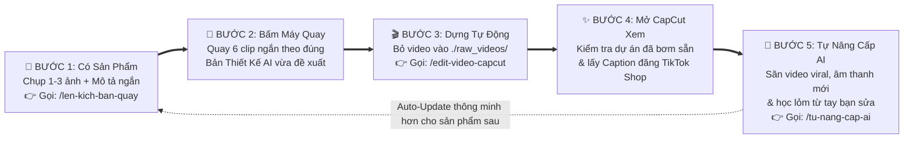

# SỔ TAY TỔNG CHỈ HUY: HƯỚNG DẪN SỬ DỤNG TOÀN DIỆN DÀNH CHO BẠN & BẤT KỲ AI NÀO KHÁC

> [!IMPORTANT]
> **MỤC ĐÍCH CỦA TÀI LIỆU NÀY:**
> 1. **Dành cho BẠN (Người sáng tạo / Chủ kênh):** Chỉ rõ **bạn cần làm gì**, **bỏ file vào đâu**, và **gọi Skill / câu lệnh nào** theo đúng trình tự từ lúc mới cầm sản phẩm trên tay $\rightarrow$ chụp ảnh lên kịch bản quay $\rightarrow$ bấm máy quay $\rightarrow$ dựng tự động ra CapCut $\rightarrow$ kích hoạt AI tự học nâng cấp bản thân.
> 2. **Dành cho BẤT KỲ CON AI NÀO KHÁC (Claude Code, Antigravity, Cursor, Codex...):** Khi bạn mở phiên chat mới hoặc đổi sang một con AI khác, bạn chỉ cần nhắn câu duy nhất:
>    👉 **`"Hãy đọc file HUONG_DAN_SU_DUNG_TOAN_DIEN_CHO_AI_VA_NGUOI_DUNG.md và AGENTS.md để nắm toàn bộ hệ thống"`**
>    Ngay lập tức, con AI mới sẽ hiểu 100% kiến trúc 8 mắt xích (`Node 0 -> Node 7`), 7 bộ máy Python và 4 Skill chuyên dụng để phục vụ bạn mà không cần giải thích lại từ đầu!

---

# PHẦN I: DÀNH RIÊNG CHO BẠN — QUY TRÌNH 5 BƯỚC TỪ LÚC CÓ SẢN PHẨM ĐẾN KHI RA VIDEO TRIỆU ĐƠN

Dưới đây là toàn bộ những gì **bạn cần làm** trong thực tế. Mọi việc nặng nhọc nhất đã có **4 Skill AI** và **7 Bộ máy Python** gánh vác:



---

## 📸 BƯỚC 1: Khi Bạn Vừa Có Sản Phẩm Trong Tay (Chưa Quay Video)

**Việc bạn cần làm:**
1. Dùng điện thoại chụp nhanh **1 đến 3 tấm ảnh thật của sản phẩm** (chụp mặt trước vỏ hộp, chụp chất kem/bề mặt sản phẩm, hoặc chụp nhãn công dụng) rồi bỏ vào thư mục `/Users/huynguyen/Desktop/tiktok/raw_photos/` (hoặc kéo thả trực tiếp ảnh vào khung chat với AI).
2. Gọi **Skill Số 1 (`tiktok-pre-shoot-director` / `/len-kich-ban-quay`)**:
   - **Nếu dùng trên Claude Code CLI (Gõ lệnh tắt):**
     ```text
     /len-kich-ban-quay Ảnh trong ./raw_photos/san_pham.jpg - Máy xay tỏi ớt mini sạc pin lưỡi inox 304 giá 129k
     ```
   - **Nếu dùng trên Antigravity hoặc nhắn tự nhiên:**
     ```text
     Hãy dùng skill tiktok-pre-shoot-director đọc ảnh sản phẩm trong ./raw_photos/ kèm mô tả: "Máy xay tỏi ớt mini sạc pin lưỡi inox 304 giá 129k" và lên đề xuất quay video cho tôi.
     ```
3. **AI sẽ làm gì cho bạn?**
   - AI tự động `Auto-Update` xu hướng mới nhất từ não bộ, đọc ảnh sản phẩm để phát hiện độ bóng/màu sắc và **cảnh báo trước những cảnh cấm quay theo luật CHR Việt Nam**.
   - AI hỏi bạn **3 câu ngắn gọn** để bạn chọn: **Phong cách (`V1 KOC Đời thường` / `V2 Sang trọng ASMR` / `V3 Test thực chiến` / `V4 Đập hộp Beat-Sync`)**, **Cách lên hình (`Lộ mặt` hay `Chỉ quay 2 bàn tay POV`)**, và **Bối cảnh sẵn có**. *(Nếu bạn lười chọn, chỉ cần nhắn: `"Tự chọn phương án tốt nhất cho tôi"`).*
   - Ngay sau đó, AI xuất cho bạn **Bảng Chỉ Dẫn Bấm Máy 6 Cảnh (`RAW_01_HOOK` $\rightarrow$ `RAW_06_SEAMLESS_LOOP_CTA`)** kèm lời thoại mẫu 28 giây!

---

## 📱 BƯỚC 2: Cầm Điện Thoại Bấm Máy Quay Theo 6 Cảnh Đề Xuất

**Việc bạn cần làm khi bấm máy (Chỉ mất 10–15 phút):**
Bạn có thể quay thành **6 clip rời** hoặc **1 video dài liền mạch (>1 phút)** theo đúng 4 mẹo vàng mà Bản Thiết Kế của AI đã dặn:
1. **Ở Cảnh 1 (`Hook 1.5s đầu`):** Bấm máy trước 1 giây rồi đưa tay chuyển động dứt khoát vào giữa khung hình (để bộ Edit tự bắt điểm `Cutting on Action` và gắn tiếng `Whoosh/Shimmer`). Chừa trống 1/3 trên và 1/3 dưới màn hình để AI đặt chữ không đè lên sản phẩm.
2. **Ở Cảnh 3 (`Cảnh thu tiếng ASMR thật`):** Đưa sản phẩm lại sát mic điện thoại `15cm` (bóc seal, bấm nút, gõ móng tay, thoa kem...) và **giữ im lặng hoàn toàn không nói trong `2.5 giây`** để AI giữ lại `100% Tiếng ASMR Thật`.
3. **Ở Cảnh 4 (`Cảnh chứng minh công dụng One-Take`):** Quay liền mạch 1 lần bấm máy không ngắt quãng từ lúc test đến lúc ra kết quả (đoạn chờ ở giữa AI sẽ tự động tua nhanh `Speed Ramp 2.5x`).
4. **Ở Cảnh 6 (`Cảnh Kết & CTA`):** Giây cuối cùng nhớ dùng ngón tay **chỉ xuống góc dưới bên trái màn hình** (nơi gắn Giỏ Hàng Vàng TikTok Shop).

---

## 🎬 BƯỚC 3: Khi Quay Xong — Đưa Video Thô Vào Để AI Tự Động Edit Ra CapCut

**Việc bạn cần làm (Không bao giờ phải xóa file cũ bằng tay!):**
1. Bạn chỉ việc thả các file video mới quay (`.mp4` hoặc `.mov`) vào hộp thư đến:
   `/Users/huynguyen/Desktop/tiktok/raw_videos/` *(Hoặc bỏ trực tiếp vào thư mục riêng mà Bước 1 đã tạo sẵn tại `./projects/<Tên_Dự_Án>/videos/`)*.
   > 💡 **Cơ chế Hộp Thư Tự Động Dọn (`Auto-Archive Inbox`):** Ngay khi bạn gọi lệnh dựng, AI sẽ **tự động di chuyển (`Auto-Move`)** toàn bộ ảnh từ `./raw_photos/` và video từ `./raw_videos/` sang ngăn chứa vĩnh viễn của riêng dự án đó tại **`/Users/huynguyen/Desktop/tiktok/projects/<Tên_Dự_Án>/{photos,videos,blueprint}/`** trước khi gắn vào CapCut Desktop!
   > Nhờ vậy:
   > - Hai thư mục `./raw_photos/` và `./raw_videos/` **luôn tự động sạch trống 100%** để đón sản phẩm tiếp theo — bạn **không bao giờ phải tự tay xóa file cũ**!
   > - Các dự án cũ trên CapCut Desktop **vĩnh viễn không bao giờ bị lỗi mất file (`Media Lost`)**!
2. Gọi **Skill Số 2 (`tiktok-auto-edit-master` / `/edit-video-capcut`)**:
   - **Trên Claude Code CLI:**
     ```text
     /edit-video-capcut Dựng dự án tên "May_Xay_Toi_Ot_129k" từ thư mục ./raw_videos/ theo ngành hàng P2
     ```
   - **Trên Antigravity hoặc nhắn tự nhiên:**
     ```text
     Hãy dùng skill tiktok-auto-edit-master dựng toàn bộ video trong ./raw_videos/ thành dự án CapCut tên "May_Xay_Toi_Ot_129k".
     ```
3. **Nếu AI phát hiện thiếu cảnh hoặc cần ý kiến của bạn:**
   - Trước khi dựng, AI sẽ tự kiểm tra. Nếu thấy thiếu cảnh quan trọng hoặc âm thanh có vấn đề, AI sẽ **nhắn hỏi bạn** (ví dụ: *"Cảnh test đang dài 4.2s hơi tĩnh, bạn có muốn gửi thêm 1 clip quay cận 2s không, hay để mình tự động tạo hiệu ứng Zoom + Split-Screen chữa cháy?"*). Bạn chỉ cần trả lời 1 câu là AI làm tiếp từ A–Z!

---

## ✨ BƯỚC 4: Mở CapCut Desktop Kiểm Tra & Đăng Video Lên TikTok Shop

**Việc bạn cần làm:**
1. Sau khi AI báo **Điểm tự kiểm duyệt QA đạt `>= 95/100 điểm`**, bạn mở ứng dụng **CapCut Desktop** trên máy Mac lên $\rightarrow$ Dự án **`May_Xay_Toi_Ot_129k`** đã nằm sẵn ở đầu danh sách!
2. Toàn bộ các lớp: **Video đã cắt gọn gàng (`V1`)**, **Chữ sang trọng hút đúng màu video và né 100% sản phẩm (`T1/T2`)**, **Giọng đọc + Tiếng ASMR thật (`A1`)**, **Hiệu ứng âm thanh chuyển động `Whoosh/Pop/Ding` (`A2`)**, và **Nhạc nền tự hạ nhỏ khi bạn nói (`A3`)** đã được xếp khít từng mili-giây.
3. Bạn bấm **Export (Xuất video)** và copy ngay **Tiêu đề Thẻ Giỏ Hàng (`<= 30 ký tự`) + Caption SEO** mà AI đã viết sẵn để đăng lên TikTok Shop!

---

## 🧠 BƯỚC 5: Kích Hoạt Skill "Tự Nâng Cấp Trí Thông Minh" (Học Từ CapCut, Video Viral, Âm Thanh & Trending)

Đây là vũ khí giúp hệ thống của bạn **càng dùng càng thông minh hơn mỗi ngày**. Bất cứ khi nào bạn muốn AI tự đi học hỏi hoặc học từ chính tay bạn sửa trên CapCut, hãy gọi **Skill Số 3 (`tiktok-self-evolve-trainer` / `/tu-nang-cap-ai`)**:

| Tình huống bạn muốn AI tự nâng cấp | Câu lệnh bạn gõ trong khung chat AI (Claude Code / Antigravity) | Câu lệnh Terminal (Nếu bạn muốn chạy trực tiếp bằng dòng lệnh) |
| :--- | :--- | :--- |
| **1. Tự lên TikTok tìm các video Review đang lên xu hướng / view đột biến để tải về học góc quay, chuyển cảnh, nhịp cắt & âm thanh** | `/tu-nang-cap-ai Lên TikTok tìm các video review đồ gia dụng (P2) đang lên xu hướng để tải về mổ xẻ học hỏi và cập nhật âm thanh mới` | `python3 tiktok_viral_scout_and_learner.py --scout-keyword "review đồ gia dụng thông minh" --archetype P2 --max-videos 3` |
| **2. Theo dõi kênh KOC mẫu (như `@meshinthuine`) để bắt ngay video nào có view vọt đột biến (`Outlier >= 2.5x`)** | `/tu-nang-cap-ai Quét kênh meshinthuine xem có video nào mới nổ view đột biến thì tải về học tập ngay` | `python3 tiktok_viral_scout_and_learner.py --scout-koc-channels "meshinthuine" --archetype P1` |
| **3. Đưa 1 đường link TikTok cụ thể bạn thấy hay để AI tải về mổ xẻ 6 lớp & thu hoạch SFX** | `/tu-nang-cap-ai Học ngay video này cho tôi: https://www.tiktok.com/@.../video/...` | `python3 tiktok_viral_scout_and_learner.py --learn-url "https://www.tiktok.com/..." --archetype P1` |
| **4. Học lỏm từ chính tay bạn vừa chỉnh sửa trên CapCut Desktop** *(Sau khi bạn mở CapCut sửa lại cỡ chữ/nhạc/cảnh theo ý thích)* | `/tu-nang-cap-ai Hãy đọc lại dự án "May_Xay_Toi_Ot_129k" trên CapCut mà tôi vừa chỉnh tay để học gu của tôi` | `python3 self_evolving_trainer.py --learn-from-capcut "May_Xay_Toi_Ot_129k"` |
| **5. Báo cho AI biết 1 video bạn đăng đã nổ đơn / nhiều view để lưu làm Khuôn Mẫu Vàng** | `/tu-nang-cap-ai Dự án "May_Xay_Toi_Ot_129k" đạt 350.000 view và 280 đơn, hãy lưu làm mẫu vàng cho ngành P2` | `python3 self_evolving_trainer.py --reward-winner "May_Xay_Toi_Ot_129k" --archetype P2 --views 350000 --orders 280` |
| **6. Tự động sưu tầm thêm âm thanh Trending & giải cứu kho nhạc/SFX từ bộ nhớ đệm CapCut Cache** | `/tu-nang-cap-ai Đồng bộ và sưu tầm toàn bộ âm thanh trending mới nhất kèm giải cứu CapCut Cache` | `python3 viral_sfx_harvester.py --sync-live-trends` |

---

# PHẦN II: DANH MỤC 4 SKILL ĐÃ CÀI ĐẶT SẴN (ĐỦ 2 ĐỊNH DẠNG: CLAUDE CODE & ANTIGRAVITY)

Toàn bộ 4 Skill đã được xuất sẵn ở **cả 2 chuẩn cấu trúc** ngay trong thư mục `/Users/huynguyen/Desktop/tiktok/`:

| Tên Skill Chuẩn | Đường dẫn Định dạng 1: **Antigravity** (`.agents/skills/` & `.agent/skills/`) | Đường dẫn Định dạng 2: **Claude Code** (`.claude/skills/` & `.claude/commands/`) | Lệnh gọi nhanh trên Claude Code / Antigravity |
| :--- | :--- | :--- | :--- |
| **1. Đạo Diễn Tiền Kỳ & Đề Xuất Cảnh Quay (`Node 0`)** | [.agents/skills/tiktok-pre-shoot-director/SKILL.md](./.agents/skills/tiktok-pre-shoot-director/SKILL.md) | • [.claude/skills/tiktok-pre-shoot-director/SKILL.md](./.claude/skills/tiktok-pre-shoot-director/SKILL.md)<br>• [.claude/commands/len-kich-ban-quay.md](./.claude/commands/len-kich-ban-quay.md) | **`/len-kich-ban-quay`** hoặc gọi tên `tiktok-pre-shoot-director` |
| **2. Tổng Đạo Diễn Edit Video Tự Động (`Node 1 -> Node 7`)** | [.agents/skills/tiktok-auto-edit-master/SKILL.md](./.agents/skills/tiktok-auto-edit-master/SKILL.md) | • [.claude/skills/tiktok-auto-edit-master/SKILL.md](./.claude/skills/tiktok-auto-edit-master/SKILL.md)<br>• [.claude/commands/edit-video-capcut.md](./.claude/commands/edit-video-capcut.md) | **`/edit-video-capcut`** hoặc gọi tên `tiktok-auto-edit-master` |
| **3. Tự Động Săn Trend, Thu Hoạch SFX & Tự Train Model (`Self-Evolve`)** | [.agents/skills/tiktok-self-evolve-trainer/SKILL.md](./.agents/skills/tiktok-self-evolve-trainer/SKILL.md) | • [.claude/skills/tiktok-self-evolve-trainer/SKILL.md](./.claude/skills/tiktok-self-evolve-trainer/SKILL.md)<br>• [.claude/commands/tu-nang-cap-ai.md](./.claude/commands/tu-nang-cap-ai.md) | **`/tu-nang-cap-ai`** hoặc gọi tên `tiktok-self-evolve-trainer` |
| **4. Giám Khảo Chấm Điểm 100 & Kiểm Duyệt Luật CHR Việt Nam** | [.agents/skills/tiktok-qa-chr-auditor/SKILL.md](./.agents/skills/tiktok-qa-chr-auditor/SKILL.md) | • [.claude/skills/tiktok-qa-chr-auditor/SKILL.md](./.claude/skills/tiktok-qa-chr-auditor/SKILL.md)<br>• [.claude/commands/kiem-duyet-video.md](./.claude/commands/kiem-duyet-video.md) | **`/kiem-duyet-video`** hoặc gọi tên `tiktok-qa-chr-auditor` |

---

# PHẦN III: HƯỚNG DẪN KỸ THUẬT DÀNH CHO CON AI KHÁC (`AI-TO-AI HANDOVER PROTOCOL`)

> **GỬI BẤT KỲ AI AGENT NÀO ĐANG ĐỌC FILE NÀY:**
> Nếu người dùng vừa yêu cầu bạn đọc file này, dưới đây là **Bản Đồ Cấu Trúc Thực Thi** để bạn làm việc ngay lập tức mà không cần hỏi lại cách vận hành:

1. **Cấu trúc thư mục chuẩn trong `/Users/huynguyen/Desktop/tiktok/`:**
   - `./raw_photos/`: Nơi người dùng bỏ ảnh chụp sản phẩm trước khi quay (dùng cho `Node 0: pre_production_shooting_planner.py`).
   - `./raw_videos/`: Nơi người dùng bỏ các file video thô sau khi quay xong (dùng cho `Node 1 -> Node 7: smart_raw_miner.py` & `capcut_master_injector.py`).
   - `./sfx_vault/` & `./bgm_vault/`: Kho hiệu ứng âm thanh 8 nhóm và kho nhạc nền (được quản lý và chuẩn hóa `0ms delay, -16 LUFS` bởi `viral_sfx_harvester.py`).
   - `./workspace/brain_memory/`: **Trái tim bộ nhớ tự huấn luyện của hệ thống**, bao gồm:
     - `learned_user_preferences.json`: Lưu gu thẩm mỹ riêng của người dùng học từ CapCut Desktop (`preferred_font_size_delta`, `preferred_subtitle_y`, `preferred_bgm_volume`, `filming_habit_notes`).
     - `learned_viral_patterns.json`: Lưu hồ sơ giải phẫu 6 lớp của các video TikTok viral đột biến (`tiktok_viral_scout_and_learner.py`).
     - `gold_winning_templates.json`: Lưu ADN của các dự án nổ đơn/triệu view (`self_evolving_trainer.py`).
     - `learned_shooting_rules_by_archetype.json`: Kho quy tắc đề xuất góc quay động được `Auto-Update` tự động trước mỗi lần chạy `pre_production_shooting_planner.py`.
     - `reflexion_lessons.jsonl`: Nhật ký miễn dịch lỗi từ các lần chạy `Auto-Heal` trước.
   - `./workspace/shooting_blueprints/`: Lưu các file `<project_slug>_shooting_plan.json` khóa đồng bộ giữa khâu Đề xuất quay (`Node 0`) và khâu Dựng tự động (`Node 1–7`).
   - `./workspace/viral_study_lab/`: Lưu các video `.mp4` viral tải từ TikTok cùng tấm ảnh bản đồ phân cảnh `viral_<id>_storyboard_grid.jpg` để bạn (AI) dùng công cụ đọc ảnh (`read_file`) học góc quay `A1–A8`.
   - `/Users/huynguyen/Movies/CapCut/User Data/Projects/com.lveditor.draft/`: Thư mục gốc chứa các dự án CapCut Desktop trên máy Mac của người dùng.

2. **5 Nguyên Tắc Bất Khả Xâm Phạm Khi Bạn (AI) Xử Lý Video Cho Người Dùng:**
   - **Nguyên tắc 1 (`Chữ Sang Trọng & Không Đè Sản Phẩm`):** Luôn gọi `compute_dynamic_video_matched_text_style()` và `find_obstacle_free_text_coordinates()` trong `capcut_master_injector.py`. Không bao giờ dùng màu chữ cố định hay đặt chữ đè lên vùng có sản phẩm/khuôn mặt hoặc chạm vùng cấm UI TikTok (`y < -0.58`).
   - **Nguyên tắc 2 (`Giữ Âm Thanh ASMR Thật & Kinetic SFX Nổ Sớm 40ms`):** Luôn gọi `evaluate_and_route_clip_audio()`. Nếu tiếng thật từ sản phẩm có `Crest Factor >= 11dB` và không dính giọng nói, bắt buộc giữ `100% Native ASMR`. Với các cử chỉ tay chuyển động (`detect_kinetic_movement_sfx_triggers`), đặt SFX sớm `-0.04s` trước đỉnh chuyển động.
   - **Nguyên tắc 3 (`Chọn Nhạc & Cắt Theo Beat Có Tư Duy M1–M4`):** Dùng `select_smart_bgm_and_beat_editing_strategy()` trong `smart_raw_miner.py`. Không chọn nhạc bừa và không cắt theo beat máy móc ở những đoạn cần nghe rõ lời thoại giải thích công dụng hoặc tiếng ASMR thật.
   - **Nguyên tắc 4 (`Tự Chấm Điểm QA >= 95/100 & Chủ Động Hỏi Người Dùng`):** Trước khi bàn giao, bắt buộc chạy `audit_and_auto_heal_edit_plan_before_delivery()` và `verify_and_auto_heal_draft()`. Nếu thiếu tài nguyên quan trọng, phải chủ động nhắn hỏi người dùng kèm phương án chữa cháy (`Fallback`).
   - **Nguyên tắc 5 (`Bảo Vệ Điểm CHR 1.000 Tuyệt Đối`):** Mọi lời thoại, chữ trên màn hình, và tiêu đề giỏ hàng phải được quét qua bộ lọc `CHR_FORBIDDEN_PATTERNS_VIETNAM` trong `pre_delivery_qa_auditor.py` (dựa trên `Cẩm nang Toàn diện TikTok Affiliate (Việt Nam).md`).
